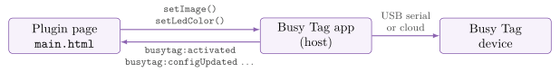
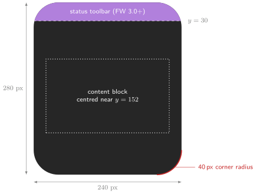

:::info[PDF version]
This guide is also available as a [PDF](pathname:///pdf/BusyTag_Plugin_Development_Guide.pdf).
:::

A Busy Tag plugin is a small web app – HTML, CSS and JavaScript – that the Busy Tag app runs in a hidden WebView. The plugin draws a 240 × 280 image on a canvas and hands it to the host, which converts it and sends it to the device over USB or the cloud. A plugin can also set the LED colour, play LED patterns, show animations, store secrets, call web APIs and, on desktop, read local files. This guide covers the plugin file layout, the lifecycle, the full `busyTagPlugin` API, the screen constraints of the device, and how to package and install a plugin.

## How plugins work

Each plugin has two pages, and the app loads each one in its own WebView:

- **`main.html`** – the *runtime* page. It stays loaded while the plugin instance exists. Whenever the instance is the one showing on the device it is *active*, and it pushes images and LED colours. If the manifest sets `hasInteractiveMode` to `true`, the user can also open this page from **Integrations**.
- **`config.html`** – the *settings* page. It opens when the user configures an instance. It edits a JSON config object, renders a live preview in the host’s device mock-up and returns the config when the user presses **Save**.

The pages talk to the host through `window.busyTagPlugin`, which is defined by the shared library `pluginlibrary.js`. The host loads this library into every plugin page automatically, so you never include it yourself. Calls from the page are queued and sent to the host as URL navigations (`busytag://command?…`). To call back into the page, the host uses `busyTagPlugin.fireEvent()`, which dispatches `busytag:*` events on `window`.



### Instances, rotation and activation

The user adds a plugin to **Integrations** as an *instance*. Each instance has its own config and its own secure storage, so one plugin can run as several instances, for example two World Clocks set to different cities. Enabled instances take turns on the device. Each instance stays on screen for its display duration (15 s, 30 s, 1 min, 2 min or 5 min) and then the next one takes over.

When an instance takes the screen, the host sends `busytag:activated`. When it hands the screen over, the host sends `busytag:deactivated`. Device calls made while the instance is inactive (`setImage`, `setLedColor`, `setAnimation`, `playPattern`, `stopPattern`) are **ignored** and log a console warning. The page itself keeps running the whole time, so it can keep fetching data in the background. It then has an image ready the moment it is activated.

## File layout

    my-plugin/
      manifest.json   required  metadata and capability declarations
      main.html       required  runtime page (draws device images)
      config.html     required  settings page
      script.js       optional  shared drawing/data code used by both pages
      icon.png        optional  80x80 px icon for the gallery and install dialog
      ...             optional  any other assets your pages reference

The three required files must be at the root of the plugin folder (and of the ZIP; see [Packaging and installing](#packaging-and-installing)). Subfolders are allowed for your own assets.

### Shared host files

The app ships two shared files in the parent `Plugins` folder. Reference them with these **exact** tags:

```html
<link rel="stylesheet" href="../plugin-ui.css">   <!-- in <head> -->
<script src="../plugin-ui.js"></script>          <!-- before your own scripts -->
<script src="script.js"></script>
```

:::warning
**Mobile portability.** On Android and iOS (and the sandboxed Mac App Store build) the page is loaded from an in-memory HTML string. The host makes these files work there by finding the three tags above *character for character* and inlining the files in their place. If you add attributes (`defer`, `type`, `id`), change the quotes or rename `script.js`, the tag is not inlined and the file silently fails to load on those platforms. Desktop builds load from disk and do not show the problem.
:::

## manifest.json

```json
{
  "id": "acme-rss-headlines",
  "name": "RSS Headlines",
  "description": "Shows the latest headline from an RSS feed.",
  "version": "1.0.0",
  "author": "Acme Ltd",
  "hasInteractiveMode": true,
  "iconBackgroundColor": "#7D2BC4",
  "supportedPlatforms": ["windows", "macos", "android", "ios"],
  "fileAccess": [
    { "pattern": "~/Documents/feeds/*.xml",
      "purpose": "Load your saved feed list" }
  ]
}
```

| **Field** | **Req.** | **Meaning** |
|:---|:---|:---|
| `id` | yes | Letters, digits, `-` and `_`; 1–64 characters. Must not match a built-in plugin id. Prefix it with your name (`acme-…`) to avoid collisions with future built-ins. |
| `name` | yes | Display name in the gallery, the Integrations list and the install dialog. |
| `version` | yes | Any non-empty string; semantic versioning (`1.2.0`) is recommended. Increase it on every release, because the install dialog shows the installed version next to the new one. |
| `description` | no | One short paragraph shown on the tile and in the install dialog. |
| `author` | no | Shown as “by …” in the install dialog. |
| `hasInteractiveMode` | no | `true` if `main.html` has a UI worth opening. Set it to `false` for plugins that only render device images. |
| `iconBackgroundColor` | no | Hex colour drawn behind the plugin’s initials when there is no `icon.png`. |
| `supportedPlatforms` | no | Case-insensitive list of `windows` (or `winui`), `macos` (or `maccatalyst`), `android`, `ios`. If you omit it or leave it empty, the plugin is available on every platform. |
| `fileAccess` | no | Host file read rules; see [Reading local files (desktop)](#reading-local-files-desktop). |
| `systemAccess` | no | OS capabilities the plugin uses. Currently only `"nowPlaying"`; see [System bridge: now playing](#system-bridge-now-playing). |
| `developerOnly` | no | If `true`, the plugin is listed only while Developer Mode is on. This is meant for unfinished built-in plugins. |

## A minimal plugin

The example below is a complete working plugin. It shows a greeting and the current time and lets the user choose the text and the colours. Like the built-in plugins, it puts the drawing code in `script.js` so that both pages draw the image the same way.

### script.js – shared drawing

```javascript
const DEFAULT_CONFIG = {
    greeting: 'Hello!',
    textColor: '#FFFFFF',
    backgroundColor: '#000000',
    ledColor: '#7D2BC4'
};

function loadConfiguration(config = {}) {
    return { ...DEFAULT_CONFIG, ...config };
}

// Always render at the device's native size.
function renderImage(config) {
    const canvas = document.createElement('canvas');
    canvas.width = 240;
    canvas.height = 280;
    const ctx = canvas.getContext('2d');

    ctx.fillStyle = config.backgroundColor;
    ctx.fillRect(0, 0, 240, 280);

    ctx.fillStyle = config.textColor;
    ctx.textAlign = 'center';
    ctx.textBaseline = 'middle';
    ctx.font = 'bold 30px sans-serif';
    ctx.fillText(config.greeting, 120, 130);

    const now = new Date();
    ctx.font = '22px sans-serif';
    ctx.fillText(now.toLocaleTimeString([], { hour: '2-digit', minute: '2-digit' }), 120, 175);

    return canvas.toDataURL('image/png');
}
```

### main.html – runtime page

```html
<!DOCTYPE html>
<html lang="en">
<head>
    <meta charset="UTF-8">
    <title>Hello</title>
    <link rel="stylesheet" href="../plugin-ui.css">
</head>
<body>
    <script src="../plugin-ui.js"></script>
    <script src="script.js"></script>
    <script>
        let config = loadConfiguration();
        let timer = null;

        window.addEventListener('busytag:initialized', (e) => {
            config = loadConfiguration(e.detail || busyTagPlugin.getConfig());
        });

        window.addEventListener('busytag:activated', () => {
            pushToDevice();
            timer = setInterval(pushToDevice, 60000);
        });

        window.addEventListener('busytag:deactivated', () => {
            clearInterval(timer);
            timer = null;
        });

        window.addEventListener('busytag:configUpdated', (e) => {
            if (!e.detail) return;
            config = loadConfiguration(e.detail);
            if (timer) pushToDevice();
        });

        function pushToDevice() {
            busyTagPlugin.setImage(renderImage(config));
            busyTagPlugin.setLedColor(config.ledColor);
        }

        // Called by the host when the user pushes the
        // interactive page to the device.
        function getDeviceImage() { return renderImage(config).split(',')[1]; }
        function getLedColor() { return config.ledColor; }
    </script>
</body>
</html>
```

### config.html – settings page

```html
<!DOCTYPE html>
<html lang="en">
<head>
    <meta charset="UTF-8">
    <title>Hello - Settings</title>
    <link rel="stylesheet" href="../plugin-ui.css">
</head>
<body>
<div class="pl-page">
    <header class="pl-header">
        <h1 class="pl-header__title">Hello</h1>
    </header>
    <form class="pl-form" id="form" onsubmit="event.preventDefault();">
        <section class="pl-section">
            <div class="pl-field">
                <label class="pl-label" for="greeting">Greeting</label>
                <input class="pl-input" id="greeting" type="text" maxlength="12">
            </div>
            <div class="pl-field">
                <label class="pl-label" for="ledColor">LED</label>
                <label class="pl-color">
                    <input type="color" id="ledColor">
                    <span class="pl-color__hex"></span>
                </label>
            </div>
        </section>
    </form>
</div>
<script src="../plugin-ui.js"></script>
<script src="script.js"></script>
<script>
    let config = loadConfiguration();
    const greetingEl = document.getElementById('greeting');
    const ledEl = document.getElementById('ledColor');

    window.addEventListener('busytag:initialized', (e) => {
        if (e.detail) config = loadConfiguration(e.detail);
        greetingEl.value = config.greeting;
        ledEl.value = config.ledColor;
        plUI.bindColorInput(ledEl);
        updatePreview();
    });

    // The ONLY place saveConfig() may be called (see warning).
    window.addEventListener('busytag:configRequested', () => {
        busyTagPlugin.saveConfig(readForm());
    });

    function readForm() {
        config.greeting = greetingEl.value;
        config.ledColor = ledEl.value;
        return config;
    }

    function updatePreview() {
        readForm();
        busyTagPlugin.updatePreview(renderImage(config));
        busyTagPlugin.setLedPreview(config.ledColor);
    }

    document.getElementById('form').addEventListener('input', updatePreview);
</script>
</body>
</html>
```

:::warning
**Only call `saveConfig()` from `busytag:configRequested`.** The host treats *every* `saveConfig` call from the settings page as the user pressing **Save**: it stores the config, shows the “saved” message and **closes the settings page**. A `saveConfig` call in an `input` or `change` handler therefore closes the page on the user’s first keystroke. Keep the working config in a local variable and return it only when the host asks for it.
:::

## Lifecycle events

All events are dispatched on `window` as `CustomEvent`s named `busytag:<name>`, and their payload is in `event.detail`.

| **Event** | **Page** | **When / payload** |
|:---|:---|:---|
| `ready` | both | The library has loaded. You rarely need this event. |
| `initialized` | both | The host has supplied the instance config. `detail` is the config object (`{}` for a new instance). Do your setup here. |
| `activated` | main | The instance now owns the device screen. Push an image straight away and start any periodic updates. |
| `deactivated` | main | Another instance owns the screen. Stop pushing and clear timers. Data fetching may continue. |
| `configUpdated` | both | The config changed (the user saved new settings, or the page called `saveConfig`). `detail` is the new config. |
| `configRequested` | config | The user pressed **Save**. Reply with `busyTagPlugin.saveConfig(config)`. If you don’t reply, the changes are lost. |
| `patternsReceived` | main | Reply to `requestPatterns()`. `detail` is `[{name, description}, …]`. |
| `redirect` | both | A browser panel or system browser was redirected to `busytag://redirect?…`. `detail` holds the query parameters as an object. |
| `browserClosed` | both | The user closed the browser panel. |

:::tip
**Late listeners are safe.** The host can call `initialize()` or `activate()` while your page is still parsing, before your trailing `<script>` has added its listeners. The library records the state events (`ready`, `initialized`, `activated`, `deactivated`, `configUpdated`, `patternsReceived`) and replays the latest of each to any listener that subscribes later. A replayed `activated` is dropped once `deactivated` has fired, and the reverse. One-shot events (`redirect`, `browserClosed`, `configRequested`) are *not* replayed.
:::

## API reference

### Config

| **Method** | **Description** |
|:---|:---|
| `getConfig()` | Returns the current config object. |
| `saveConfig(config)` | Stores the config and fires `configUpdated`. In `config.html`, call it only from `configRequested`. |

Config is stored as JSON, so use plain values: strings, numbers, booleans, arrays and objects. Don’t keep secrets in it; use secure storage instead ([Secure storage](#secure-storage)).

### Device output (main.html, active only)

| **Method** | **Description** |
|:---|:---|
| `setImage(base64OrDataUrl)` | Shows a still image on the device. Accepts a `data:image/…` URL or bare base64. PNG is recommended. |
| `setLedColor(hex, ledBits = 127)` | Sets the LED colour (`’#RRGGBB’`). `ledBits` is a bit mask of which LEDs to light; `127` lights all of them. |
| `setAnimation(frames, options)` | Shows an animated GIF built from frames; see [Animations](#animations). |
| `requestPatterns()` | Asks the host for the device’s LED patterns, which arrive in `patternsReceived`. This also works while the instance is inactive. |
| `getPatterns()` | Returns the last pattern list that was received. |
| `playPattern(name, loop = false)` | Plays a named LED pattern. |
| `stopPattern()` | Stops the current pattern. |

Image and LED updates are *coalesced*. If several `setImage` calls are queued, only the newest one reaches the device, and the same goes for `setLedColor`, `setAnimation`, `updatePreview` and `setLedPreview`. Pushing every second is therefore harmless, but it is still wasteful: each image upload takes real time over USB and over the cloud. Push only when what is on screen actually changes. A clock, for example, needs a push once a minute, on the minute.

### Preview (config.html)

| **Method** | **Description** |
|:---|:---|
| `updatePreview(base64OrDataUrl)` | Updates the device mock-up in the settings window. Nothing is sent to the device. |
| `setLedPreview(hex, ledBits = 127)` | Updates the LED in the mock-up. |

### Host hooks (main.html)

When the user pushes an interactive plugin page to the device by hand, the host calls two global functions if they exist. `getDeviceImage()` returns bare base64 (no `data:` prefix), and `getLedColor()` returns a hex string. Define them whenever `hasInteractiveMode` is `true`.

### Utilities (both pages)

| **Method** | **Description** |
|:---|:---|
| `log(message)` | Writes to the WebView console (`console.log`). |
| `openUrl(url)` | Opens a URL in a browser panel; see [Browser panel and OAuth](#browser-panel-and-oauth). |
| `secureStorage.*` | Per-instance key/value store for secrets; see [Secure storage](#secure-storage). |
| `http.request(options)` | HTTP request made by the host, free of CORS limits; see [Network access](#network-access). |
| `fs.*` | Reads host files (desktop only); see [Reading local files (desktop)](#reading-local-files-desktop). |
| `system.getNowPlaying(opts)` | Returns the desktop media session; see [System bridge: now playing](#system-bridge-now-playing). |

## Designing for the device screen

The screen is **240 pixels wide and 280 pixels tall**. Always draw on a canvas of exactly that size. The host scales other sizes, but text then comes out blurry. Images are converted to the device’s RGB565 format, so gradients may show slight banding.



### Status toolbar safe area

Firmware 3.0 and later draws a status toolbar over the **top 30 px** of the screen. The user can turn it off, and older firmware never shows it. A plugin cannot tell which case applies, so lay the screen out to look right either way. Measure your content block, centre it vertically around y ≈ 152, and never start it above y = 32. That clears the toolbar when it is shown and leaves a balanced margin when it isn’t. Don’t pin a header to the very top, and don’t leave a permanently empty 30 px strip either.

### Rounded corners

The glass has rounded corners. Design against a **40 px radius**. Full-bleed artwork is fine there, because it is only cropped. Text, progress bars, badges and icons near a corner get cut off on the device even though they look fine in the square preview.

The risky case is a label anchored to a side margin on one of the top or bottom rows. A 12 px side margin is plenty mid-screen and almost nothing in a corner. On a row that is d pixels from the nearest horizontal edge (for d \< 40), the visible edge moves inwards by

*inset(d) = 40 − √(40² − (40 − d)²)*

which is already about 14 px when d = 10. Either add that inset to the label’s margin or move the row further from the edge. The top corners also lose the toolbar strip, which makes them the tightest part of the screen.

```javascript
function cornerInset(y, radius = 40, height = 280) {
    const d = Math.min(y, height - y);
    if (d >= radius) return 0;
    return radius - Math.sqrt(radius * radius - (radius - d) * (radius - d));
}
```

### Legibility

- The device is read from a desk away. Body text should be about 18 px or larger, and the main figure 40 px or larger.
- Use high contrast. Thin hairlines and grey-on-grey text disappear on the panel.
- Measure long or user-supplied strings with `ctx.measureText()` and shrink or truncate them so they fit. Don’t let them run off the edge.
- Bundle any web font with the plugin, and wait for `document.fonts.ready` before drawing. Otherwise the first frame is drawn in a fallback font.

## Animations

`setAnimation(frames, options)` turns a list of frames into an animated GIF on the host and shows it on the device.

```javascript
const frames = [];
const canvas = document.createElement('canvas');
canvas.width = 240; canvas.height = 280;
const ctx = canvas.getContext('2d');

for (let i = 0; i < 8; i++) {
    ctx.fillStyle = '#000'; ctx.fillRect(0, 0, 240, 280);
    ctx.fillStyle = '#7D2BC4';
    ctx.beginPath();
    ctx.arc(120, 152, 20 + i * 8, 0, Math.PI * 2);
    ctx.fill();
    frames.push({ imageData: canvas.toDataURL('image/png'), delay: 120 });
}

busyTagPlugin.setAnimation(frames, { loop: true, loopCount: 0 });
```

- `imageData` – a data URL or bare base64 string for each frame.
- `delay` – how long the frame is shown, in milliseconds (default 100). GIF stores delays in centiseconds, so values are rounded to the nearest 10 ms.
- `loop` / `loopCount` – `loopCount: 0` with `loop: true` repeats forever. If `loop` is `false`, the animation plays once.

:::warning
The device accepts files of up to **1 MB**. The plugin animation path does *not* shrink the GIF for you: an oversized file is sent as it is, the device rejects it, and the screen doesn’t change. Keep animations well under the limit by using few frames (10–30), flat colours and small moving areas.
:::

## LED patterns

```javascript
window.addEventListener('busytag:patternsReceived', (e) => {
    const names = e.detail.map(p => p.name);
    if (names.includes('Police')) busyTagPlugin.playPattern('Police', true);
});

window.addEventListener('busytag:activated', () => busyTagPlugin.requestPatterns());
window.addEventListener('busytag:deactivated', () => busyTagPlugin.stopPattern());
```

The set of patterns depends on the device and its firmware, so check that a pattern is in the list before you play it. Treat patterns as decoration and have a fallback, such as a plain `setLedColor`.

## Network access

Plugins can use `fetch()` directly for APIs that send CORS headers. For APIs that don’t (most server-to-server APIs), use the host HTTP bridge. It sends the request from the app process and returns the full response:

```javascript
const res = await busyTagPlugin.http.request({
    url: 'https://api.example.com/v1/status',
    method: 'POST',                 // default GET
    headers: { 'Authorization': 'Bearer ' + token,
               'Content-Type': 'application/json' },
    body: JSON.stringify({ q: 'x' }) // string; ignored for GET/HEAD
});
// res = { status: 200, headers: { 'content-type': '...' }, body: '...' }
if (res.status === 200) {
    const data = JSON.parse(res.body);
}
```

- The promise *resolves* for every HTTP status, including 4xx and 5xx, so check `res.status` yourself. It *rejects* only on transport errors, or when the request takes longer than about 30 seconds.
- The `body` is always a string; binary responses are not supported. Response header names are lower-cased.
- Poll politely. The page stays loaded while inactive, so you can refresh data in the background, but match the interval to how often the data really changes. Many APIs rate-limit by IP address.

## Secure storage

Use secure storage for tokens and API keys. It keeps them out of the config JSON, which is passed around more freely (it is handed to both pages and written to the page’s `localStorage`). Each *instance* has its own store, and the instance’s `main.html` and `config.html` share it.

:::warning
In the current app version, values are stored in the app’s preferences under a hashed key and are only base64-encoded, **not encrypted**. Treat the store as “kept separately”, not “protected against other software on the machine”. The API will stay the same when platform encryption is added.
:::

```javascript
busyTagPlugin.secureStorage.setItem('apiKey', key);        // fire and forget
const key = await busyTagPlugin.secureStorage.getItem('apiKey'); // null if missing
busyTagPlugin.secureStorage.removeItem('apiKey');
```

`getItem` rejects if the host doesn’t answer within 10 seconds. Values must be strings, so use `JSON.stringify` for anything structured. Store the token’s expiry time alongside the token so you can refresh it before it runs out.

## Browser panel and OAuth

`busyTagPlugin.openUrl(url)` opens a URL for the user to interact with, typically for sign-in. Your OAuth provider should redirect to `busytag://redirect?code=…`. The host catches that redirect, closes the browser and fires `busytag:redirect` with the query parameters:

```javascript
window.addEventListener('busytag:redirect', async (e) => {
    const { code, state, error } = e.detail;
    if (error || state !== expectedState) return;
    const tokens = await exchangeCode(code);   // your token endpoint
    busyTagPlugin.secureStorage.setItem('refreshToken', tokens.refresh_token);
});
window.addEventListener('busytag:browserClosed', () => showSignInButton());
```

Each platform opens the URL differently. Windows and macOS use an embedded panel, Android uses the system browser with a `busytag://redirect` deep link, and iOS uses the system authentication session. Some providers, Google among them, block sign-in from embedded WebViews. Use PKCE wherever the provider supports it. If the token exchange needs a client secret, run it through your own server and never ship the secret inside the plugin. Start sign-in from a button in `config.html`.

## Reading local files (desktop)

A plugin can read files on the computer, but only paths that match a rule in its manifest’s `fileAccess`. Each rule is shown to the user in the install dialog. The bridge works on Windows and macOS only, so add `supportedPlatforms` to plugins that depend on it.

```json
"supportedPlatforms": ["windows", "macos"],
"fileAccess": [
  { "pattern": "~/.mytool/state.json",
    "purpose": "Read MyTool's current status" },
  { "pattern": "
    "purpose": "Count today's builds" }
]
```

- In patterns, `*` matches within one path segment, `**` matches across segments and `?` matches a single character. `~` expands to the user’s home folder, and `%VAR%` or `${VAR}` expand environment variables. Use `/` as the separator on every platform.
- A bare `"**"` pattern grants read access to the whole disk. The install dialog flags it with a warning, so avoid it.
- `purpose` is shown verbatim to the user, so write a concrete reason.

| **Method (returns a Promise)** | **Resolves to** |
|:---|:---|
| `fs.readText(path)` | The file contents as a UTF-8 string. |
| `fs.readBytes(path)` | The file contents as a base64 string. |
| `fs.exists(path)` | `true` or `false`. |
| `fs.listDir(path)` | `[{name, isDirectory, size}, …]`. |
| `fs.findText(path, regex)` | The first match of a .NET regular expression as `[whole, group1, …]`, or `null`. Only the match is sent to the page, so use this instead of `readText` to pull one value out of a large file. |
| `fs.needsAccess(folder)` | `true` if the sandboxed macOS build still needs the user to grant access to `folder` (always `false` on other builds). |
| `fs.requestAccess(folder)` | Opens a folder picker at `folder` and resolves to `true` once access is granted. Call it from a button click in `config.html`. |

Failed calls reject with an `Error` whose message starts with a code you can test for:

- `PermissionDenied:` – the path matches none of the manifest’s rules.
- `NotFound:` – the file or folder doesn’t exist.
- `AccessRequired:` – sandboxed macOS only: the user hasn’t granted access to the folder yet. `plUI.mountFolderAccess(el, folder, opts)` renders a ready-made “Grant access” notice for this case.

## System bridge: now playing

Plugins that declare `"systemAccess": ["nowPlaying"]` can ask the desktop which media is playing. On Windows the information comes from the system media controls; on macOS it comes from Apple Music.

```javascript
const np = await busyTagPlugin.system.getNowPlaying({
    playerFilter: 'any',         // or 'apple'
    includeArt: true,
    knownTrackId: lastTrackId    // skip re-sending cover art you already have
});
// { supported, reason, hasSession, playerName, playing, title, artist, album,
//   trackId, positionMs, durationMs, artBase64, artMime, artUnchanged }
```

`positionMs` is the position at the player’s last update, not at the moment of your call. To show a moving progress bar, advance the position with your own clock while `playing` is `true`.

## Settings UI kit

`plugin-ui.css` provides the look of the built-in plugins: `pl-page`, `pl-header`, `pl-section`, `pl-field`, `pl-label`, `pl-input`, `pl-select`, `pl-color`, `pl-row pl-row--2/--3`, preset grids and more. It follows the app’s light and dark themes, so prefer these classes to your own styles. The built-in plugins in `BusyTag/Resources/Raw/DefaultPlugins` show every component in use.

`plugin-ui.js` adds `window.plUI`:

| **Helper** | **Purpose** |
|:---|:---|
| `plUI.toast(msg, type)` | A short notice. `type` is `success`, `error`, `warning` or `info`; shortcuts such as `plUI.toast.error(msg)` exist. |
| `plUI.bindColorInput(input)` | Keeps the `.pl-color__hex` label in sync with a colour input. |
| `plUI.bindPresetGrid(root, onChange)` | Wires up a grid of preset buttons: selection state (`aria-pressed`) and keyboard navigation. |
| `plUI.applyAccent(hex)` | Overrides the accent colour. |
| `plUI.mountFolderAccess(el, folder, opts)` | “Grant access” notice for sandboxed macOS folder reads. |

:::tip
Use toasts only for real news: errors, warnings, or confirming an action that otherwise gives no feedback. Don’t toast “Ready” when the page loads, on every preview redraw, or “Settings saved” (the host already shows that message).
:::

## Packaging and installing

Zip the *contents* of the plugin folder, so that `manifest.json` is at the root of the archive and not inside a subfolder:

    # Windows (PowerShell)
    Compress-Archive -Path my-plugin\* -DestinationPath my-plugin.zip

    # macOS / Linux
    cd my-plugin && zip -r ../my-plugin.zip .

To install it, the user opens **Integrations** → **Add Integrations** → **Install from ZIP…**. The app then:

1.  checks that the required files are present, that `manifest.json` parses, that the `id` is valid and not reserved, and that no entry in the ZIP points outside the plugin folder;
2.  shows the install dialog with the name, version, author, description, every `fileAccess` rule with its purpose, platform notes and, if the plugin is already installed, an upgrade notice;
3.  extracts the files to a staging folder and moves them into place, so a failed install never leaves a half-written plugin;
4.  refreshes the plugin list. No restart is needed.

Installing a ZIP with the same `id` upgrades the plugin and keeps the existing instances and their configs. Because of that, new versions must read old configs. Merging the stored config over a set of defaults, as `loadConfiguration()` does above, handles this.

## Debugging

- **Develop in a desktop browser first.** Open `main.html` directly, stub the bridge and fire the events yourself:

  ``` JavaScript
  window.busyTagPlugin = window.busyTagPlugin || {
      getConfig: () => ({}), log: console.log,
      setLedColor: c => console.log('LED', c),
      setImage: src => document.body.append(Object.assign(new Image(), { src }))
  };
  window.dispatchEvent(new CustomEvent('busytag:initialized', { detail: {} }));
  window.dispatchEvent(new CustomEvent('busytag:activated'));
  ```

- **Check the layout with real pixels.** Render your images in a headless browser and compare them with the toolbar and corner-radius safe areas. Reading the drawing code won’t show you text collisions.
- **Inside the app** there is no plugin log viewer, and `busyTagPlugin.log()` only writes to the WebView console. To see what a plugin is doing, write diagnostics onto the canvas itself or into the interactive page’s DOM. That is the quickest dependable way.
- Installed plugins live in the app’s data folder under `Plugins/<id>/`. Editing files there and reopening the plugin is a fast way to iterate.

## Checklist before release

- `id` is unique and prefixed; `version` has been increased.
- Every canvas is 240 × 280.
- Content clears the top 30 px toolbar strip and the 40 px rounded corners, and still looks balanced when there is no toolbar.
- `activated` pushes an image straight away; `deactivated` clears all timers.
- `config.html` calls `saveConfig()` only inside `configRequested`.
- The config is merged over defaults, so older saved configs still load.
- Secrets are in `secureStorage`, not in the config or in the source.
- `fileAccess` patterns are as narrow as possible and each has a clear `purpose`.
- `supportedPlatforms` is set if the plugin depends on desktop-only features.
- The shared-file tags are written exactly as in [Shared host files](#shared-host-files), and the plugin works on a phone.
- Network polling matches how often the data really changes, and errors are shown on the device instead of leaving a blank screen.
