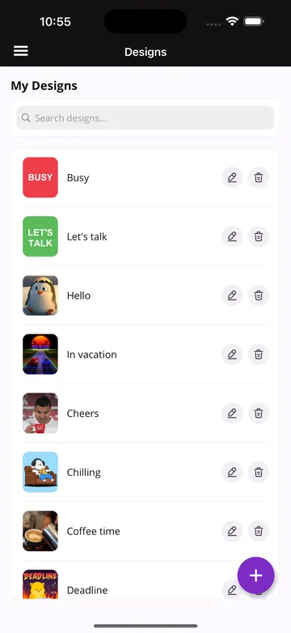
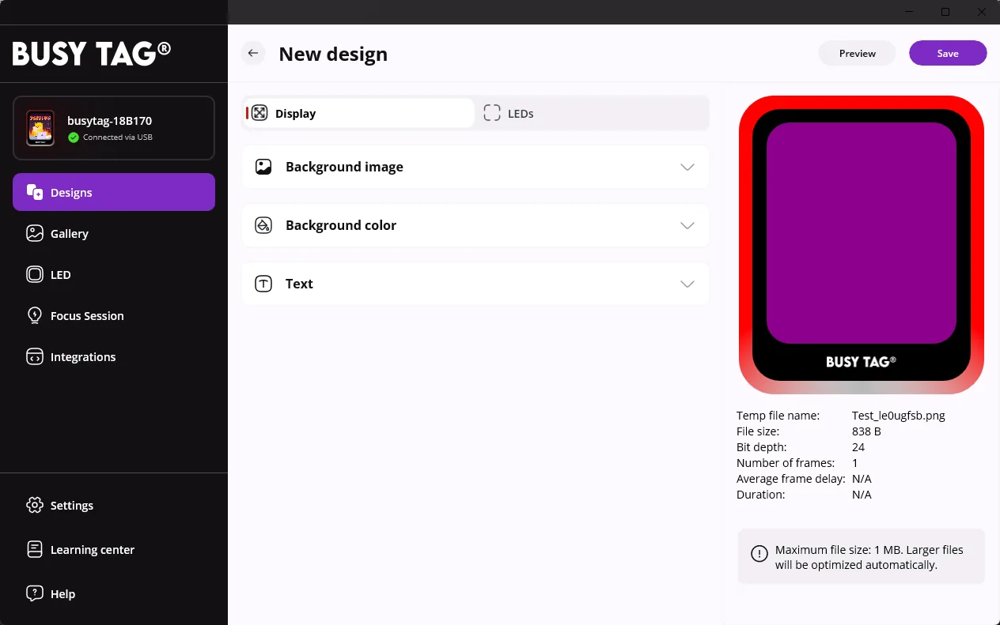
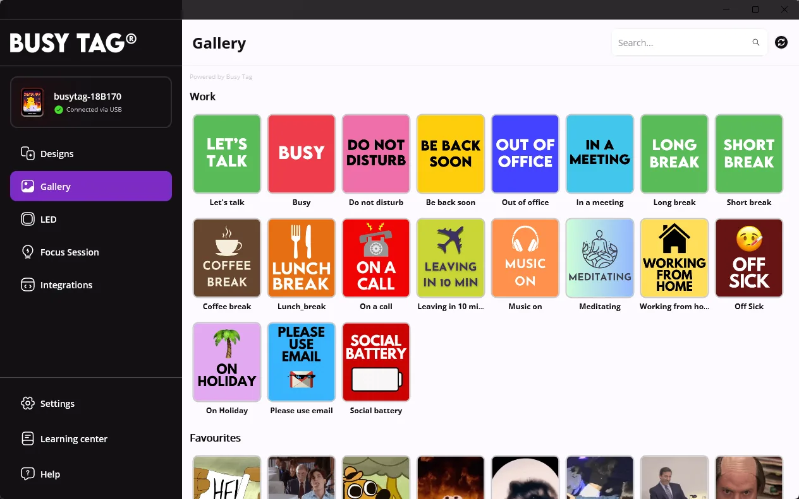
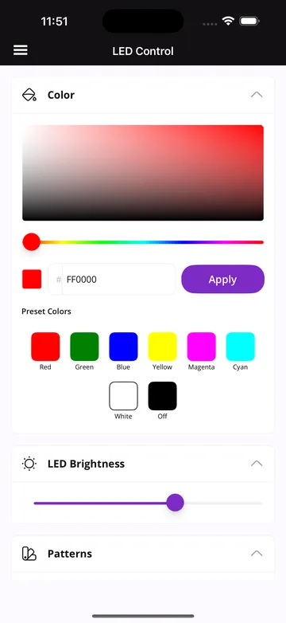
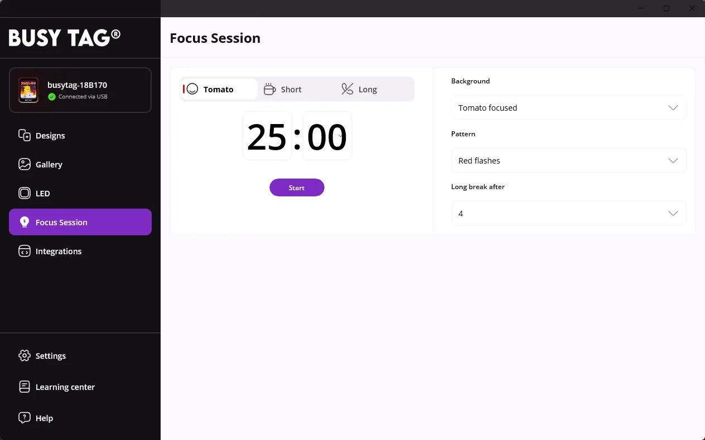
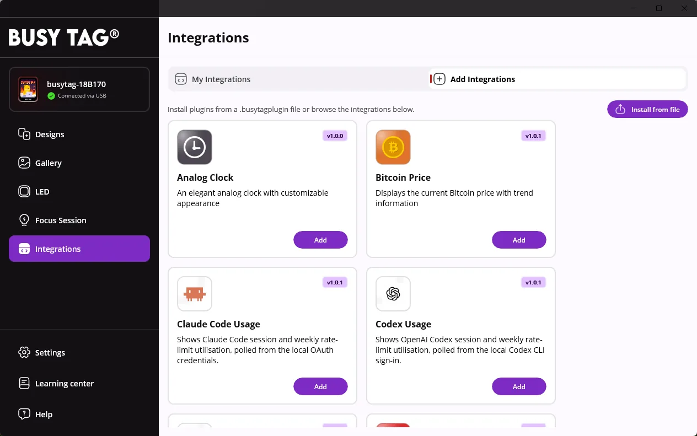
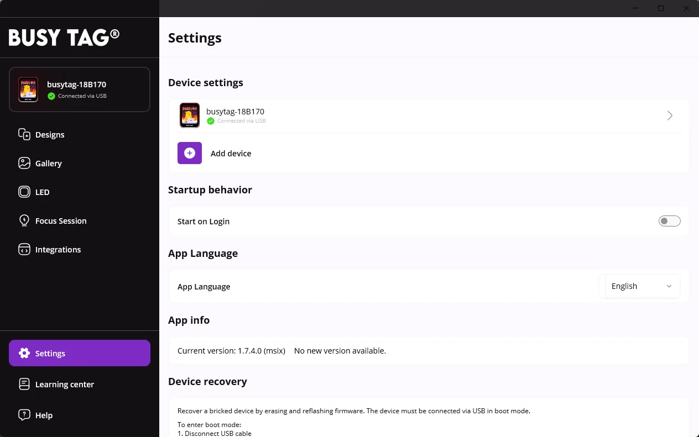
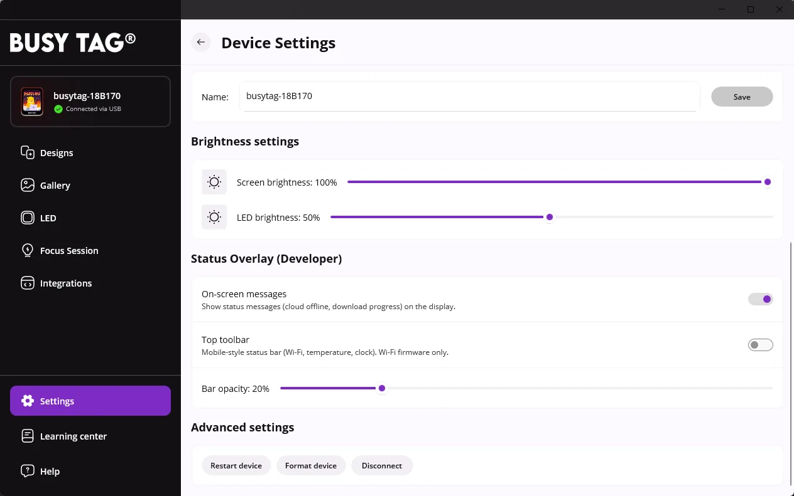

This tour shows the Busy Tag app on a computer (Windows and macOS). The menu on the left is always
visible. At the top it shows the selected Busy Tag and how it is connected; with more than one
device, click it to pick the device you want to control.

The Android and iOS apps have the same sections. Open the menu with the menu icon in the top-left
corner or by swiping in from the left edge.

## Designs

A design is what Busy Tag shows: an image or animated GIF on the screen plus an LED colour or
pattern. Click a design to send it to the device. **Search designs** in the top-right corner
filters your library by name.

Right-click a design for **Download**, **Share**, **Play**, **Edit** and **Delete**.

### Create a design

Click **Create New Design** (the **+** tile). The editor shows a live preview of the device on the
right, with the image's file size and frame count. It has two tabs:

- **Display:**
  - **Background image:** your own photos, online images (photos by Pexels, GIFs by KLIPY), or an
    uploaded PNG or GIF. **Video to GIF** turns a video clip into a GIF: choose where the clip
    starts and ends.
  - **Background color:** a solid colour.
  - **Text:** optional text with its own style, colour and position.
- **LEDs:** the LED colour or one of the patterns that plays with the design.

**Preview** shows the design on your Busy Tag without saving it. **Save** adds it to your designs.

GIFs can be at most **1 MB** on the device. Larger files are optimised automatically.

### Share and import designs

Right-click a design and choose **Share**:

- **Share image / GIF** sends just the picture.
- **Share as design file** sends a `.busytagdesign` file with the image, text and LED settings.
- **Share via link** creates a link and QR code that another Busy Tag app can open.

To bring designs in, click **⋯** next to the search box and choose **Import design file**: pick a
file, scan a design QR code or paste a link. **Export all designs** in the same menu saves your
whole library to a folder.

## Gallery

Ready-made Busy Tag designs, grouped by topic, plus GIFs, stickers and clips (powered by KLIPY).
Click an item to show it on the device. Right-click it for more actions: **Save as new design**
keeps it in your designs, with or without the selected LED colour.

## LED

Control the LEDs directly:

- **Color:** pick any colour in the colour field and hue bar, or type a hex code, then click
  **Apply**.
- **Preset Colors:** one click for red, green, blue, yellow, magenta, cyan, white or off.
- **LED Brightness:** 1–100 %.
- **Patterns:** flashes, running lights, pulses, police lights and more. Click **▶** next to a
  pattern to play it; **Stop Pattern** returns to the solid colour.

## Focus Session

A Pomodoro timer that counts down on Busy Tag, so people around you see that you are focusing.

1. Choose **Tomato** (work), **Short** or **Long** break.
2. Set the duration. On the right, choose the **Background** design and the LED **Pattern** shown
   on the device, and after how many work sessions the long break comes (**Long break after**).
3. Click **Start**. **Reset** starts over.

:::note[Phones and tablets]
On Android and iOS the timer runs only while the app is open and in the foreground. If the phone
locks or you switch apps, the session pauses until you come back.
:::

## Integrations

Integrations (plugins) show live information on Busy Tag: clocks, weather, calendars, e-mail,
stock prices, AI-usage meters and more. Each one has its own [user guide](/plugins).

- **Add Integrations** lists the available plugins. Click **Add**, then configure the plugin.
  **Install from file** adds a `.busytagplugin` package, for example one you
  [built yourself](/developers/plugin-development).
- **My Integrations** lists the ones you added. **▶** shows one on the device now.
- **Start Playlist** rotates through your integrations. Set how long each one stays on screen
  (15 s – 5 min) and **Include in playlist** / **Exclude from playlist** in its **⋯** menu, where
  you also find **Configure**, the icon colour, the order and **Delete**.

On phones and tablets integrations update only while the app is open and in the foreground.

## Settings

- **Device settings:** your devices, and **Add device** to set up a new device or add a shared
  one ([Connect](/getting-started/connect)).
- **Startup behavior:** **Start on Login** starts the app when you log in to your computer.
- **App Language:** the language of the app.
- **App info:** the app version and, for direct installs, app updates.
- **Device recovery:** reflashes the firmware of a device that no longer starts. See
  [Firmware updates](/updates/firmware).

### Device settings

Click a device in **Settings** to open its settings:

- **Basic device info:** ID, port and connection status.
- **Sync with Cloud:** **Enable Cloud Sync** lets the device be controlled over Wi-Fi from
  anywhere. With cloud sync on, Busy Tag 2 also shows its **Wi-Fi** settings
  (**Configure Wi-Fi**) and **Share device**.
- **Device firmware:** the installed and newest firmware version, and the update button when a
  newer version is available ([Firmware updates](/updates/firmware)).
- **Device name** and **Brightness settings** for the screen and the LEDs.
- **Advanced settings:** **Restart device**, **Format device** (erases all files on the device)
  and **Disconnect**.

## Help and Learning center

**Help** opens the FAQ from busytag.com inside the app. **Learning center** opens the tutorials on
busytag.com. For problems with the device or the app, see also
[Troubleshooting & FAQ](/troubleshooting).
