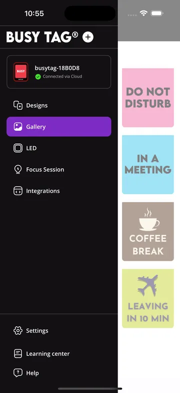
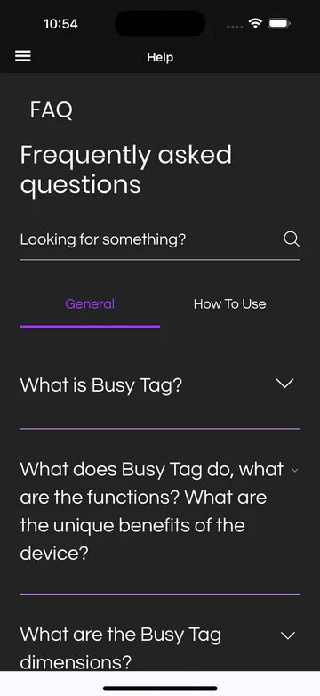

The app has the same sections on every platform. Open them from the side menu: tap the menu icon
in the top-left corner (or swipe in from the left edge) on a phone; in a wide window on a computer the
menu stays open. The menu also shows which device is selected and how it is connected. With more
than one Busy Tag, pick the device you want to control there.

## Designs

A design is what Busy Tag shows: an image or animated GIF on the screen plus an LED colour or
pattern. Tap a design to send it to the device.

**Create a design** with **Create New Design**. The editor has two tabs:

- **Display:** a solid colour or a background image, and optional text with its own style,
  colour and position. For the background you can use your own photos, search online images
  (photos by Pexels, GIFs by KLIPY), or upload a PNG or GIF. A video can be turned into a GIF
  with **Video to GIF**: choose the start and end of the clip.
- **LEDs:** the LED colour or one of the default patterns that plays with the design.

GIFs can be at most **1 MB** on the device. Larger files are optimised automatically.

**Share and import designs** from a design's **⋯** menu:

- **Share image / GIF** sends just the picture.
- **Share as design file** sends a `.busytagdesign` file with the image, text and LED settings.
- **Share via link** creates a link and QR code that another Busy Tag app can open.

To bring designs in, use **Import design file**: choose a file, scan a design QR code or paste a
link. **Export all designs** saves your whole library to a folder.

## Gallery

Ready-made Busy Tag designs plus GIFs, stickers and clips (powered by KLIPY). Tap an item to show
it on the device. Long-press it (right-click on a computer) for more actions: **Save as new
design** keeps it in your Designs, with or without the selected LED colour.

## LED

Control the LEDs directly:

- **Preset Colors:** one tap for red, green, blue, yellow, magenta, cyan, white or off.
- **Color:** pick any colour with the colour wheel.
- **LED Brightness:** 1–100 %.
- **Patterns:** flashes, running lights, pulses, police lights and more. **Stop Pattern** returns
  to the solid colour.

## Focus Session

A Pomodoro timer that counts down on Busy Tag, so people around you see that you are focusing.

1. Choose **Tomato** (work), **Short** or **Long** break.
2. Adjust the durations, the background and LED pattern shown on the device, and after how many
   work sessions the long break comes.
3. Tap **Start**. **Reset** starts over.

You can save your favourite settings as presets.

:::note[Phones and tablets]
On Android and iOS the timer runs only while the app is open and in the foreground. If the phone
locks or you switch apps, the session pauses until you come back.
:::

## Integrations

Integrations (plugins) show live information on Busy Tag: clocks, weather, calendars, e-mail,
stock prices, AI-usage meters and more. Each one has its own
[user guide](/plugins).

- **Add Integrations** lists the available plugins. Add one, then configure it. You can also
  **Install from file** a `.busytagplugin` package, for example one you
  [built yourself](/developers/plugin-development).
- **My Integrations** lists the ones you added. **▶** shows one on the device now.
- **Start Playlist** rotates through your integrations. Set how long each one stays on screen
  (15 s – 5 min) and **Include in playlist** / **Exclude from playlist** in its **⋯** menu, where
  you also find **Configure**, **Rename**, the icon colour, the order and **Delete**.

On phones and tablets integrations update only while the app is open and in the foreground.

## Settings

- **Device settings:** tap a device to rename it, set screen and LED brightness, see and delete
  files on the device, configure Wi-Fi, share the device and update its firmware (see
  [Firmware updates](/updates/firmware)).
- **Status overlay** (firmware 3.0 or later): on-screen messages and an optional top toolbar
  with Wi-Fi signal, temperature and clock.
- **Advanced settings:** restart the device or format its storage.
- **Add device:** set up a new device or add a shared one ([Connect](/getting-started/connect)).
- **Startup behavior** (Windows and macOS): start the app when you log in.
- **App Language** and **App Theme** (dark mode).
- **App info:** the app version and, for direct installs, app updates.

## Help and Learning center

**Help** opens the FAQ from busytag.com and links to this documentation. **Learning center**
opens the tutorials on busytag.com.

