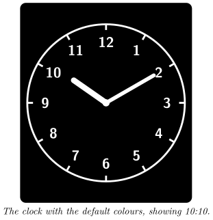
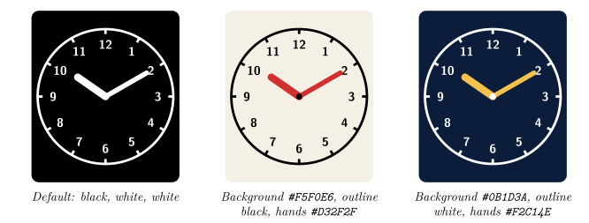

*Turn your Busy Tag into a classic clock face*

:::info[PDF version]
This guide is also available as a [PDF](pathname:///pdf/AnalogClock_UserGuide.pdf).
:::

## Overview

The **Analog Clock** plugin shows the current time as a round clock face on your Busy Tag. The face has hour marks, the numbers 1 to 12, an hour hand and a minute hand. There is no second hand. The device screen is updated at the start of every minute.

You can choose the colours of the background, the outline and numbers, and the hands. You can also set a colour for the Busy Tag LED. The plugin works offline: no account and no internet connection are needed.

## Requirements

- The **Busy Tag app** on Windows, macOS, Android or iOS.
- A Busy Tag device added to the app.

The clock uses the time of the computer or phone that runs the Busy Tag app. Make sure its clock and time zone are correct.

## Adding the Plugin in Busy Tag

1.  Open the Busy Tag app and select your device.
2.  Go to **Integrations** in the navigation menu.
3.  Open the **Add Integrations** tab.
4.  Find **Analog Clock**. You can type “Clock” in the search box. Click **Add**.
5.  In the **Add Plugin** window, keep the suggested name or enter your own. Confirm.
6.  The plugin now appears in the **My Integrations** tab, and its configuration page opens automatically.

## Configuring the Plugin

The configuration page opens automatically after you add the plugin. To open it again later, click the **More Options** button (**…**) next to the plugin in **My Integrations** and choose **Configure**.

| **Setting** | **Default** | **Description** |
|:---|:---|:---|
| *Clock face* |  |  |
| Background | `#000000` | The screen and clock face background. |
| Outline | `#FFFFFF` | The circle, the hour marks, the numbers and the centre dot. |
| Hands | `#FFFFFF` | The hour hand and the minute hand. |
| *LED* |  |  |
| LED | `#7D2BC4` | The colour of the Busy Tag LED while the clock is shown. |

A preview next to the form shows how the clock will look. Click **Save** to apply your changes. If the clock is already showing on your Busy Tag, it switches to the new colours straight away.

### Colour examples

The clock has one face design; the colours are what you change. Here are a few combinations to start from. Each shows 10:10.

:::tip
Use a hands colour that differs from the outline colour, for example a bright accent colour for the hands. This makes the time easier to read from across the room.
:::

## Using the Plugin

### Show it on your Busy Tag

In **My Integrations**, click the **Activate** button (▶) next to Analog Clock. The clock is sent to your Busy Tag right away and the LED changes to your chosen colour. After that, the plugin sends a new image at the start of every minute while it is active, so the minute hand moves at the same moment as your computer’s clock.

### Interactive panel

On a computer or tablet, click **Open** to see a live clock in a panel inside the app. The **Open** button is not shown on phones.

### Playlist

The plugin can rotate with your other integrations. Open **More Options** (**…**) and use **Include in playlist** and **Duration** to choose whether it is included and how long it stays on screen. Then click **Start Playlist**.

## Troubleshooting

| **Problem** | **What to do** |
|:---|:---|
| The clock shows the wrong time. | Check the clock and time zone of the computer or phone that runs the Busy Tag app. |
| The clock stopped moving. | The plugin runs inside the Busy Tag app. Keep the app running and the plugin active. Click **Activate** again to restart it. |
| Colour changes do not show on the device. | Make sure you clicked **Save** on the configuration page. An active clock picks up the new colours as soon as you save. |

## Privacy

The plugin works entirely on your computer or phone. It does not sign in to any service, does not read any files and does not send any data over the internet. Only the clock image and the LED colour are sent to your Busy Tag device.
