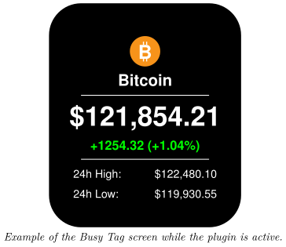
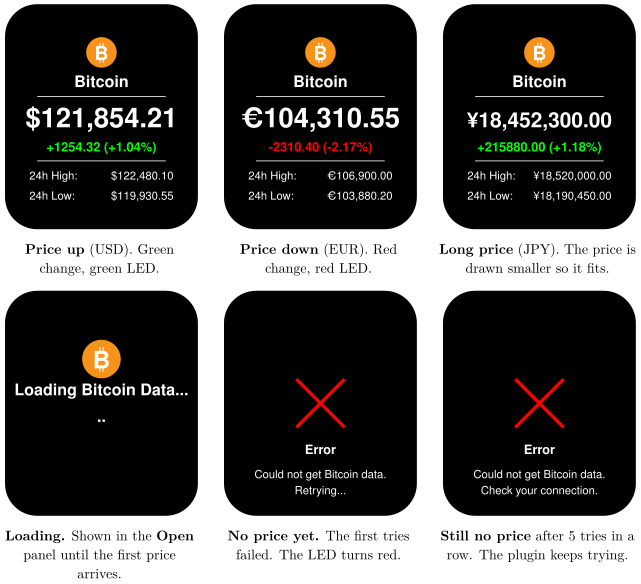

*Show the live Bitcoin price and its 24-hour trend on your Busy Tag display*

:::info[PDF version]
This guide is also available as a [PDF](pathname:///pdf/BitcoinPrice_UserGuide.pdf).
:::

## Overview

The **Bitcoin Price** plugin shows the current price of Bitcoin (BTC) on your Busy Tag. Your Busy Tag shows at a glance:

- the current Bitcoin price in the currency you choose,
- the price change over the last 24 hours, in money and in percent,
- the highest and lowest price of the last 24 hours.

The price refreshes automatically, every 5 minutes by default. The Busy Tag LED turns **green** when the price is up over the last 24 hours and **red** when it is down. No account or sign-in is needed.

## Requirements

- The Busy Tag app on **Windows**, **macOS**, **Android** or **iOS**.
- A Busy Tag device added to the app.
- An internet connection.

You do not need an account with any exchange or price service.

## Adding the Plugin in Busy Tag

1.  Open the Busy Tag app and select your device.
2.  Go to **Integrations** in the navigation menu.
3.  Open the **Add Integrations** tab.
4.  Find **Bitcoin Price**. You can type “Bitcoin” in the search box. Click **Add**.
5.  In the **Add Plugin** window, keep the suggested name or enter your own (for example “BTC in EUR”). Confirm.
6.  The plugin now appears in the **My Integrations** tab, and its configuration page opens automatically.

:::tip
You can add the plugin more than once, for example one copy showing the price in USD and another in EUR. Give each copy its own name.
:::

## Configuring the Plugin

The configuration page opens automatically after you add the plugin. To open it again later, click the **More Options** button (**…**) next to the plugin in **My Integrations** and choose **Configure**.

| **Setting** | **Default** | **Description** |
|:---|:---|:---|
| Currency | US Dollar (USD) | The currency the price is shown in. Choices: USD, EUR, GBP, JPY, CAD, AUD, CHF and CNY. |
| Refresh | Every 5 minutes | How often the plugin fetches a new price. Choices: every 1, 2, 5, 10, 15 or 30 minutes, or every hour. |

The colours on the screen and the LED are fixed and cannot be changed.

A preview next to the form shows the screen with the live price. If the price cannot be fetched while you are on this page, the preview shows example figures and the message *Couldn’t fetch live Bitcoin price – showing sample data*. These example figures are only used in the preview. They are never sent to your Busy Tag. Click **Save** to apply your changes.

## Using the Plugin

### Show it on your Busy Tag

In **My Integrations**, click the **Activate** button (▶) next to Bitcoin Price. The plugin fetches the price right away, sends the image to your Busy Tag and sets the LED. It then refreshes at the interval you chose.

### Interactive panel

On a computer or tablet, click **Open** to see the plugin screen in a panel inside the app. The **Open** button is hidden on phones.

### Playlist

The plugin can rotate with your other integrations. Open **More Options** (**…**) and use **Include in playlist** and **Duration** to choose whether it is included and how long it stays on screen. Then click **Start Playlist**.

## Screen Examples

The screen always has the same layout. What changes is the currency, the colour of the 24-hour change and, when there is a problem, the error screen.

## Reading the Display

[TABLE]

## Troubleshooting

| **What you see** | **What to do** |
|:---|:---|
| *Error* – Could not get Bitcoin data. Retrying… | The price service could not be reached, and no price has loaded yet. Check your internet connection. The plugin tries again at the next refresh. |
| *Error* – Could not get Bitcoin data. Check your connection. | The plugin has failed 5 times in a row without ever loading a price. Check your internet connection. The plugin keeps trying at every refresh and shows the price as soon as one arrives. |
| The price does not change for a long time. | If a refresh fails after the price has loaded once, the plugin keeps showing the last price it received. Check your internet connection. |
| Couldn’t fetch live Bitcoin price – showing sample data | Shown on the configuration page only. The preview uses example figures. Your settings still save normally. |
| Errors when you refresh every minute. | The free price service limits how often it can be asked. Choose a longer refresh interval. |

## Privacy and Security

- The price comes from **CoinGecko**, a public price service (`api.coingecko.com`). The app asks it for the current Bitcoin market data.
- No account, API key or personal data is sent with the request.
- The plugin does not read any files on your computer or phone.

Prices are for information only and may be delayed. Busy Tag is not affiliated with CoinGecko. Do not use this display to make financial decisions.
