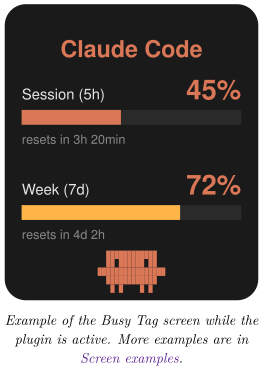
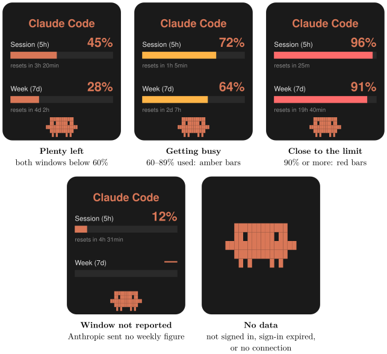

*Show your Claude Code session and weekly usage limits on your Busy Tag display*

:::info[PDF version]
This guide is also available as a [PDF](pathname:///pdf/ClaudeUsage_UserGuide.pdf).
:::

## Overview

The **Claude Code Usage** plugin shows how much of your Claude Code allowance you have used. It reads the sign-in that Claude Code stores on your computer. It then asks Anthropic for your current usage limits and draws the result on your Busy Tag screen. Your Busy Tag shows at a glance:

- how much of the current **session** window you have used (5 hours),
- how much of the **weekly** window you have used (7 days),
- how long until each window resets.

The display refreshes automatically, every 5 minutes by default. You can also turn on the Busy Tag LED in orange while the plugin is active.



## Requirements

- The **Busy Tag desktop app** on **Windows** or **macOS**. The plugin reads a file on your computer, so it is not offered in the Android or iOS apps.
- A Busy Tag device added to the app.
- **Claude Code** installed on the *same computer* as the Busy Tag app.
- Claude Code signed in with your **Claude account** (for example a Pro or Max subscription), so that it has session and weekly limits.
- An internet connection.

## Setting Up Claude Code on Your Computer

Skip this section if you already use Claude Code on this computer.

### Install Claude Code

Install Claude Code by following Anthropic’s instructions at <https://docs.anthropic.com/en/docs/claude-code>.

### Sign in

1.  Open a terminal (Windows Terminal or PowerShell on Windows, Terminal on macOS) and run:

```text
claude
```

2.  Follow the prompts to sign in with your Claude account. A browser window opens. Sign in and approve the request.
3.  Return to the terminal. Claude Code is now signed in.

Claude Code saves your sign-in in a file in your home folder. This is the file the plugin reads:

| **System** | **Sign-in file**                           |
|:-----------|:-------------------------------------------|
| Windows    | `C:\Users\<you>\.claude\.credentials.json` |
| macOS      | `/Users/<you>/.claude/.credentials.json`   |

:::note
**macOS:** Claude Code usually keeps its sign-in in the macOS Keychain (as the item *Claude Code-credentials*) instead of in this file. Busy Tag then reads it from the Keychain for you. The first time, macOS asks whether Busy Tag may use that Keychain item. Enter your Mac password and click **Always Allow**, so that macOS does not ask again at every refresh.
:::

:::tip
Sign in to Claude Code with the *same user account* you use to run the Busy Tag app. The plugin only looks in the home folder of the user who is running Busy Tag.
:::

## Adding the Plugin in Busy Tag

1.  Open the Busy Tag app and select your device.
2.  Go to **Integrations** in the navigation menu.
3.  Open the **Add Integrations** tab.
4.  Find **Claude Code Usage**. You can type “Claude” in the search box. Click **Add**.
5.  In the **Add Plugin** window, keep the suggested name or enter your own. Confirm.
6.  The plugin now appears in the **My Integrations** tab, and its configuration page opens automatically.

## Configuring the Plugin

The configuration page opens automatically after you add the plugin. To open it again later, click the **More Options** button (**…**) next to the plugin in **My Integrations** and choose **Configure**.

### Folder access (Mac App Store version only)

If you installed Busy Tag from the Mac App Store, macOS only lets Busy Tag read your Claude Code folder after you allow it once. In that case an orange box appears at the top of the page:

1.  Click **Grant access to ~/.claude**.
2.  A folder window opens inside the `.claude` folder. Click **Open**.
3.  The orange box disappears and the sign-in check below runs. macOS remembers your choice.

If you choose a different folder, the page says *Access not granted*. Click the button again and pick the `.claude` folder itself. On Windows, and with the Busy Tag version downloaded from the website, this box never appears.

### Sign-in check

At the top of the page, the plugin checks whether Claude Code’s sign-in exists:

- **Claude Code credentials detected**: you are ready to go.
- **Claude Code credentials not found**: run `claude` and sign in (see [Setting Up Claude Code on Your Computer](#setting-up-claude-code-on-your-computer)), then reopen this page.
- **Waiting for folder access**: grant access first (see above).

### Settings

[TABLE]

A preview next to the form shows how the screen will look with sample data. Click **Save** to apply your changes.

## Using the Plugin

### Show it on your Busy Tag

In **My Integrations**, click the **Activate** button (▶) next to Claude Code Usage. The plugin starts right away. It fetches your usage, sends the image to your Busy Tag and then refreshes at the interval you chose.

### Interactive panel

Click **Open** to see the plugin in a panel inside the app. Below the screen preview, a status line shows what the plugin is doing, for example:

- *Reading credentials…* / *Querying Anthropic…*
- *Updated 14:32:05*, which means the last refresh succeeded.
- An error message in red if something went wrong (see [Troubleshooting](#troubleshooting)).

### Playlist

The plugin can rotate with your other integrations. Open **More Options** (**…**) and use **Include in playlist** and **Duration** to choose whether it is included and how long it stays on screen. Then click **Start Playlist**.

## Reading the Display

### What each part means

[TABLE]

### Screen examples

The screen has one layout. What changes is the colour of each bar, which follows how much of that window you have used, and the large monster shown when there is nothing to report. The LED setting does not change the screen.



## Troubleshooting

| **Message** | **What to do** |
|:---|:---|
| Claude Code credentials not found. Sign in via `claude` first. | Claude Code is not installed or not signed in for this user. Follow [Setting Up Claude Code on Your Computer](#setting-up-claude-code-on-your-computer). On macOS, see the note in [Setting Up Claude Code on Your Computer](#setting-up-claude-code-on-your-computer): if macOS asked about the Keychain and you clicked **Deny**, run the plugin again and allow it. |
| Busy Tag needs access to `~/.claude`. | Mac App Store version only. Open the plugin’s configuration page and click **Grant access** (see [Folder access (Mac App Store version only)](#folder-access-mac-app-store-version-only)). |
| No OAuth access token found in credentials file. | The sign-in file is incomplete. Run `claude` and sign in again. |
| Credentials JSON parse failed. | The sign-in file is damaged. Sign out of Claude Code and sign in again. |
| Claude Code sign-in expired or rejected (HTTP 401/403). Run `claude` to refresh it. | Run `claude` once in a terminal. Claude Code renews its own sign-in when it runs, and the plugin recovers at the next refresh. |
| API responded but no rate-limit headers. | Anthropic did not send usage figures, for example during a temporary outage, or because the account has no session or weekly limits. The plugin tries again at the next refresh. |
| The screen shows only the pixel monster. | Click **Open** on the plugin to see the status message, then use this table. |

## Privacy and Security

- The plugin can read **only** `~/.claude/.credentials.json` (on macOS, or the *Claude Code-credentials* Keychain item when that file is missing). It cannot access any other files on your computer. In the Mac App Store version it can read nothing at all until you grant access to the `.claude` folder.
- To get your usage figures, the plugin sends a very small request (a one-word message to the smallest Claude model) to Anthropic’s own service (`api.anthropic.com`) at each refresh. Your usage limits come back with the reply. This request uses a tiny amount of your allowance.
- Your sign-in token is sent only to Anthropic. It is never sent to Busy Tag or to anyone else.
- The plugin only reads the sign-in file. It never changes it. Claude Code itself renews the sign-in.
- Only the usage image is sent to your Busy Tag device.
- To stop the plugin, delete it from **My Integrations** (**…** → **Delete**).

Claude and Claude Code are trademarks of Anthropic. Busy Tag is not affiliated with or endorsed by Anthropic.
