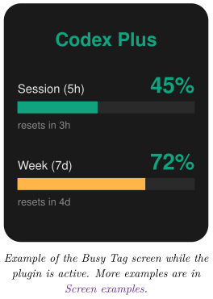
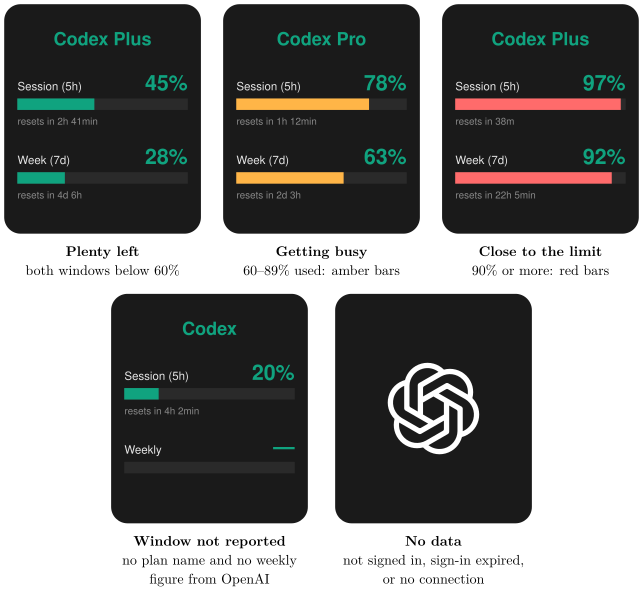

*Show your OpenAI Codex session and weekly rate-limit usage on your Busy Tag display*

:::info[PDF version]
This guide is also available as a [PDF](pathname:///pdf/CodexUsage_UserGuide.pdf).
:::

## Overview

The **Codex Usage** plugin shows how much of your OpenAI Codex allowance you have used. It reads the sign-in that the Codex command-line tool (Codex CLI) stores on your computer. It then asks OpenAI for your current rate-limit windows and draws the result on your Busy Tag screen. Your Busy Tag shows at a glance:

- your ChatGPT plan (for example *Plus* or *Pro*),
- how much of the current **session** window you have used (typically 5 hours),
- how much of the **weekly** window you have used (7 days),
- how long until each window resets.

The display refreshes automatically, every 5 minutes by default. You can also turn on the Busy Tag LED in green while the plugin is active.



## Requirements

- The **Busy Tag desktop app** on **Windows** or **macOS**. The plugin reads a file on your computer, so it is not offered in the Android or iOS apps.
- A Busy Tag device added to the app.
- The **OpenAI Codex CLI** installed on the *same computer* as the Busy Tag app.
- A **ChatGPT account** with Codex access (Plus, Pro, Team, Business, Enterprise or Edu). You must sign in to Codex with *Sign in with ChatGPT*.
- An internet connection.

:::note
**API keys are not supported.** If you set up Codex with an OpenAI API key instead of your ChatGPT account, there are no session or weekly limits to show. The plugin will ask you to sign in with ChatGPT.
:::

## Setting Up Codex on Your Computer

Skip this section if you already use Codex on this computer with your ChatGPT account.

### Install the Codex CLI

Install the Codex CLI by following OpenAI’s instructions at <https://developers.openai.com/codex/cli>. If you have Node.js installed, you can usually install it from a terminal (Windows Terminal or PowerShell on Windows, Terminal on macOS) with this command:

```text
npm install -g @openai/codex
```

### Sign in with ChatGPT

1.  Open a terminal and run:

```text
codex
```

2.  When Codex asks how to sign in, choose **Sign in with ChatGPT**.
3.  A browser window opens. Sign in to your ChatGPT account and approve the request.
4.  Return to the terminal. Codex is now signed in. You can close it or keep working.

Codex saves your sign-in in a file in your home folder. This is the file the plugin reads:

| **System** | **Sign-in file**                  |
|:-----------|:----------------------------------|
| Windows    | `C:\Users\<you>\.codex\auth.json` |
| macOS      | `/Users/<you>/.codex/auth.json`   |

:::tip
Sign in to Codex with the *same user account* you use to run the Busy Tag app. The plugin only looks in the home folder of the user who is running Busy Tag.
:::

## Adding the Plugin in Busy Tag

1.  Open the Busy Tag app and select your device.
2.  Go to **Integrations** in the navigation menu.
3.  Open the **Add Integrations** tab.
4.  Find **Codex Usage**. You can type “Codex” in the search box. Click **Add**.
5.  In the **Add Plugin** window, keep the suggested name or enter your own (for example “Codex – work account”). Confirm.
6.  The plugin now appears in the **My Integrations** tab, and its configuration page opens automatically.

## Configuring the Plugin

The configuration page opens automatically after you add the plugin. To open it again later, click the **More Options** button (**…**) next to the plugin in **My Integrations** and choose **Configure**.

### Folder access (Mac App Store version only)

If you installed Busy Tag from the Mac App Store, macOS only lets Busy Tag read your Codex folder after you allow it once. In that case an orange box appears at the top of the page:

1.  Click **Grant access to ~/.codex**.
2.  A folder window opens inside the `.codex` folder. Click **Open**.
3.  The orange box disappears and the sign-in check below runs. macOS remembers your choice.

If you choose a different folder, the page says *Access not granted*. Click the button again and pick the `.codex` folder itself. On Windows, and with the Busy Tag version downloaded from the website, this box never appears.

### Sign-in check

At the top of the page, the plugin checks whether a Codex sign-in exists on this computer:

- **Codex sign-in detected**: you are ready to go.
- **Codex sign-in not found**: run `codex` and sign in with ChatGPT (see [Setting Up Codex on Your Computer](#setting-up-codex-on-your-computer)), then reopen this page.
- **Waiting for folder access**: grant access first (see above).

### Settings

[TABLE]

A preview next to the form shows how the screen will look with sample data. Click **Save** to apply your changes.

## Using the Plugin

### Show it on your Busy Tag

In **My Integrations**, click the **Activate** button (▶) next to Codex Usage. The plugin starts right away. It fetches your usage, sends the image to your Busy Tag and then refreshes at the interval you chose.

### Interactive panel

Click **Open** to see the plugin in a panel inside the app. Below the screen preview, a status line shows what the plugin is doing, for example:

- *Reading Codex sign-in…* / *Querying OpenAI…*
- *Updated 14:32:05 · Plus plan*, which means the last refresh succeeded.
- An error message in red if something went wrong (see [Troubleshooting](#troubleshooting)).

### Playlist

The plugin can rotate with your other integrations. Open **More Options** (**…**) and use **Include in playlist** and **Duration** to choose whether it is included and how long it stays on screen. Then click **Start Playlist**.

## Reading the Display

### What each part means

[TABLE]

### Screen examples

The screen has one layout. What changes is the title (your plan), the colour of each bar, which follows how much of that window you have used, and the OpenAI logo shown when there is nothing to report. The LED setting does not change the screen.



## Troubleshooting

| **Message** | **What to do** |
|:---|:---|
| Codex sign-in not found. Run `codex` and sign in with ChatGPT first. | Codex is not installed or has never been signed in for this user. Follow [Setting Up Codex on Your Computer](#setting-up-codex-on-your-computer). |
| Busy Tag needs access to `~/.codex`. | Mac App Store version only. Open the plugin’s configuration page and click **Grant access** (see [Folder access (Mac App Store version only)](#folder-access-mac-app-store-version-only)). |
| Codex is signed in with an API key. | Sign out of Codex and sign in again with *Sign in with ChatGPT*. |
| Codex sign-in has expired. / Codex sign-in expired or rejected (HTTP 401/403). | Run `codex` once in a terminal. Codex renews its own sign-in when it runs, and the plugin recovers at the next refresh. |
| No OAuth access token in Codex auth file. | The sign-in file is incomplete. Run `codex`, sign out and sign in again with ChatGPT. |
| OpenAI responded but reported no rate-limit windows. | Your account currently has no Codex limits to report, for example because the plan has no Codex access. Check your plan in ChatGPT. |
| Codex usage endpoint returned HTTP 5xx / 429. | A temporary problem on OpenAI’s side, or too many requests. The plugin tries again at the next refresh. Choose a longer refresh interval if this keeps happening. |
| The screen shows only the OpenAI logo. | Click **Open** on the plugin to see the status message, then use this table. |

## Privacy and Security

- The plugin can read **only** `~/.codex/auth.json`. It cannot access any other files on your computer. In the Mac App Store version it can read nothing at all until you grant access to the `.codex` folder.
- Your sign-in token is sent to one place only: OpenAI’s own usage service (`chatgpt.com`). This is the same request the Codex CLI makes itself. The token is never sent to Busy Tag or to anyone else.
- The plugin only reads the sign-in file. It never changes it. Codex itself renews the sign-in.
- Only the usage image is sent to your Busy Tag device. Your token and account details are never sent to the device.
- To stop the plugin, delete it from **My Integrations** (**…** → **Delete**). To sign out of Codex completely, use Codex’s own logout command.

OpenAI, ChatGPT and Codex are trademarks of OpenAI. Busy Tag is not affiliated with or endorsed by OpenAI.
