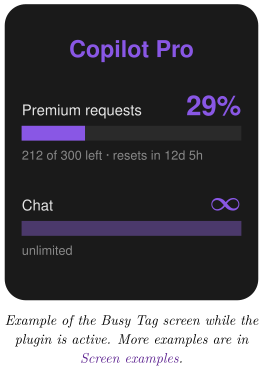
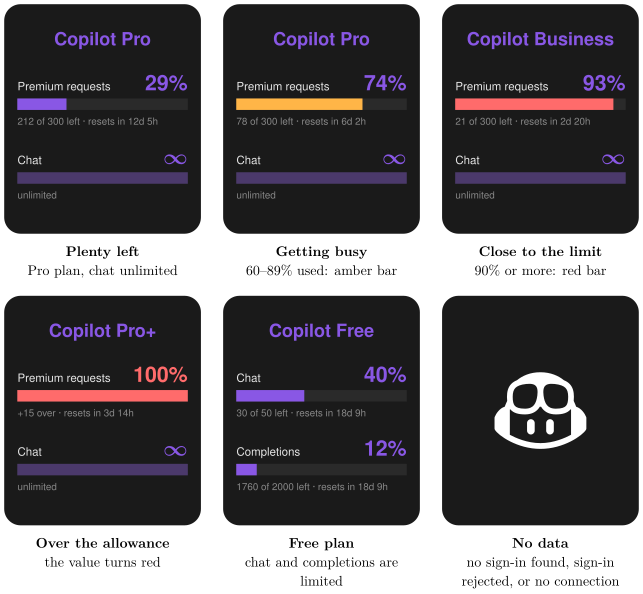

*Show your monthly GitHub Copilot quota on your Busy Tag display*

:::info[PDF version]
This guide is also available as a [PDF](pathname:///pdf/CopilotUsage_UserGuide.pdf).
:::

## Overview

The **GitHub Copilot Usage** plugin shows how much of your monthly GitHub Copilot allowance you have used. It finds a GitHub sign-in saved on your computer. It then asks GitHub for your quota and draws the result on your Busy Tag screen. Your Busy Tag shows at a glance:

- your Copilot plan (for example *Free*, *Pro*, *Pro+* or *Business*),
- how many **premium requests** you have used this month, and how many are left,
- your **chat** or **completions** quota, or that it is unlimited,
- how long until the quota resets at the start of the next billing month.

The display refreshes automatically, every 5 minutes by default. You can also turn on the Busy Tag LED in violet while the plugin is active.



## Requirements

- The **Busy Tag desktop app** on **Windows** or **macOS**. The plugin reads files on your computer, so it is not offered in the Android or iOS apps.
- A Busy Tag device added to the app.
- A **GitHub account** with GitHub Copilot (any plan, including Copilot Free).
- A GitHub sign-in that is **saved in a file** on the *same computer* as the Busy Tag app (see [Preparing a GitHub Sign-in](#preparing-a-github-sign-in)).
- An internet connection.

## Preparing a GitHub Sign-in

The plugin needs a GitHub sign-in that it can read from a file. It looks for one in this order:

1.  the **Copilot plugin for JetBrains IDEs or Neovim**,
2.  the **GitHub Copilot CLI**, if it saved its sign-in to a file,
3.  the **GitHub CLI** (`gh`), if it saved its sign-in to a file.

:::note
**VS Code is not enough on its own.** Current versions of VS Code and the Copilot CLI keep their sign-in in the system keychain (Windows Credential Manager or macOS Keychain). The plugin cannot read the keychain. If you only use Copilot in VS Code, set up the GitHub CLI as described below.
:::

### Option A: JetBrains IDE or Neovim

If you already use GitHub Copilot in a JetBrains IDE (IntelliJ IDEA, Rider, PyCharm, …) or in Neovim on this computer, you are probably ready. Open the plugin’s configuration page ([Configuring the Plugin](#configuring-the-plugin)) and check that it reports a sign-in.

### Option B: GitHub CLI (recommended)

1.  Install the GitHub CLI from <https://cli.github.com>.
2.  Open a terminal (Windows Terminal or PowerShell on Windows, Terminal on macOS) and run:

```text
gh auth login –web –insecure-storage
```

3.  Follow the prompts. A browser window opens. Sign in with the GitHub account that has Copilot and approve the request.

The `--insecure-storage` option tells the GitHub CLI to save the sign-in in a file instead of the system keychain, so the plugin can read it.

:::tip
**Good to know:** with `--insecure-storage`, your GitHub sign-in is saved as plain text in your user folder. Programs running under your user account can read it. If you no longer need it, run `gh auth logout`.
:::

Sign in with the *same user account* you use to run the Busy Tag app. The plugin only looks in the folders of the user who is running Busy Tag.

## Adding the Plugin in Busy Tag

1.  Open the Busy Tag app and select your device.
2.  Go to **Integrations** in the navigation menu.
3.  Open the **Add Integrations** tab.
4.  Find **GitHub Copilot Usage**. You can type “Copilot” in the search box. Click **Add**.
5.  In the **Add Plugin** window, keep the suggested name or enter your own. Confirm.
6.  The plugin now appears in the **My Integrations** tab, and its configuration page opens automatically.

## Configuring the Plugin

The configuration page opens automatically after you add the plugin. To open it again later, click the **More Options** button (**…**) next to the plugin in **My Integrations** and choose **Configure**.

### Folder access (Mac App Store version only)

If you installed Busy Tag from the Mac App Store, macOS only lets Busy Tag read your GitHub sign-in after you allow it once. Both the GitHub CLI and the Copilot editor plugins keep it in the hidden `.config` folder in your home folder. In that case an orange box appears at the top of the page:

1.  Click **Grant access to ~/.config**.
2.  A folder window opens inside the `.config` folder. Click **Open**.
3.  The orange box disappears and the sign-in check below runs. macOS remembers your choice.

If you choose a different folder, the page says *Access not granted*. Click the button again and pick the `.config` folder itself. On Windows, and with the Busy Tag version downloaded from the website, this box never appears.

:::note
In the Mac App Store version, use the GitHub CLI ([Preparing a GitHub Sign-in](#preparing-a-github-sign-in), Option B) or the Copilot plugin of a JetBrains IDE or Neovim. A Copilot CLI sign-in saved in `~/.copilot` cannot be read there.
:::

### Sign-in check

At the top of the page, the plugin looks for a sign-in it can use:

- **Sign-in detected: GitHub CLI** (or *Copilot (editor)*, or *Copilot CLI*): you are ready to go. The name shows where the sign-in was found.
- **No readable sign-in found**: follow [Preparing a GitHub Sign-in](#preparing-a-github-sign-in), then reopen this page.
- **Waiting for folder access**: grant access first (see above).

### Settings

[TABLE]

A preview next to the form shows how the screen will look with sample data. Click **Save** to apply your changes.

## Using the Plugin

### Show it on your Busy Tag

In **My Integrations**, click the **Activate** button (▶) next to GitHub Copilot Usage. The plugin starts right away. It fetches your quota, sends the image to your Busy Tag and then refreshes at the interval you chose.

### Interactive panel

Click **Open** to see the plugin in a panel inside the app. Below the screen preview, a status line shows what the plugin is doing, for example:

- *Looking for Copilot sign-in…* / *Querying GitHub…*
- *Updated 14:32:05 · octocat · Pro · via GitHub CLI*, which means the last refresh succeeded. It also shows the GitHub user, the plan and where the sign-in was found.
- An error message in red if something went wrong (see [Troubleshooting](#troubleshooting)).

### Playlist

The plugin can rotate with your other integrations. Open **More Options** (**…**) and use **Include in playlist** and **Duration** to choose whether it is included and how long it stays on screen. Then click **Start Playlist**.

## Reading the Display

The screen has room for two quotas. Quotas with a limit come first (premium requests, then chat, then completions). Unlimited quotas come next. Quotas your plan does not include come last.

### What each part means

[TABLE]

### Screen examples

The screen has one layout. Which two quotas appear depends on your plan, and each bar changes colour as you use more of it. The LED setting does not change the screen.



## Troubleshooting

| **Message** | **What to do** |
|:---|:---|
| No readable GitHub sign-in found. | The plugin did not find a sign-in saved in a file. Follow [Preparing a GitHub Sign-in](#preparing-a-github-sign-in), Option B. |
| Busy Tag needs access to `~/.config`. | Mac App Store version only. Open the plugin’s configuration page and click **Grant access** (see [Folder access (Mac App Store version only)](#folder-access-mac-app-store-version-only)). |
| GitHub rejected the stored sign-in (HTTP 401). Sign in to Copilot again. | The saved sign-in is no longer valid. Run `gh auth login --web --insecure-storage` again, or sign in to Copilot again in your editor. |
| GitHub refused the request (HTTP 403). The token may lack Copilot access. | The GitHub account you signed in with cannot use Copilot. Check that you signed in with the right account. |
| No Copilot subscription found for this GitHub account. | This account has no Copilot plan. Activate Copilot on GitHub, or sign in with another account. |
| GitHub responded but reported no quota snapshots. | GitHub did not send any quota figures for this account. Try again later. |
| Copilot usage endpoint returned HTTP 5xx / 429. | A temporary problem on GitHub’s side, or too many requests. The plugin tries again at the next refresh. Choose a longer refresh interval if this keeps happening. |
| The screen shows only the Copilot logo. | Click **Open** on the plugin to see the status message, then use this table. |

## Privacy and Security

- The plugin can read **only** the sign-in files of the Copilot editor plugins, the Copilot CLI and the GitHub CLI. It cannot access any other files on your computer. In the Mac App Store version it can read nothing at all until you grant access to the `.config` folder.
- Your sign-in token is sent to one place only: GitHub (`api.github.com`). This is the same request the Copilot editor plugins make. The token is never sent to Busy Tag or to anyone else.
- The plugin only reads the sign-in files. It never changes them.
- Only the usage image is sent to your Busy Tag device.
- To stop the plugin, delete it from **My Integrations** (**…** → **Delete**). To remove a GitHub CLI sign-in, run `gh auth logout`.

GitHub and GitHub Copilot are trademarks of GitHub, Inc. Busy Tag is not affiliated with or endorsed by GitHub.
