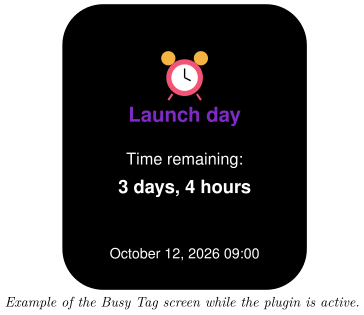
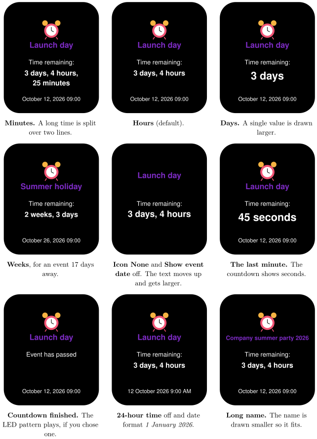

*Count down to an important date and light up the LED when it arrives*

:::info[PDF version]
This guide is also available as a [PDF](pathname:///pdf/Countdown_UserGuide.pdf).
:::

## Overview

The **Countdown Timer** plugin counts down to a date and time you choose, such as a launch, a holiday or a deadline. Your Busy Tag shows:

- an optional icon and the name of the event,
- the time remaining, in weeks, days, hours or minutes,
- the date and time of the event (optional).

While the plugin is active, the Busy Tag LED shows the colour you choose. When the countdown reaches zero, the plugin can play an LED pattern. The plugin works offline. It needs no account or internet connection.

## Requirements

- The Busy Tag app on **Windows**, **macOS**, **Android** or **iOS**.
- A Busy Tag device added to the app.

The plugin uses the clock of the computer or phone that runs the Busy Tag app. Make sure its date, time and time zone are correct.

## Adding the Plugin in Busy Tag

1.  Open the Busy Tag app and select your device.
2.  Go to **Integrations** in the navigation menu.
3.  Open the **Add Integrations** tab.
4.  Find **Countdown Timer**. You can type “Countdown” in the search box. Click **Add**.
5.  In the **Add Plugin** window, keep the suggested name or enter your own (for example “Summer holiday”). Confirm.
6.  The plugin now appears in the **My Integrations** tab, and its configuration page opens automatically.

:::tip
Each copy of the plugin counts down to one event. To follow several events, add the plugin several times and give each copy its own name.
:::

## Configuring the Plugin

The configuration page opens automatically after you add the plugin. To open it again later, click the **More Options** button (**…**) next to the plugin in **My Integrations** and choose **Configure**.

A new countdown starts with the event name *Tomorrow’s Deadline*, set 24 hours after you added the plugin. Change these to your own event.

### Event

| **Setting** | **Description** |
|:---|:---|
| Name | The event name shown on the screen, for example “Launch day”. Long names are drawn in a smaller font so they fit. Very long names are shortened with “…”. |
| Icon | A picture shown above the name. Choose from 21 icons (alarm clock, party, birthday, wedding, graduation, travel, vacation, meeting, competition, Christmas, Halloween, New Year, anniversary, moving, baby, game release, movie, exam, deadline, show, concert) or *None*. A new countdown starts with the alarm clock. |
| Date & time | The date and time to count down to. |

### Display

| **Setting** | **Default** | **Description** |
|:---|:---|:---|
| Precision | Hours | How detailed the remaining time is, and how often the screen is updated (see the table below). |
| Show event date | On | Shows the event date and time at the bottom of the screen. |
| 24-hour time | On | Shows the event time as 14:30. Turn it off for 2:30 PM. |
| Date format | January 1, 2026 | How the event date is written. Choices: *January 1, 2026*, *1 January 2026*, *01/01/2026* (month first), *01/01/2026* (day first) and *2026-01-01*. Shown only when **Show event date** is on. |

| **Precision** | **Screen updates** | **Example**                 |
|:--------------|:-------------------|:----------------------------|
| Minutes       | Every minute       | 3 days, 4 hours, 25 minutes |
| Hours         | Every minute       | 3 days, 4 hours             |
| Days          | Every hour         | 3 days                      |
| Weeks         | Every 6 hours      | 2 weeks, 3 days             |

When less time is left than the chosen unit, the plugin switches to a smaller unit by itself. For example, with *Days* precision, the last day is shown in hours, and the last minute in seconds. With *Minutes* precision, the last minute counts down second by second. [Screen Examples](#screen-examples) shows each precision on the screen.

### On completion

| **Setting** | **Default** | **Description** |
|:---|:---|:---|
| LED pattern | None | An LED pattern to play when the countdown reaches zero. The list shows the patterns available in the app. |
| Loop the pattern | Off | Off: the pattern plays 5 times. On: the pattern keeps playing without stopping. |

### Colors

[TABLE]

A preview next to the form updates as you change settings. Click **Save** to apply your changes.

## Using the Plugin

### Show it on your Busy Tag

In **My Integrations**, click the **Activate** button (▶) next to Countdown Timer. The plugin sends the countdown to your Busy Tag, sets the LED colour and keeps the screen up to date.

### When the countdown reaches zero

The screen shows *Event has passed*. If you chose an LED pattern, it plays once for this event. It plays only while the plugin is active. If the plugin was not active at that moment, the pattern plays the next time you activate it. The plugin does not send its LED colour again while the pattern plays, so the pattern is not cut short.

To use the same plugin for a new event, change the date and time. The pattern is then ready to play again for the new date.

### Interactive panel

On a computer or tablet, click **Open** to see the countdown in a panel inside the app. The **Open** button is hidden on phones.

### Playlist

The plugin can rotate with your other integrations. Open **More Options** (**…**) and use **Include in playlist** and **Duration** to choose whether it is included and how long it stays on screen. Then click **Start Playlist**.

## Screen Examples

These examples show the event *Launch day* on October 12, 2026 at 09:00, seen 3 days, 4 hours and 25 minutes before it starts. The first four examples show the four precisions.

## Reading the Display

| **Element** | **Meaning** |
|:---|:---|
| Icon | The icon you chose for the event (not shown if you chose *None*). |
| **Launch day** | The event name. Long names are drawn smaller. |
| **3 days, 4 hours** | The time left until the event. A single value, such as *23 hours*, is drawn larger. |
| **October 12, 2026 09:00** | The event date and time, in your chosen format. |
| *Event has passed* | The event date and time are in the past. |

## Troubleshooting

| **What you see** | **What to do** |
|:---|:---|
| The screen shows *Event has passed* right away. | The date and time you set are in the past. Check the date, and check the time zone and clock of your computer or phone. |
| The remaining time is off by a few hours. | The countdown uses the time zone of the device running the Busy Tag app. Check its time zone setting. |
| The LED pattern did not play. | Check that a pattern is selected under **On completion**, and that the plugin was active. The pattern plays only once per event date. Change the date to play it again. |
| The event name is small or ends with “…”. | The name is too long for the screen, so it is shrunk to fit. Use a shorter name. |

## Privacy

The Countdown Timer works fully on your own device. It does not connect to the internet, does not send any data and does not read any files.
