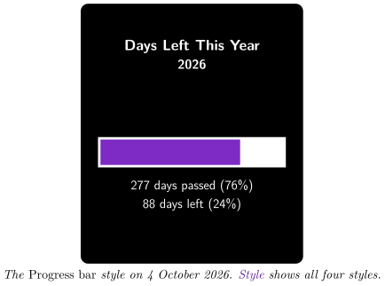
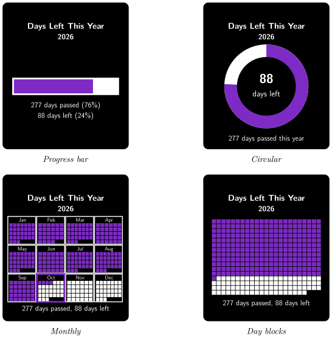

*See at a glance how much of the current year has passed and how much is left*

:::info[PDF version]
This guide is also available as a [PDF](pathname:///pdf/DaysLeftThisYear_UserGuide.pdf).
:::

## Overview

The **Days Left This Year** plugin shows how far through the year you are. Your Busy Tag shows:

- the current year,
- how many days have passed, including today,
- how many days are left until the end of the year,
- the same numbers as percentages, in one of four visual styles.

The plugin updates itself shortly after midnight every day. It works offline: no account and no internet connection are needed. You can also choose a colour for the Busy Tag LED.

## Requirements

- The **Busy Tag app** on Windows, macOS, Android or iOS.
- A Busy Tag device added to the app.

The plugin uses the date of the computer or phone that runs the Busy Tag app. Make sure its date and time zone are correct.

## Adding the Plugin in Busy Tag

1.  Open the Busy Tag app and select your device.
2.  Go to **Integrations** in the navigation menu.
3.  Open the **Add Integrations** tab.
4.  Find **Days Left This Year**. You can type “Days” in the search box. Click **Add**.
5.  In the **Add Plugin** window, keep the suggested name or enter your own. Confirm.
6.  The plugin now appears in the **My Integrations** tab, and its configuration page opens automatically.

## Configuring the Plugin

The configuration page opens automatically after you add the plugin. To open it again later, click the **More Options** button (**…**) next to the plugin in **My Integrations** and choose **Configure**.

### Style

Choose one of four styles. The default is **Progress bar**. Every style shows the title and the year at the top. The examples below show each style on 4 October 2026 with the default colours.

- **Progress bar**: a horizontal bar that fills up as the year goes by. Below it: days passed and days left, each with a percentage.
- **Circular**: a ring that fills clockwise from the top. The number of days left is shown in the middle, and the days passed are shown below the ring.
- **Monthly**: twelve small boxes, one per month, with one small block for each day. The current month has a thicker outline in the *Days passed* colour.
- **Day blocks**: one small block for every day of the year (365, or 366 in a leap year). Passed days are filled in.

### Colours

| **Setting** | **Default** | **Description** |
|:---|:---|:---|
| Background | `#000000` | The screen background. |
| Text | `#FFFFFF` | The title, year, numbers and outlines. |
| Days passed | `#7D2BC4` | The part of the bar, ring or grid that stands for days already gone. |
| Days remaining | `#FFFFFF` | The part that stands for days still to come. |
| LED | `#7D2BC4` | The colour of the Busy Tag LED while the plugin is shown. |

A preview next to the form shows how the screen will look. Click **Save** to apply your changes.

:::tip
Pick a *Days passed* colour that stands out clearly from *Days remaining*. On the *Monthly* and *Day blocks* styles the blocks are small, so strong contrast makes them much easier to read.
:::

## Using the Plugin

### Show it on your Busy Tag

In **My Integrations**, click the **Activate** button (▶) next to Days Left This Year. The image is sent to your Busy Tag right away and the LED changes to your chosen colour. After that, the plugin updates the screen a few seconds after each midnight.

### Interactive panel

On a computer or tablet, click **Open** to see the plugin in a panel inside the app. The **Open** button is not shown on phones.

### Playlist

The plugin can rotate with your other integrations. Open **More Options** (**…**) and use **Include in playlist** and **Duration** to choose whether it is included and how long it stays on screen. Then click **Start Playlist**.

## Reading the Display

- **Days passed** includes today. On 1 January it shows 1 day passed.
- **Days left** counts the days after today. On 31 December it shows 0 days left.
- In a leap year the year has 366 days, so the numbers and the *Day blocks* grid include one extra day.
- Percentages are rounded to whole numbers, so they may not add up to exactly 100%.

## Troubleshooting

| **Problem** | **What to do** |
|:---|:---|
| The numbers are one day off. | Check the date and time zone of the computer or phone that runs the Busy Tag app. |
| The screen did not change after midnight. | The plugin runs inside the Busy Tag app. Keep the app running and the plugin active. Click **Activate** again to refresh it straight away. |
| Colour changes do not show on the device. | Make sure you clicked **Save** on the configuration page. Then click **Activate** again. |
| The blocks in *Day blocks* or *Monthly* are hard to see. | Choose colours with more contrast, or switch to the *Progress bar* or *Circular* style. |

## Privacy

The plugin works entirely on your computer or phone. It does not sign in to any service, does not read any files and does not send any data over the internet. Only the finished image and the LED colour are sent to your Busy Tag device.
