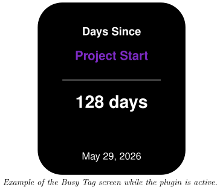
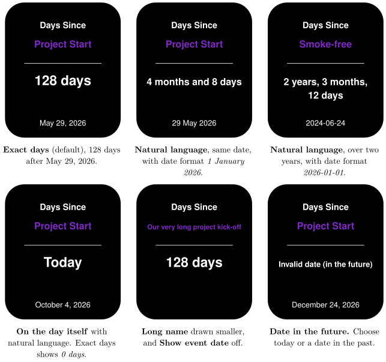

*Count the days since an important date on your Busy Tag display*

:::info[PDF version]
This guide is also available as a [PDF](pathname:///pdf/DaysSince_UserGuide.pdf).
:::

## Overview

The **Days Since** plugin counts how many days have passed since a date you choose, such as the start of a project, a habit streak or the last incident. Your Busy Tag shows:

- the name of the event,
- the number of days since that date, either as an exact number of days or in words such as “2 months and 5 days”,
- the event date (optional).

The count goes up by itself just after midnight every day. While the plugin is active, the Busy Tag LED shows the colour you choose. The plugin works offline. It needs no account or internet connection.

## Requirements

- The Busy Tag app on **Windows**, **macOS**, **Android** or **iOS**.
- A Busy Tag device added to the app.

The plugin uses the clock of the computer or phone that runs the Busy Tag app. Make sure its date and time zone are correct.

## Adding the Plugin in Busy Tag

1.  Open the Busy Tag app and select your device.
2.  Go to **Integrations** in the navigation menu.
3.  Open the **Add Integrations** tab.
4.  Find **Days Since**. You can type “Days” in the search box. Click **Add**.
5.  In the **Add Plugin** window, keep the suggested name or enter your own (for example “No-sugar streak”). Confirm.
6.  The plugin now appears in the **My Integrations** tab, and its configuration page opens automatically.

:::tip
Each copy of the plugin counts from one date. To track several dates, add the plugin several times and give each copy its own name.
:::

## Configuring the Plugin

The configuration page opens automatically after you add the plugin. To open it again later, click the **More Options** button (**…**) next to the plugin in **My Integrations** and choose **Configure**.

A new plugin starts with the event name *Project Start* and today’s date. Change these to your own event.

### Event

| **Setting** | **Description** |
|:---|:---|
| Name | The event name shown on the screen. Long names are drawn in a smaller font so they fit. Very long names are shortened with “…”. |
| Date | The date to count from. Choose today or a date in the past. |

### Display

| **Setting** | **Default** | **Description** |
|:---|:---|:---|
| Time display | Exact days | *Exact days* shows a single number, for example *128 days*. *Natural language* shows weeks, months and years, for example *4 months and 8 days*. |
| Show event date at the bottom | On | Shows the event date at the bottom of the screen. |
| Date format | January 1, 2026 | How the event date is written. Choices: *January 1, 2026*, *1 January 2026*, *01/01/2026* (month first), *01/01/2026* (day first) and *2026-01-01*. Shown only when the event date is shown. |

### Colors

[TABLE]

A preview next to the form updates as you change settings. Click **Save** to apply your changes.

## Using the Plugin

### Show it on your Busy Tag

In **My Integrations**, click the **Activate** button (▶) next to Days Since. The plugin sends the count to your Busy Tag and sets the LED colour. While the plugin stays active, the count is updated just after midnight each day.

### Interactive panel

On a computer or tablet, click **Open** to see the plugin screen in a panel inside the app. The **Open** button is hidden on phones.

### Playlist

The plugin can rotate with your other integrations. Open **More Options** (**…**) and use **Include in playlist** and **Duration** to choose whether it is included and how long it stays on screen. Then click **Start Playlist**.

## Reading the Display

| **Element** | **Meaning** |
|:---|:---|
| **Days Since** | The plugin title. It is always shown. |
| **Project Start** | Your event name. |
| **128 days** | The number of full days since the event date. On the event date itself, it shows *0 days* (or *Today* with natural language). |
| **May 29, 2026** | The event date, in your chosen format. |

### Natural language

With **Time display** set to *Natural language*, the plugin counts like this:

| **Days passed** | **Shown as** |
|:---|:---|
| 0 | Today |
| 1–6 | Days, for example *5 days* |
| 7–29 | Weeks and days, for example *2 weeks and 3 days* |
| 30–364 | Months and days, for example *4 months and 8 days* |
| 365 and more | Years, months and days, for example *2 years, 3 months, 10 days* |

:::note
In natural language, a month always counts as 30 days and a year as 365 days. The result can differ by a few days from a calendar count. Use *Exact days* if you need the precise number.
:::

## Screen Examples

These examples were taken on October 4, 2026.

## Troubleshooting

| **What you see** | **What to do** |
|:---|:---|
| Invalid date (in the future) | The event date is after today. Choose today or a date in the past. |
| The count or the date is one day off. | The plugin counts in the local time of the computer or phone running the Busy Tag app. Check its date, time and time zone. |
| The count did not go up overnight. | The plugin must be active to update at midnight. Activate it again to refresh the count. |
| The event name is small or ends with “…”. | The name is too long for the screen, so it is shrunk to fit. Use a shorter name. |

## Privacy

The Days Since plugin works fully on your own device. It does not connect to the internet, does not send any data and does not read any files.
