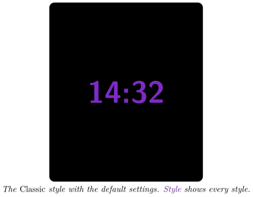
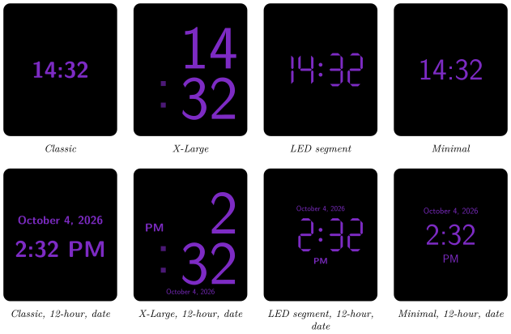

*Show the current time on your Busy Tag in one of four digital styles*

:::info[PDF version]
This guide is also available as a [PDF](pathname:///pdf/DigitalClock_UserGuide.pdf).
:::

## Overview

The **Digital Clock** plugin shows the current time in large digits on your Busy Tag. You can choose:

- one of four styles: *Classic*, *X-Large*, *LED segment* or *Minimal*,
- a 12-hour or 24-hour clock,
- whether to show the date, and in which format,
- the colour of the digits. The Busy Tag LED uses the same colour.

The colon between the hours and the minutes gently fades in and out once a second, so you can see at a glance that the clock is running. The time on the device is updated at the start of every minute. The plugin works offline: no account and no internet connection are needed.

## Requirements

- The **Busy Tag app** on Windows, macOS, Android or iOS.
- A Busy Tag device added to the app.

The clock uses the time of the computer or phone that runs the Busy Tag app. Make sure its clock and time zone are correct.

## Adding the Plugin in Busy Tag

1.  Open the Busy Tag app and select your device.
2.  Go to **Integrations** in the navigation menu.
3.  Open the **Add Integrations** tab.
4.  Find **Digital Clock**. You can type “Clock” in the search box. Click **Add**.
5.  In the **Add Plugin** window, keep the suggested name or enter your own. Confirm.
6.  The plugin now appears in the **My Integrations** tab, and its configuration page opens automatically.

## Configuring the Plugin

The configuration page opens automatically after you add the plugin. To open it again later, click the **More Options** button (**…**) next to the plugin in **My Integrations** and choose **Configure**.

### Style

Click one of the four style tiles. Each tile shows a small preview. The default is **Classic**.

- **Classic**: the time on one line in the middle of the screen. When the date is shown, a smaller date line sits above the time.
- **X-Large**: very large digits, with the hours on the top half of the screen and the minutes on the bottom half. The colon is slightly transparent. In 12-hour mode, AM or PM appears in small letters on the left. The date, if shown, sits at the bottom.
- **LED segment**: digits drawn like a classic 7-segment LED display, with two round dots for the colon. AM or PM appears below the digits, and the date above them. In 12-hour mode a single-digit hour leaves the first digit dark, like a real LED clock.
- **Minimal**: light digits in the middle of the screen. AM or PM appears below the time, and the date above it.

The top row below shows each style with the default settings (24-hour, no date). The bottom row shows the same styles in 12-hour mode with **Show date** on.

### Time and colour

| **Setting** | **Default** | **Description** |
|:---|:---|:---|
| Format | 24-hour | *12-hour* (for example 2:30 PM) or *24-hour* (14:30). |
| Show date | Off | Shows the date together with the time. |
| Date format | January 1, 2026 | Only shown when *Show date* is on. See the table below. |
| Clock color | `#7D2BC4` | The colour of the digits, the colon and the date. The Busy Tag LED lights up in the same colour. |

| **Date format option** | **Example for 4 October 2026** |
|:-----------------------|:-------------------------------|
| January 1, 2026        | October 4, 2026                |
| 1 January 2026         | 4 October 2026                 |
| 01/01/2026             | 10/04/2026 (month first)       |
| 01/01/2026 (DD/MM)     | 04/10/2026 (day first)         |
| 2026-01-01             | 2026-10-04                     |

A preview next to the form shows how the clock will look. Click **Save** to apply your changes.

:::tip
For reading the time from across the room, use the *X-Large* style. For a quiet look that still shows the date, try *Minimal*.
:::

## Using the Plugin

### Show it on your Busy Tag

In **My Integrations**, click the **Activate** button (▶) next to Digital Clock. The clock is sent to your Busy Tag right away and the LED changes to the clock colour. After that, the plugin sends the new time at the start of every minute while it is active.

### Interactive panel

On a computer or tablet, click **Open** to see a live clock in a panel inside the app. The **Open** button is not shown on phones.

### Playlist

The plugin can rotate with your other integrations. Open **More Options** (**…**) and use **Include in playlist** and **Duration** to choose whether it is included and how long it stays on screen. Then click **Start Playlist**.

## Troubleshooting

| **Problem** | **What to do** |
|:---|:---|
| The clock shows the wrong time. | Check the clock and time zone of the computer or phone that runs the Busy Tag app. |
| The clock stopped changing, but the colon still blinks. | The blinking colon is an animation stored on the device. The digits are updated by the Busy Tag app. Keep the app running and the plugin active. Click **Activate** again to restart it. |
| I cannot find the *Date format* setting. | It only appears when **Show date** is turned on. |
| The LED colour is different from what I want. | The LED always uses the *Clock color*. Change the clock colour to change the LED. |
| Changes do not show on the device. | Make sure you clicked **Save** on the configuration page. |

## Privacy

The plugin works entirely on your computer or phone. It does not sign in to any service, does not read any files and does not send any data over the internet. Only the clock animation and the LED colour are sent to your Busy Tag device.
