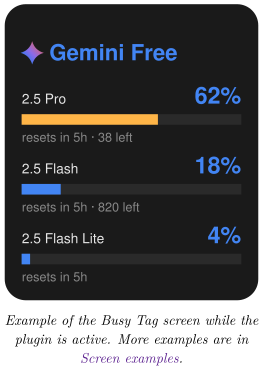
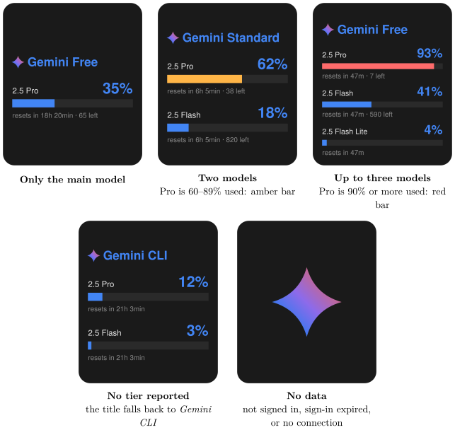

*Show your Gemini CLI request quota per model on your Busy Tag display*

:::info[PDF version]
This guide is also available as a [PDF](pathname:///pdf/GeminiUsage_UserGuide.pdf).
:::

## Overview

The **Gemini CLI Usage** plugin shows how much of your Gemini CLI request quota you have used. It reads the Google sign-in that the Gemini CLI stores on your computer. It then asks Google for your current quota and draws the result on your Busy Tag screen. Your Busy Tag shows at a glance:

- your Gemini Code Assist tier (for example *Free* or *Standard*),
- up to three models (Pro first, then Flash, then Flash Lite),
- how much of each model’s quota you have used and how many requests are left,
- how long until each quota resets.

The display refreshes automatically, every 5 minutes by default. You can also turn on the Busy Tag LED in blue while the plugin is active.



## Requirements

- The **Busy Tag desktop app** on **Windows** or **macOS**. The plugin reads files on your computer, so it is not offered in the Android or iOS apps.
- A Busy Tag device added to the app.
- The **Gemini CLI** installed on the *same computer* as the Busy Tag app.
- The Gemini CLI signed in with *Login with Google*, using a Google account that can use Gemini Code Assist.
- An internet connection.

:::note
**Developer mode required.** This plugin is still in preview. It only appears in the list when developer mode is on. To turn it on, open **Settings** in the Busy Tag app and tap the app version label 5 times. The app counts down the remaining taps and then confirms *Developer mode is now enabled*. Developer-only plugins show a **Dev** badge.
:::

:::note
**API keys are not supported.** If you set up the Gemini CLI with an API key instead of *Login with Google*, there is no request quota to show.
:::

## Setting Up the Gemini CLI on Your Computer

Skip this section if you already use the Gemini CLI on this computer with *Login with Google*.

### Install the Gemini CLI

Install the Gemini CLI by following Google’s instructions at:

<https://github.com/google-gemini/gemini-cli>

If you have Node.js installed, you can usually install it from a terminal (Windows Terminal or PowerShell on Windows, Terminal on macOS) with this command:

```text
npm install -g @google/gemini-cli
```

### Sign in with Google

1.  Open a terminal and run:

```text
gemini
```

2.  When the CLI asks how to sign in, choose **Login with Google**.
3.  A browser window opens. Sign in to your Google account and approve the request.
4.  Return to the terminal. The Gemini CLI is now signed in.

The Gemini CLI saves your sign-in in a folder in your home folder. This is the file the plugin reads:

| **System** | **Sign-in file**                          |
|:-----------|:------------------------------------------|
| Windows    | `C:\Users\<you>\.gemini\oauth_creds.json` |
| macOS      | `/Users/<you>/.gemini/oauth_creds.json`   |

:::tip
Sign in to the Gemini CLI with the *same user account* you use to run the Busy Tag app. The plugin only looks in the home folder of the user who is running Busy Tag.
:::

### When the sign-in expires

Google sign-ins expire after a short time. The Gemini CLI renews its sign-in whenever you use it. If the saved sign-in has expired, the plugin tries to renew it on its own. To do that, it looks for the installed Gemini CLI in the usual install locations (npm on Windows; Homebrew, npm or nvm on macOS). The renewed sign-in is kept only in memory and is never written back to the file. If the plugin cannot find the CLI, simply run `gemini` once.

## Adding the Plugin in Busy Tag

1.  Turn on developer mode (see [Requirements](#requirements)).
2.  Open the Busy Tag app and select your device.
3.  Go to **Integrations** in the navigation menu.
4.  Open the **Add Integrations** tab.
5.  Find **Gemini CLI Usage**. You can type “Gemini” in the search box. Click **Add**.
6.  In the **Add Plugin** window, keep the suggested name or enter your own. Confirm.
7.  The plugin now appears in the **My Integrations** tab, and its configuration page opens automatically.

## Configuring the Plugin

The configuration page opens automatically after you add the plugin. To open it again later, click the **More Options** button (**…**) next to the plugin in **My Integrations** and choose **Configure**.

### Folder access (Mac App Store version only)

The Mac App Store version of Busy Tag may only read folders you allow. If you see *Folder access needed*, click **Grant access to ~/.gemini**. In the window that appears, make sure the `.gemini` folder is selected and click **Open**. You only need to do this once. Windows users and other macOS versions do not see this step.

### Sign-in check

The **Sign-in** section shows what the plugin found:

- **Gemini CLI sign-in detected (you@gmail.com)**, with *Token is valid.*: you are ready to go.
- *Token has expired; it will be refreshed automatically using the installed CLI.*: also fine. The plugin renews the sign-in itself.
- *Token has expired and the CLI install was not found.*: run `gemini` once in a terminal.
- **Gemini CLI sign-in not found**: follow [Setting Up the Gemini CLI on Your Computer](#setting-up-the-gemini-cli-on-your-computer), then reopen this page.

### Settings

[TABLE]

A preview next to the form shows how the screen will look with sample data. Click **Save** to apply your changes.

## Using the Plugin

### Show it on your Busy Tag

In **My Integrations**, click the **Activate** button (▶) next to Gemini CLI Usage. The plugin starts right away. It fetches your quota, sends the image to your Busy Tag and then refreshes at the interval you chose.

### Interactive panel

Click **Open** to see the plugin in a panel inside the app. Below the screen preview, a status line shows what the plugin is doing, for example:

- *Reading Gemini CLI sign-in…*
- *Updated 14:32:05 · Free tier · you@gmail.com*, which means the last refresh succeeded.
- An error message in red if something went wrong (see [Troubleshooting](#troubleshooting)).

### Playlist

The plugin can rotate with your other integrations. Open **More Options** (**…**) and use **Include in playlist** and **Duration** to choose whether it is included and how long it stays on screen. Then click **Start Playlist**.

## Reading the Display

### What each part means

[TABLE]

### Screen examples

The **Models to show** setting picks the layout. With one or two models the rows are large; with three they are more compact. The title and rows are always centred as one block. If Google reports fewer models than you chose, the screen uses the layout for the number it got.



## Troubleshooting

| **Message** | **What to do** |
|:---|:---|
| Gemini CLI sign-in not found. Run `gemini` and choose “Login with Google”. | The Gemini CLI is not installed or not signed in for this user. Follow [Setting Up the Gemini CLI on Your Computer](#setting-up-the-gemini-cli-on-your-computer). |
| No access token in Gemini CLI sign-in. | The sign-in file is incomplete. Run `gemini` and log in with Google again. |
| Busy Tag needs access to ~/.gemini. | Mac App Store version only. Open the plugin’s configuration page and click **Grant access** ([Folder access (Mac App Store version only)](#folder-access-mac-app-store-version-only)). |
| Gemini CLI sign-in has expired. / …the CLI install could not be found to refresh it. | Run `gemini` once in a terminal. The CLI renews the sign-in, and the plugin recovers at the next refresh. |
| Token refresh failed (…). Run `gemini` to sign in again. | Google did not accept the renewal. Run `gemini` and sign in again. |
| Google rejected the Gemini CLI token (HTTP 401). | The sign-in is no longer valid. Run `gemini` to sign in again. |
| Google refused the request (HTTP 403): … | Your sign-in works, but the account has no Gemini Code Assist access. Google’s own reason follows the colon. Signing in again does not help. |
| Gemini Code Assist is not available for this Google account: … | Google does not offer Code Assist to this account, for example some personal accounts. Use an account that has access. |
| Google responded but reported no quota buckets. | Google did not send any quota figures for this account. Try again later. |

If the screen shows only the Gemini spark, click **Open** on the plugin to see the status message, then use this table.

## Privacy and Security

- The plugin reads your Gemini CLI sign-in (`~/.gemini/oauth_creds.json`) and the name of the signed-in account (`~/.gemini/google_accounts.json`).
- To renew an expired sign-in, it also reads the installed Gemini CLI’s own program files. It only looks for the CLI’s public sign-in settings there. It cannot access any other files on your computer.
- Your sign-in token is sent only to Google (`cloudcode-pa.googleapis.com` for the quota, `oauth2.googleapis.com` to renew the sign-in). These are the same requests the Gemini CLI makes. The token is never sent to Busy Tag or to anyone else.
- The plugin never changes the Gemini CLI’s files. A renewed sign-in is kept only in memory while the app runs.
- Only the usage image is sent to your Busy Tag device.
- To stop the plugin, delete it from **My Integrations** (**…** → **Delete**).

Google and Gemini are trademarks of Google LLC. Busy Tag is not affiliated with or endorsed by Google.
