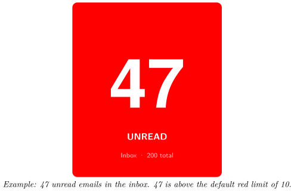
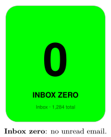
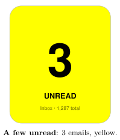
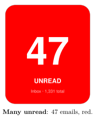
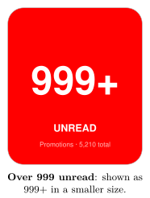
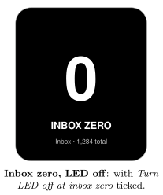
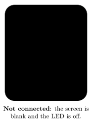

*Show how many unread emails are waiting in Gmail, and get an LED alert when new mail arrives*

:::info[PDF version]
This guide is also available as a [PDF](pathname:///pdf/GmailUnread_UserGuide.pdf).
:::

## Overview

The **Gmail Unread** plugin shows the number of unread emails in your Gmail account on your Busy Tag. The whole screen and the LED change colour as the number grows, so you can see from across the room whether your inbox needs attention.

- A large unread count fills the screen.
- The background and LED are **green** at inbox zero, **yellow** when a few emails are waiting and **red** when many are waiting. You choose the limits and the colours.
- You can watch your whole inbox, one inbox tab (Primary, Social, Promotions…) or another Gmail system label.
- Optionally, the LED plays a light pattern each time a new email arrives.

The plugin checks Gmail every minute by default.

## Requirements

- The **Busy Tag app** on Windows, macOS, Android or iOS.
- A Busy Tag device added to the app.
- A **Google account** with Gmail. Personal accounts and Google Workspace accounts both work, unless your Workspace administrator blocks third-party apps.
- An internet connection.

:::note
The plugin checks Gmail only while the Busy Tag app is open and the plugin is showing on your device. It does not run in the background when the app is closed.
:::

## Adding the Plugin in Busy Tag

1.  Open the Busy Tag app and select your device.
2.  Go to **Integrations** in the navigation menu.
3.  Open the **Add Integrations** tab.
4.  Find **Gmail Unread**. You can type “Gmail” in the search box. Click **Add**.
5.  In the **Add Plugin** window, keep the suggested name or enter your own (for example “Work Gmail”). Confirm.
6.  The plugin now appears in the **My Integrations** tab, and its configuration page opens automatically.

:::tip
Each copy of the plugin has its own Google sign-in. To watch two Gmail accounts, add the plugin twice and sign each copy in to a different account.
:::

## Connecting Your Google Account

Sign in from the plugin’s configuration page. If you closed it, click the **More Options** button (**…**) next to the plugin in **My Integrations** and choose **Configure**.

1.  In the **Account** section, click **Connect to Google**. The button changes to *Connecting…*
2.  Google’s sign-in page opens:

    - **Windows and macOS:** in a browser panel inside the Busy Tag app.

    - **Android:** in your phone’s web browser.

    - **iPhone and iPad:** in a secure sign-in window on top of the app.

3.  Choose your Google account and sign in.
4.  Google lists what Busy Tag is asking for: viewing your Gmail labels (this includes the unread and total counts), and your email address and basic profile. Click **Continue** (or **Allow**).
5.  The sign-in page closes and you return to Busy Tag. A *Connected to Google* message appears, and the **Account** section shows *Connected as: your.name@gmail.com*.

Google asks you to approve the permissions every time you connect. This is normal.

You stay signed in after that. The plugin renews its access to Google on its own, so you do not need to sign in again unless you sign out or remove Busy Tag’s access in your Google account.

:::note
**Sign out:** on the configuration page (or in the **Open** panel), click **Sign out**. The plugin forgets your sign-in. If the plugin is showing on your device, the screen goes black and the LED turns off.
:::

## Configuring the Plugin

A preview next to the form shows how the screen and LED will look. Click **Save** to apply your changes.

### Label

**Watch which Gmail label** chooses which unread emails are counted:

| **Option** | **Counts unread emails in…** |
|:---|:---|
| Inbox (default) | Your whole inbox, all tabs together. Best for most people. |
| Important | Emails Gmail marked as important. |
| Starred | Starred emails. |
| Primary, Social, Promotions, Updates, Forums | One of Gmail’s inbox tabs. |
| All unread (any label) | Every unread email in your account, including archived ones. |
| Spam | Your spam folder. |

Only these built-in Gmail labels can be chosen. Labels you created yourself are not in the list.

### Refresh

**Check Gmail every**: 30 seconds, **1 minute** (default), 2 minutes or 5 minutes.

### LED color thresholds

| **Setting** | **Default** | **Description** |
|:---|:---|:---|
| Yellow at | 1 unread | The count at which the colour changes to yellow. Choices: 1, 3, 5 or 10. |
| Red at | 10 unread | The count at which the colour changes to red. Choices: 5, 10, 20 or 50. |
| Inbox zero | `#00FF00` | Colour when there are no unread emails. |
| Yellow | `#FFFF00` | Colour from the yellow limit. |
| Red | `#FF0000` | Colour from the red limit. |
| Turn LED off at inbox zero | Off | When ticked, the LED is off at inbox zero. The screen still uses the *Inbox zero* colour. |

The same colour is used for the screen background and the LED.

### New email alert

**Play LED pattern when a new email arrives**: choose one of your device’s LED patterns, or **None** (default). When the unread count goes up, the LED plays the pattern 5 times and then returns to the normal colour.

- The alert does not play on the first check after the plugin starts. It only plays when the count rises between two checks.
- Mail that arrives while another playlist item is showing still triggers the alert the next time Gmail Unread is shown.

### Preview

**Preview shows** only changes the preview, not your device. Choose between inbox zero (0), a few unread (3), many unread (47) and way too many (1234) to check your colours.

## Using the Plugin

### Show it on your Busy Tag

In **My Integrations**, click the **Activate** button (▶) next to Gmail Unread. The plugin checks Gmail right away and sends the result to your Busy Tag. It then checks again at the interval you chose. The device is only updated when something changes.

### Interactive panel

On a computer or tablet, click **Open** to see the plugin in a panel inside the app. (On phones the **Open** button is hidden.) The panel shows:

- the account you are connected as, with a **Sign out** button,
- a live copy of the device screen,
- a status line, for example *12 unread in Inbox* or *Inbox: Inbox Zero*,
- *Last checked:* and the time of the last successful check.

### Playlist

The plugin can rotate with your other integrations. Open **More Options** (**…**) and use **Include in playlist** and **Duration** to choose whether it is included and how long it stays on screen. Then click **Start Playlist**.

## Reading the Display

| **Element** | **Meaning** |
|:---|:---|
| Large number | Unread emails in the watched label. Above 999 it shows **999+**. |
| **UNREAD** | At least one email is unread. |
| **INBOX ZERO** | No unread emails. |
| **Inbox · 200 total** | The watched label and the total number of emails in it, read or unread. |
| Green | No unread emails. |
| Yellow | At or above the yellow limit, below the red limit. |
| Red | At or above the red limit. |

Text is drawn in black on light colours and in white on dark colours, so it stays readable with any colour you pick.

### Screen examples

These examples use the default colours and limits (yellow from 1 unread, red from 10).

## Troubleshooting

Error messages appear in the status line of the **Open** panel and as short pop-up messages.

| **Message or problem** | **What to do** |
|:---|:---|
| **Connect to Google** is shown again, or *No valid access token available* | Your sign-in has ended (for example, you removed Busy Tag’s access in your Google account). Click **Connect to Google** and sign in again. |
| Authentication failed: Auth error: access_denied | You clicked **Cancel** on Google’s permission page. Connect again and click **Continue**. |
| Authentication failed: … | The sign-in did not finish. Check your internet connection and try again. |
| 403 Forbidden — … | Google refused the request. For Workspace accounts, your administrator may block third-party access to Gmail. The plugin stops checking until you fix this and activate it again. |
| Label “…” not found | The chosen label does not exist in this account. Choose **Inbox**. |
| Rate limited by Gmail | Too many requests. Choose a longer refresh interval. |
| Gmail API 5xx | A temporary problem at Google. The plugin tries again at the next check. |
| The new-mail pattern never plays | Make sure a pattern (not *None*) is selected and the plugin is showing on the device. The alert only plays when the count goes up between two checks. |
| The sign-in panel opened but nothing happened | Close the panel and click **Connect to Google** again. Signing in from the configuration page works best. |

## Privacy and Security

- The plugin asks Google only for permission to see your Gmail **labels**. It reads the number of unread and total emails in one label. It cannot read, send or delete your emails, and it never sees subjects, senders or message content.
- It also reads your email address, to show which account is connected.
- Your Gmail data goes directly from Google to the Busy Tag app on your device.
- When you sign in, and when the plugin renews its access, the request passes through Busy Tag’s sign-in service (`ig.busytag.com`). This service adds Busy Tag’s app credentials, which Google requires. It does not read your mail.
- Your sign-in is stored in the app’s secure storage on this device, separately for each copy of the plugin.
- Only the finished image and the LED colour are sent to your Busy Tag device.
- To disconnect, click **Sign out**, or delete the plugin from **My Integrations** (**…** → **Delete**). You can also remove Busy Tag’s access in your Google account under *Security* → *Third-party apps & services*.

Google, Gmail and Google Workspace are trademarks of Google LLC. Busy Tag is not affiliated with or endorsed by Google.
