*Show your current or next meeting on your Busy Tag, with a red, yellow or green status light*

:::info[PDF version]
This guide is also available as a [PDF](pathname:///pdf/GoogleCalendar_UserGuide.pdf).
:::

## Overview

The **Google Calendar** plugin turns your Busy Tag into a meeting light. It reads your Google Calendar and shows whether you are in a meeting, about to start one, or free. Colleagues can see at a glance whether they can talk to you.

- **In meeting**: red. The screen shows the meeting title, its time and how long is left.
- **Starting soon**: yellow. A meeting starts within the next few minutes.
- **Free**: green. The screen shows when your next meeting starts.
- The countdown on the screen updates every minute. The plugin checks Google Calendar for changes every minute by default.
- A *simple display* option shows only the status and the time in large text.

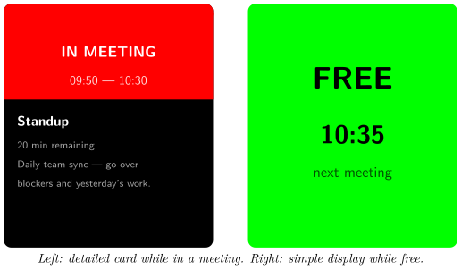

## Requirements

- The **Busy Tag app** on Windows, macOS, Android or iOS.
- A Busy Tag device added to the app.
- A **Google account** with Google Calendar. Personal accounts and Google Workspace accounts both work, unless your Workspace administrator blocks third-party apps.
- An internet connection.

:::note
The plugin checks your calendar only while the Busy Tag app is open and the plugin is showing on your device. It does not run in the background when the app is closed.
:::

## Adding the Plugin in Busy Tag

1.  Open the Busy Tag app and select your device.
2.  Go to **Integrations** in the navigation menu.
3.  Open the **Add Integrations** tab.
4.  Find **Google Calendar**. You can type “Calendar” in the search box. Click **Add**.
5.  In the **Add Plugin** window, keep the suggested name or enter your own (for example “Work calendar”). Confirm.
6.  The plugin now appears in the **My Integrations** tab, and its configuration page opens automatically.

:::tip
Each copy of the plugin has its own Google sign-in. To follow two Google accounts, add the plugin twice and sign each copy in to a different account.
:::

## Connecting Your Google Account

Sign in from the plugin’s configuration page. If you closed it, click the **More Options** button (**…**) next to the plugin in **My Integrations** and choose **Configure**.

1.  In the **Account** section, click **Connect to Google**. The button changes to *Connecting…*
2.  Google’s sign-in page opens:

    - **Windows and macOS:** in a browser panel inside the Busy Tag app.

    - **Android:** in your phone’s web browser.

    - **iPhone and iPad:** in a secure sign-in window on top of the app.

3.  Choose your Google account and sign in.
4.  Google lists what Busy Tag is asking for: *viewing* your calendars, and your email address and basic profile. Click **Continue** (or **Allow**).
5.  The sign-in page closes and you return to Busy Tag. A *Connected to Google* message appears, and the **Account** section shows *Connected as: your.name@gmail.com*.

Google asks you to approve the permissions every time you connect. This is normal.

You stay signed in after that. The plugin renews its access to Google on its own, so you do not need to sign in again unless you sign out or remove Busy Tag’s access in your Google account.

:::note
**Sign out:** on the configuration page (or in the **Open** panel), click **Sign out**. The plugin forgets your sign-in. If the plugin is showing on your device, the screen goes black and the LED turns off.
:::

## Configuring the Plugin

A preview next to the form shows how the screen and LED will look. Use **Preview shows** at the bottom of the page to see each state: in a meeting, starting soon, free with a meeting coming up, and free with nothing coming up. The preview uses sample meetings, not your real ones. Click **Save** to apply your changes.

### Calendar

**Which calendar to watch**: after you sign in, this list shows every calendar you can see, including shared calendars. The default is **Primary calendar**, your own main calendar. If a calendar you chose earlier is no longer available, it is marked *(unavailable)*.

### Display

[TABLE]

### Refresh

**Check Google Calendar every**: 30 seconds, **1 minute** (default), 2 minutes or 5 minutes. The countdown on the screen keeps moving between checks. This setting only controls how quickly the plugin notices new, moved or cancelled meetings.

### Filter events

| **Setting** | **Default** | **Description** |
|:---|:---|:---|
| Ignore all-day events | On | All-day events (holidays, birthdays, out-of-office days) do not count as meetings. Recommended. |
| Ignore events with no other attendees | Off | Events you created only for yourself (focus time, reminders) do not count as meetings. |
| Show event description on the device | On | Shows up to two short lines of the event’s description under the title. |

Cancelled events are always ignored. The plugin looks 24 hours ahead.

### LED colors

| **Setting** | **Default** | **Description** |
|:---|:---|:---|
| In meeting | `#FF0000` | Colour during a meeting. |
| Starting soon | `#FFFF00` | Colour shortly before a meeting. |
| Free | `#00FF00` | Colour when you are free. |
| Turn LED off entirely when free | Off | When ticked, the LED is off while you are free. |

The same colour is used for the coloured part of the screen and for the LED.

## Using the Plugin

### Show it on your Busy Tag

In **My Integrations**, click the **Activate** button (▶) next to Google Calendar. The plugin reads your calendar right away and sends the result to your Busy Tag. After that, it updates the device every minute so the countdown stays correct, and checks Google Calendar at the interval you chose.

### Interactive panel

On a computer or tablet, click **Open** to see the plugin in a panel inside the app. (On phones the **Open** button is hidden.) The panel shows:

- the account you are connected as, with a **Sign out** button,
- a live copy of the device screen,
- a status line, for example *In: Standup*, *Starting soon: 1:1 with Anna* or *Free — next: Design Review at 14:00*,
- *Last checked:* and the time of the last successful check.

### Playlist

The plugin can rotate with your other integrations. Open **More Options** (**…**) and use **Include in playlist** and **Duration** to choose whether it is included and how long it stays on screen. Then click **Start Playlist**.

:::tip
If you use the Busy Tag as a meeting light, it works best on its own rather than in a playlist. In a playlist, other items cover the meeting status part of the time.
:::

## Reading the Display

### Detailed card (default)

The top part of the screen is coloured by status. The bottom part shows the meeting.

| **Status** | **Second line** | **Bottom part** |
|:---|:---|:---|
| IN MEETING | Start – end time | Title, time remaining, description. With *Only current meeting*, also the location. |
| STARTING SOON | *In 3 min · 10:00* | Title, location, description. |
| FREE | *Next in 35 min* | Title and start time of the next meeting. |
| FREE | *No upcoming meetings* | Empty. Nothing in the next 24 hours. |
| NEXT MEETING | *14:00 · in 2h 15m* | Title, location, description (*Always next upcoming meeting* mode). |
| NO UPCOMING | *Nothing in next 24h* | Empty (*Always next upcoming meeting* mode). |

Long titles are shortened with “…”. Events without a title show *(no title)*.

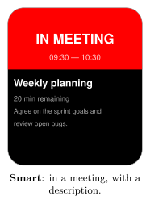

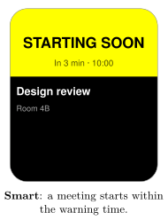

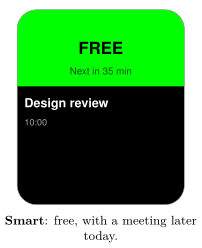

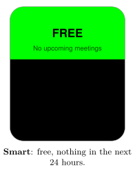

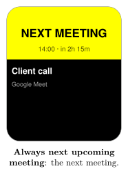

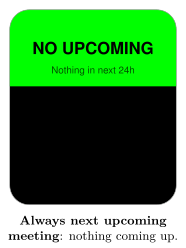

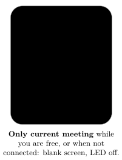

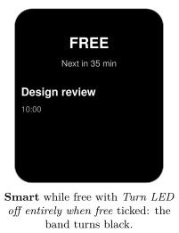

### Simple display

The whole screen takes the status colour and shows only large text:

- **IN MEETING**, the start and end time, and how long is left (*20 min left*).
- **STARTING SOON**, the start time, and *in 3 min*.
- **FREE** and the start time of the next meeting, or only **FREE** when nothing is coming up.
- **NEXT MEETING** or **NO UPCOMING** in *Always next upcoming meeting* mode.

Text is drawn in black on light colours and in white on dark colours. Long words are made smaller so they fit on one line.

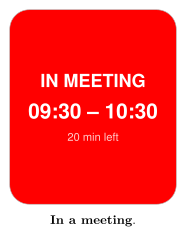

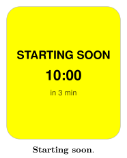

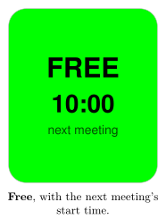

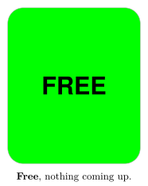

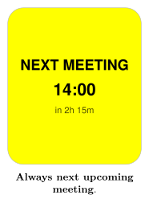

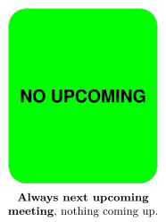

## Troubleshooting

Error messages appear in the status line of the **Open** panel and as short pop-up messages.

| **Message or problem** | **What to do** |
|:---|:---|
| Google session expired — please reconnect. | Your sign-in has ended. Click **Connect to Google** and sign in again. |
| **Connect to Google** is shown again, or *No valid access token available* | Same as above: sign in again. |
| Authentication failed: Auth error: access_denied | You clicked **Cancel** on Google’s permission page. Connect again and click **Continue**. |
| Authentication failed: … / Network error | The sign-in did not finish. Check your internet connection and try again. |
| 403 Forbidden — … | Google refused the request. For Workspace accounts, your administrator may block third-party calendar access. You may also have lost access to the chosen calendar. The plugin stops checking until you fix this and activate it again. |
| Rate limited. Pausing 60s. | Too many requests. The plugin waits one minute and continues. Choose a longer refresh interval if it keeps happening. |
| Could not load your calendars: … | The calendar list could not be loaded on the configuration page. Check your connection, then reopen the page. |
| A meeting is missing | Check the filters: all-day events and events without other attendees can be ignored. Also check that you chose the right calendar. |
| The screen is black | In *Only current meeting* mode, the screen is black when you are free. This is expected. |

## Privacy and Security

- The plugin asks Google for **read-only** access to your calendars. It cannot create, change or delete events.
- It reads events in the next 24 hours of the chosen calendar: title, time, location, description and attendee list (only to check whether others are invited). It also reads your email address, to show which account is connected.
- Your calendar data goes directly from Google to the Busy Tag app on your device.
- When you sign in, and when the plugin renews its access, the request passes through Busy Tag’s sign-in service (`ig.busytag.com`). This service adds Busy Tag’s app credentials, which Google requires. It does not read your calendar.
- Your sign-in is stored in the app’s secure storage on this device, separately for each copy of the plugin.
- Only the finished image and the LED colour are sent to your Busy Tag device. Anyone who can see your device can read what is on the screen. Turn on **Simple display** if meeting titles are private.
- To disconnect, click **Sign out**, or delete the plugin from **My Integrations** (**…** → **Delete**). You can also remove Busy Tag’s access in your Google account under *Security* → *Third-party apps & services*.

Google, Google Calendar and Google Workspace are trademarks of Google LLC. Busy Tag is not affiliated with or endorsed by Google.
