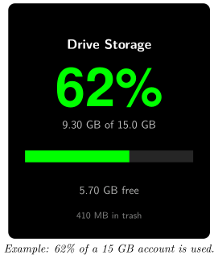
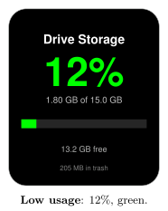
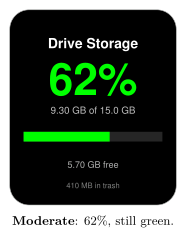
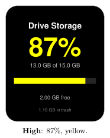
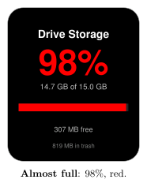
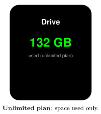
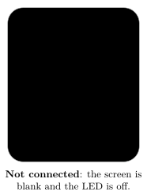

*Keep an eye on how full your Google storage is*

:::info[PDF version]
This guide is also available as a [PDF](pathname:///pdf/GoogleDrive_UserGuide.pdf).
:::

## Overview

The **Google Drive Storage** plugin shows how much of your Google storage you have used. Your Busy Tag shows:

- the percentage of your storage that is used, in large numbers,
- how much is used and how big your storage is (for example *9.30 GB of 15.0 GB*),
- a progress bar and how much space is left,
- how much space files in your Drive trash take up, when that is more than 1% of your storage.

The numbers and the LED are **green** while there is plenty of space, **yellow** when storage is getting full and **red** when it is almost full. You choose the limits and the colours.

:::note
Google storage is shared between Google Drive, Gmail and Google Photos. The plugin shows the total for your whole account, the same number Google shows on its storage page.
:::

## Requirements

- The **Busy Tag app** on Windows, macOS, Android or iOS.
- A Busy Tag device added to the app.
- A **Google account**. Personal accounts and Google Workspace accounts both work, unless your Workspace administrator blocks third-party apps.
- An internet connection.

:::note
The plugin checks your storage only while the Busy Tag app is open and the plugin is showing on your device. It does not run in the background when the app is closed.
:::

## Adding the Plugin in Busy Tag

1.  Open the Busy Tag app and select your device.
2.  Go to **Integrations** in the navigation menu.
3.  Open the **Add Integrations** tab.
4.  Find **Google Drive Storage**. You can type “Drive” in the search box. Click **Add**.
5.  In the **Add Plugin** window, keep the suggested name or enter your own. Confirm.
6.  The plugin now appears in the **My Integrations** tab, and its configuration page opens automatically.

:::tip
Each copy of the plugin has its own Google sign-in. To watch two Google accounts, add the plugin twice and sign each copy in to a different account.
:::

## Connecting Your Google Account

Sign in from the plugin’s configuration page. If you closed it, click the **More Options** button (**…**) next to the plugin in **My Integrations** and choose **Configure**.

1.  In the **Account** section, click **Connect to Google**. The button changes to *Connecting…*
2.  Google’s sign-in page opens:

    - **Windows and macOS:** in a browser panel inside the Busy Tag app.

    - **Android:** in your phone’s web browser.

    - **iPhone and iPad:** in a secure sign-in window on top of the app.

3.  Choose your Google account and sign in.
4.  Google lists what Busy Tag is asking for: access to Google Drive files that Busy Tag itself creates or opens (it creates none), and your email address and basic profile. Click **Continue** (or **Allow**).
5.  The sign-in page closes and you return to Busy Tag. A *Connected to Google* message appears, and the **Account** section shows *Connected as: your.name@gmail.com*.

Google asks you to approve the permissions every time you connect. This is normal.

You stay signed in after that. The plugin renews its access to Google on its own, so you do not need to sign in again unless you sign out or remove Busy Tag’s access in your Google account.

:::note
**Sign out:** on the configuration page (or in the **Open** panel), click **Sign out**. The plugin forgets your sign-in. If the plugin is showing on your device, the screen goes black and the LED turns off.
:::

## Configuring the Plugin

A preview next to the form shows how the screen and LED will look. Use **Preview shows** at the bottom of the page to try low (12%), moderate (62%), high (87%) and almost full (98%) usage, and an unlimited plan. The preview uses sample numbers, not your real storage. Click **Save** to apply your changes.

| **Setting** | **Default** | **Description** |
|:---|:---|:---|
| Check Drive every | 15 minutes | How often the plugin reads your storage. Choices: 5, 15 or 30 minutes, or 1 hour. Storage changes slowly, so longer intervals are fine. |
| Yellow at | 80% used | When the colour changes to yellow. Choices: 50, 70, 80 or 90%. |
| Red at | 95% used | When the colour changes to red. Choices: 85, 90, 95 or 99%. |
| Plenty of space | `#00FF00` | Colour below the yellow limit. |
| Yellow | `#FFFF00` | Colour from the yellow limit. |
| Red | `#FF0000` | Colour from the red limit. |

The chosen colour is used for the percentage, the progress bar and the LED.

## Using the Plugin

### Show it on your Busy Tag

In **My Integrations**, click the **Activate** button (▶) next to Google Drive Storage. The plugin reads your storage right away and sends the result to your Busy Tag. It then checks again at the interval you chose. The device is only updated when the numbers change.

### Interactive panel

On a computer or tablet, click **Open** to see the plugin in a panel inside the app. (On phones the **Open** button is hidden.) The panel shows:

- the account you are connected as, with a **Sign out** button,
- a live copy of the device screen,
- a status line, for example *62% used* or *Unlimited plan*,
- *Last checked:* and the time of the last successful check.

### Playlist

The plugin can rotate with your other integrations. Open **More Options** (**…**) and use **Include in playlist** and **Duration** to choose whether it is included and how long it stays on screen. Then click **Start Playlist**.

## Reading the Display

| **Element** | **Meaning** |
|:---|:---|
| **62%** | Share of your storage that is used. Below 1% it shows one decimal, for example *0.4%*. |
| **9.30 GB of 15.0 GB** | Space used and total storage of your account. |
| Progress bar | The same percentage as a bar. |
| **5.70 GB free** | Space left. |
| **410 MB in trash** | Space taken by files in your Drive trash. Only shown when it is more than 1% of your storage. Empty the trash to get this space back. |
| Green | Below the yellow limit. |
| Yellow | At or above the yellow limit, below the red limit. |
| Red | At or above the red limit. |

### Unlimited storage

Some Google Workspace accounts have no storage limit. The screen then shows **Drive**, the space used, and *used (unlimited plan)*. There is no percentage or bar, and the colour is always the *Plenty of space* colour.

### Screen examples

These examples use a 15 GB account with the default limits (yellow from 80%, red from 95%).

## Troubleshooting

Error messages appear in the status line of the **Open** panel and as short pop-up messages.

| **Message or problem** | **What to do** |
|:---|:---|
| **Connect to Google** is shown again, or *No valid access token available* | Your sign-in has ended (for example, you removed Busy Tag’s access in your Google account). Click **Connect to Google** and sign in again. |
| Authentication failed: Auth error: access_denied | You clicked **Cancel** on Google’s permission page. Connect again and click **Continue**. |
| Authentication failed: … | The sign-in did not finish. Check your internet connection and try again. |
| 403 Forbidden — … | Google refused the request. For Workspace accounts, your administrator may block third-party Drive access. The plugin stops checking until you fix this and activate it again. |
| Rate limited by Drive | Too many requests. The plugin tries again at the next check. |
| Drive API 5xx | A temporary problem at Google. The plugin tries again at the next check. |
| The number is different from Google’s storage page | The plugin only checks at the interval you chose. Wait for the next check, or deactivate and activate the plugin to check now. |

## Privacy and Security

- The plugin uses Google’s most limited Drive permission. It only gives access to files that Busy Tag itself creates or opens, and Busy Tag creates and opens none. The plugin **cannot see your files**. It only reads your account’s storage numbers.
- It also reads your email address, to show which account is connected.
- Your storage numbers go directly from Google to the Busy Tag app on your device.
- When you sign in, and when the plugin renews its access, the request passes through Busy Tag’s sign-in service (`ig.busytag.com`). This service adds Busy Tag’s app credentials, which Google requires. It does not read your Drive.
- Your sign-in is stored in the app’s secure storage on this device, separately for each copy of the plugin.
- Only the finished image and the LED colour are sent to your Busy Tag device.
- To disconnect, click **Sign out**, or delete the plugin from **My Integrations** (**…** → **Delete**). You can also remove Busy Tag’s access in your Google account under *Security* → *Third-party apps & services*.

Google, Google Drive, Gmail, Google Photos and Google Workspace are trademarks of Google LLC. Busy Tag is not affiliated with or endorsed by Google.
