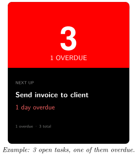
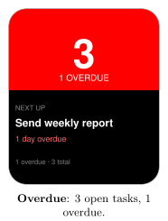
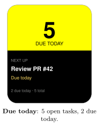
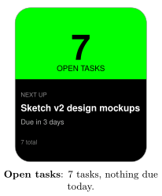
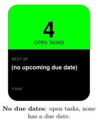
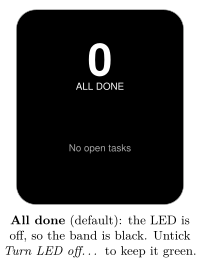
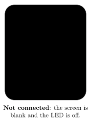

*See how many tasks are open and what is due next, right on your desk*

:::info[PDF version]
This guide is also available as a [PDF](pathname:///pdf/GoogleTasks_UserGuide.pdf).
:::

## Overview

The **Google Tasks** plugin shows your open tasks from Google Tasks on your Busy Tag:

- the number of open tasks, in large numbers,
- how many are overdue or due today,
- the next task with a due date, and when it is due.

The top of the screen and the LED are **red** when a task is overdue, **yellow** when a task is due today and **green** otherwise. When all tasks are done, the LED turns off. You can change all of these colours.

The plugin checks Google Tasks every 2 minutes by default.

## Requirements

- The **Busy Tag app** on Windows, macOS, Android or iOS.
- A Busy Tag device added to the app.
- A **Google account** that uses Google Tasks (for example from Gmail, Google Calendar or the Google Tasks app). Personal accounts and Google Workspace accounts both work, unless your Workspace administrator blocks third-party apps.
- An internet connection.

:::note
The plugin checks your tasks only while the Busy Tag app is open and the plugin is showing on your device. It does not run in the background when the app is closed.
:::

## Adding the Plugin in Busy Tag

1.  Open the Busy Tag app and select your device.
2.  Go to **Integrations** in the navigation menu.
3.  Open the **Add Integrations** tab.
4.  Find **Google Tasks**. You can type “Tasks” in the search box. Click **Add**.
5.  In the **Add Plugin** window, keep the suggested name or enter your own. Confirm.
6.  The plugin now appears in the **My Integrations** tab, and its configuration page opens automatically.

:::tip
Each copy of the plugin has its own Google sign-in. To watch two Google accounts, add the plugin twice and sign each copy in to a different account.
:::

## Connecting Your Google Account

Sign in from the plugin’s configuration page. If you closed it, click the **More Options** button (**…**) next to the plugin in **My Integrations** and choose **Configure**.

1.  In the **Account** section, click **Connect to Google**. The button changes to *Connecting…*
2.  Google’s sign-in page opens:

    - **Windows and macOS:** in a browser panel inside the Busy Tag app.

    - **Android:** in your phone’s web browser.

    - **iPhone and iPad:** in a secure sign-in window on top of the app.

3.  Choose your Google account and sign in.
4.  Google lists what Busy Tag is asking for: *viewing* your tasks, and your email address and basic profile. Click **Continue** (or **Allow**).
5.  The sign-in page closes and you return to Busy Tag. A *Connected to Google* message appears, and the **Account** section shows *Connected as: your.name@gmail.com*.

Google asks you to approve the permissions every time you connect. This is normal.

You stay signed in after that. The plugin renews its access to Google on its own, so you do not need to sign in again unless you sign out or remove Busy Tag’s access in your Google account.

:::note
**Sign out:** on the configuration page (or in the **Open** panel), click **Sign out**. The plugin forgets your sign-in. If the plugin is showing on your device, the screen goes black and the LED turns off.
:::

## Configuring the Plugin

A preview next to the form shows how the screen and LED will look. Use **Preview shows** at the bottom of the page to try four examples: 3 tasks with 1 overdue, 5 tasks with 2 due today, 7 tasks with none due soon, and no open tasks. The preview uses sample tasks, not your real ones. Click **Save** to apply your changes.

[TABLE]

The chosen colour is used for the top part of the screen and for the LED.

## Using the Plugin

### Show it on your Busy Tag

In **My Integrations**, click the **Activate** button (▶) next to Google Tasks. The plugin reads your tasks right away and sends the result to your Busy Tag. It then checks again at the interval you chose. The device is only updated when something changes.

### Interactive panel

On a computer or tablet, click **Open** to see the plugin in a panel inside the app. (On phones the **Open** button is hidden.) The panel shows:

- the account you are connected as, with a **Sign out** button,
- a live copy of the device screen,
- a status line, for example *3 open, 1 overdue* or *All done — no open tasks*,
- *Last checked:* and the time of the last successful check.

### Playlist

The plugin can rotate with your other integrations. Open **More Options** (**…**) and use **Include in playlist** and **Duration** to choose whether it is included and how long it stays on screen. Then click **Start Playlist**.

## Reading the Display

| **Element** | **Meaning** |
|:---|:---|
| Large number | Number of open (not completed) tasks. |
| **1 OVERDUE** / **2 OVERDUE** | How many tasks are past their due date. |
| **DUE TODAY** | At least one task is due today, and none are overdue. |
| **OPEN TASKS** | You have open tasks, but none are overdue or due today. |
| **ALL DONE** | No open tasks. The bottom part shows *No open tasks*. |
| **NEXT UP** | The open task with the earliest due date. If no task has a due date, it shows *(no upcoming due date)*. |
| Due text | When the next task is due: *Due today*, *Due tomorrow*, *Due in 3 days*, a date, or *1 day overdue*. Red text means overdue, yellow text means due today. |
| Bottom line | A summary, for example *1 overdue · 2 due today · 5 total*. |
| Red | At least one task is overdue. |
| Yellow | A task is due today. |
| Green | Open tasks, nothing due today. |
| LED off | No open tasks (when *Turn LED off…* is ticked). |

Google Tasks saves due dates without a time of day. The plugin compares them with today’s date in your own time zone, so a task due today counts as overdue only from tomorrow.

### Screen examples

## Troubleshooting

Error messages appear in the status line of the **Open** panel and as short pop-up messages.

| **Message or problem** | **What to do** |
|:---|:---|
| **Connect to Google** is shown again, or *No valid access token available* | Your sign-in has ended (for example, you removed Busy Tag’s access in your Google account). Click **Connect to Google** and sign in again. |
| Authentication failed: Auth error: access_denied | You clicked **Cancel** on Google’s permission page. Connect again and click **Continue**. |
| Authentication failed: … | The sign-in did not finish. Check your internet connection and try again. |
| 403 Forbidden — … | Google refused the request. For Workspace accounts, your administrator may block third-party access to Google Tasks. The plugin stops checking until you fix this and activate it again. |
| Rate limited by Google | Too many requests. Choose a longer refresh interval. |
| Tasks API 5xx | A temporary problem at Google. The plugin tries again at the next check. |
| A task is missing | The task may be in another list. Choose **All my task lists combined**. Completed tasks are never counted. |

## Privacy and Security

- The plugin asks Google for **read-only** access to your tasks. It cannot add, change, complete or delete tasks.
- It reads the title, due date and status of your open tasks. It also reads your email address, to show which account is connected.
- Your task data goes directly from Google to the Busy Tag app on your device.
- When you sign in, and when the plugin renews its access, the request passes through Busy Tag’s sign-in service (`ig.busytag.com`). This service adds Busy Tag’s app credentials, which Google requires. It does not read your tasks.
- Your sign-in is stored in the app’s secure storage on this device, separately for each copy of the plugin.
- Only the finished image and the LED colour are sent to your Busy Tag device. Anyone who can see your device can read the next task’s title.
- To disconnect, click **Sign out**, or delete the plugin from **My Integrations** (**…** → **Delete**). You can also remove Busy Tag’s access in your Google account under *Security* → *Third-party apps & services*.

Google, Google Tasks and Google Workspace are trademarks of Google LLC. Busy Tag is not affiliated with or endorsed by Google.
