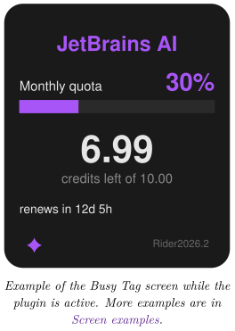
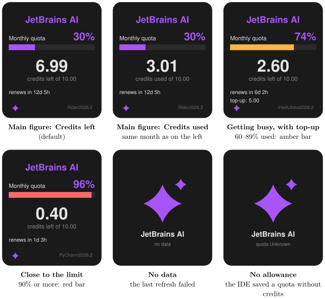

*Show your JetBrains AI Assistant credits on your Busy Tag display*

:::info[PDF version]
This guide is also available as a [PDF](pathname:///pdf/JetBrainsAiUsage_UserGuide.pdf).
:::

## Overview

The **JetBrains AI Usage** plugin shows how many JetBrains AI credits you have used this month. JetBrains IDEs (IntelliJ IDEA, Rider, PyCharm, PhpStorm and others) save your AI Assistant quota in their settings folder. The plugin reads that saved quota and draws it on your Busy Tag screen. It does not need a sign-in and does not connect to the internet. Your Busy Tag shows at a glance:

- how much of your monthly AI quota you have used, as a percentage,
- how many credits are left (or used) out of your monthly allowance,
- how long until your credits are renewed,
- any top-up credits you have bought,
- which IDE the figures came from.

The display refreshes automatically, every 5 minutes by default. You can also turn on the Busy Tag LED in violet while the plugin is active.

## Requirements

- The **Busy Tag desktop app** on **Windows** or **macOS**. The plugin reads files on your computer, so it is not offered in the Android or iOS apps.
- A Busy Tag device added to the app.
- A **JetBrains IDE** with **JetBrains AI Assistant** on the *same computer* as the Busy Tag app, signed in to a JetBrains account that has an AI plan.

:::note
**Developer mode required.** This plugin is still in preview. It only appears in the list when developer mode is on. To turn it on, open **Settings** in the Busy Tag app and tap the app version label 5 times. The app counts down the remaining taps and then confirms *Developer mode is now enabled*. Developer-only plugins show a **Dev** badge.
:::

## Preparing Your IDE

1.  Open your JetBrains IDE and sign in to your JetBrains account, if you have not already.
2.  Open the **AI Assistant** tool window at least once. The IDE then saves your AI quota to its settings folder.

:::tip
**How fresh are the figures?** The IDE updates the saved quota every few minutes while it is open. When all your JetBrains IDEs are closed, the plugin keeps showing the figures from your last IDE session.
:::

If you have several JetBrains IDEs, the plugin checks all of them and shows the most recent figures. The name of the IDE they came from appears in the bottom-right corner of the screen.

## Adding the Plugin in Busy Tag

1.  Turn on developer mode (see [Requirements](#requirements)).
2.  Open the Busy Tag app and select your device.
3.  Go to **Integrations** in the navigation menu.
4.  Open the **Add Integrations** tab.
5.  Find **JetBrains AI Usage**. You can type “JetBrains” in the search box. Click **Add**.
6.  In the **Add Plugin** window, keep the suggested name or enter your own. Confirm.
7.  The plugin now appears in the **My Integrations** tab, and its configuration page opens automatically.

## Configuring the Plugin

The configuration page opens automatically after you add the plugin. To open it again later, click the **More Options** button (**…**) next to the plugin in **My Integrations** and choose **Configure**.

### Folder access (Mac App Store version only)

The Mac App Store version of Busy Tag may only read folders you allow. If you see the message about your JetBrains settings folder, click **Grant access to ~/Library/Application Support/JetBrains**. In the window that appears, make sure the `JetBrains` folder is selected and click **Open**. You only need to do this once. Windows users and other macOS versions do not see this step.

### Quota check

Below that, the plugin reports what it found:

- **AI Assistant quota found in Rider2026.2**: you are ready to go. The name shows which IDE the figures come from.
- **No AI Assistant quota cached yet.**: open the AI Assistant in your IDE once ([Preparing Your IDE](#preparing-your-ide)), then reopen this page.
- **No JetBrains IDE configuration found on this machine.**: no JetBrains IDE has been used by this user on this computer.

### Settings

[TABLE]

A preview next to the form shows how the screen will look with sample data. Click **Save** to apply your changes.

## Using the Plugin

### Show it on your Busy Tag

In **My Integrations**, click the **Activate** button (▶) next to JetBrains AI Usage. The plugin starts right away. It reads the saved quota, sends the image to your Busy Tag and then refreshes at the interval you chose.

### Interactive panel

Click **Open** to see the plugin in a panel inside the app. Below the screen preview, a status line shows what the plugin is doing, for example:

- *Reading IDE quota cache…*
- *Updated 14:32:05 from Rider2026.2*, which means the last refresh succeeded.
- An error message in red if something went wrong (see [Troubleshooting](#troubleshooting)).

### Playlist

The plugin can rotate with your other integrations. Open **More Options** (**…**) and use **Include in playlist** and **Duration** to choose whether it is included and how long it stays on screen. Then click **Start Playlist**.

## Reading the Display

### What each part means

[TABLE]

### Screen examples

The **Main figure** setting switches the large number between credits left and credits used. The percentage and the bar always show the *used* share. The *renews* and *top-up* lines appear only when the IDE reports them.

## Troubleshooting

| **Message** | **What to do** |
|:---|:---|
| No JetBrains IDE configuration found on this machine. | No JetBrains IDE has been used by this user on this computer. Install and open your IDE. |
| No AI Assistant quota cached yet. Open the AI Assistant in your IDE once. | Open the IDE, sign in to your JetBrains account and open the AI Assistant tool window. |
| Quota state in … is “…” (no allowance yet). | The IDE saved a quota without an active allowance, for example because your AI plan is not active. Check your JetBrains AI subscription, then open the AI Assistant again. |
| Busy Tag needs access to … Open this integration’s settings and press “Grant access”. | Mac App Store version only. Open the plugin’s configuration page and click **Grant access** ([Folder access (Mac App Store version only)](#folder-access-mac-app-store-version-only)). |
| Access not granted. Choose the JetBrains folder itself and press Open. | In the folder window, select the `JetBrains` folder itself, not a folder inside it. |
| The figures do not change. | The IDE only updates the saved quota while it is open. Open your IDE to get fresh figures. |

## Privacy and Security

- The plugin can only list your JetBrains settings folders and read one file in each: the AI Assistant quota file (`options/AIAssistantQuotaManager2.xml`). It cannot access any other files on your computer.
- The plugin does not use your JetBrains sign-in and does not connect to the internet.
- The plugin never changes your IDE’s files.
- Only the usage image is sent to your Busy Tag device.
- To stop the plugin, delete it from **My Integrations** (**…** → **Delete**).

JetBrains and the names of JetBrains IDEs are trademarks of JetBrains s.r.o. Busy Tag is not affiliated with or endorsed by JetBrains.
