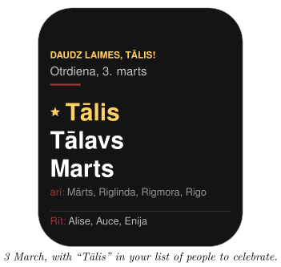
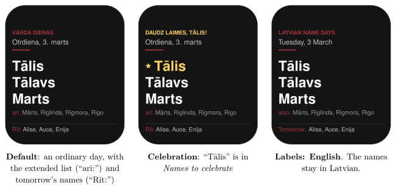
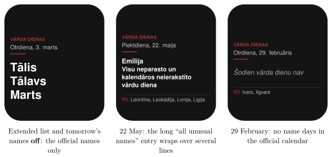
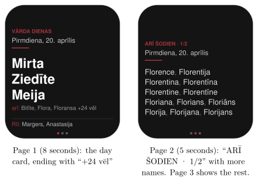

*Show today's Latvian name days on your Busy Tag, and never miss a friend's name day*

:::info[PDF version]
This guide is also available as a [PDF](pathname:///pdf/LatvianNameDays_UserGuide.pdf).
:::

## Overview

In Latvia, almost every day of the year is the *name day* (*vārda diena*) of a few first names. The **Vārda dienas** plugin shows today’s names on your Busy Tag. The names come from the official Latvian name-day calendar.

The plugin can also show:

- the **extended list**: many more names that share the same day,
- **tomorrow’s names**, so you can prepare your greetings,
- a **greeting** when one of *your people* has their name day. The LED can light up too.

The calendar is built into the plugin, so it works offline. The screen updates by itself just after midnight.

## Requirements

- The **Busy Tag app** on Windows, macOS, Android or iOS.
- A Busy Tag device added to the app.

No account and no internet connection are needed.

:::note
**Developer mode required.** Vārda dienas is a preview plugin. It appears in the list only when developer mode is on. To turn it on, open **Settings** and tap the app version label 5 times. The app counts down the remaining taps and then confirms that developer mode is enabled. Developer-only plugins show a **Dev** badge.
:::

## Adding the Plugin in Busy Tag

1.  Open the Busy Tag app and select your device.
2.  Go to **Integrations** in the navigation menu.
3.  Open the **Add Integrations** tab.
4.  Find **Vārda dienas**. You can type “Vārda” in the search box. Click **Add**.
5.  In the **Add Plugin** window, keep the suggested name or enter your own. Confirm.
6.  The plugin now appears in the **My Integrations** tab, and its configuration page opens automatically.

## Configuring the Plugin

The configuration page opens automatically after you add the plugin. To open it again later, click the **More Options** button (**…**) next to the plugin in **My Integrations** and choose **Configure**.

### My people

In **Names to celebrate**, type the first names of the people whose name days you want to remember. Separate the names with commas, for example:

`Anna, Jānis, Līga`

You do not need to type the Latvian letters: “Janis” also matches “Jānis”, and upper or lower case does not matter. Names on the extended list count too, including its Latgalian forms: “Muora” matches “Muora (LTG)”.

### Settings

| **Setting** | **Default** | **Description** |
|:---|:---|:---|
| Names to celebrate | (empty) | Your people, separated by commas (see above). |
| Labels | Latviski | The language of the captions on the screen: *Latviski* (Latvian) or *English*. The names themselves are always in Latvian. |
| Show the extended name list (“arī:”) | On | Adds the names from the extended list for the same day. |
| Show tomorrow’s names | On | Adds a “Rīt:” (“Tomorrow:”) line at the bottom. |
| Accent | `#A4343A` | The colour of the caption, the short line and the “arī:” and “Rīt:” labels. |
| Celebration | `#FFD166` | The colour used for the greeting and for your people’s names. |
| Background | `#141414` | The screen colour. |
| LED | Celebration color only when one of my people has their day | The LED lights in the celebration colour only on your people’s name days and is off on other days. *Accent color always* keeps the LED lit in the accent colour. *Off* turns the LED off. |
| Preview date | Today | Pick any date to see how the screen will look on that day. This only changes the preview, not the device. |

Below the preview date, the page lists the names for that date. If one of your people has their day, their name is shown with a party popper. If the names need more than one screen, the page also says how many frames the device will show. Click **Save** to apply your changes.

## Using the Plugin

### Show it on your Busy Tag

In **My Integrations**, click the **Activate** button (▶) next to Vārda dienas. Today’s names appear on your Busy Tag right away. Just after midnight the plugin updates the screen with the new day’s names.

### Long lists: several pages

Some days have many names on the extended list. When they do not all fit on the screen, the plugin sends a short looping animation instead of a still picture:

- the first page is the day card, shown for 8 seconds;
- each further page lists more names from the extended list, shown for 5 seconds;
- small dots at the bottom of the screen show which page you are on.

### Interactive panel

On a computer or tablet, click **Open** to see the plugin in a panel inside the app. Under the screen preview you see today’s date and the complete lists, each with the number of names: *Today*, the *Extended list* and *Tomorrow* (in Latvian: *Šodien svin*, *Paplašinātais saraksts*, *Rīt svin*). Your people are highlighted. On phones, the **Open** button is hidden.

### Playlist

The plugin can rotate with your other integrations. Open **More Options** (**…**) and use **Include in playlist** and **Duration** to choose whether it is included and how long it stays on screen. Then click **Start Playlist**.

## Screen Examples

All examples below use real calendar data.

### Day card options

### Long extended list: several pages

On 20 April the extended list has 27 more names. They do not fit on the day card, so the device gets a looping animation of three pages. The dots at the bottom show the current page.

## Reading the Display

| **Element (Latviski / English)** | **Meaning** |
|:---|:---|
| VĀRDA DIENAS / LATVIAN NAME DAYS | The caption on an ordinary day. |
| DAUDZ LAIMES, ANNA! / HAPPY NAME DAY, ANNA! | The caption when one of your people has their name day. It is shown in the celebration colour. |
| Ceturtdiena, 5. marts / Thursday, 5 March | Today’s date. |
| Large names | Today’s names from the official calendar. Your people are shown in the celebration colour with a star. |
| arī: / also: | Names from the extended list. |
| +12 vēl / +12 more | More extended names that did not fit. They follow on the next pages. |
| Rīt: / Tomorrow: | Tomorrow’s names from the official calendar. |
| ARĪ ŠODIEN · 1/2 / ALSO TODAY · 1/2 | The caption on the extra pages, with the page number. |
| Dots at the bottom | One dot per page; the current page is in the accent colour. |
| Šodien vārda dienu nav / No name days today | There are no names for today, for example on 29 February. |

:::tip
On 22 May the calendar celebrates “all unusual names and names not in the calendar” (*Visu neparasto un kalendāros neierakstīto vārdu diena*). This long entry wraps over several lines.
:::

## Troubleshooting

| **Problem** | **What to do** |
|:---|:---|
| I cannot find Vārda dienas in **Add Integrations**. | Turn on developer mode (see [Requirements](#requirements)). |
| A friend’s name day was not celebrated. | Check the spelling in **Names to celebrate** and that the names are separated by commas. The name must be in the official calendar or the extended list. Use **Preview date** to check the day. |
| The LED is off. | With the default LED setting, the LED lights only on your people’s name days. Choose *Accent color always* to keep it lit. |
| The names did not change at midnight. | The app must be running. If the computer was asleep, the names update a short while after it wakes up. Click **Activate** again to update at once. |
| Not all extended names are on the screen. | Wait for the next pages, or click **Open** to see the complete list. |

## Privacy and Data Source

The plugin works offline. It does not connect to any online service and does not read any files. Your list of people is saved with the plugin’s settings in the app. Only the screen image is sent to your Busy Tag device.

The name-day data comes from the State Language Centre of Latvia (*Valsts valodas centrs*), published on the Latvian open data portal (<https://data.gov.lv>) under the CC0 licence. The copy built into the plugin is from the dataset last updated on 16 March 2026.
