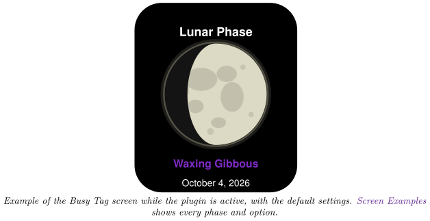
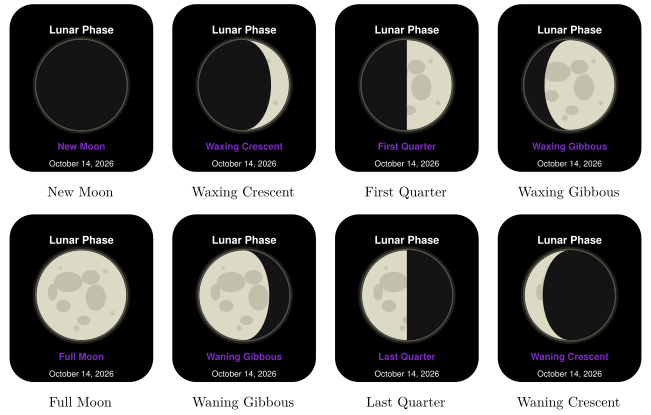
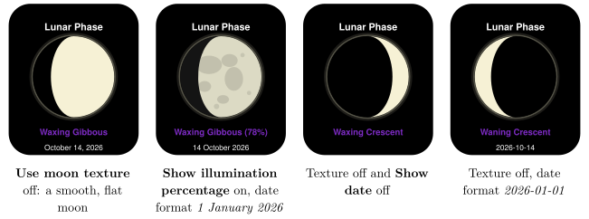
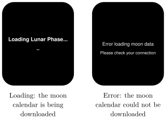

*Show today's moon phase on your Busy Tag display*

:::info[PDF version]
This guide is also available as a [PDF](pathname:///pdf/LunarPhase_UserGuide.pdf).
:::

## Overview

The **Lunar Phase** plugin shows today’s moon on your Busy Tag screen. You see:

- a picture of the moon, lit the way it looks tonight,
- the name of the phase, for example *Waxing Gibbous*,
- optionally, how much of the moon is lit, in percent,
- optionally, today’s date.

The plugin needs no account, sign-in or location. It updates itself shortly after midnight, so the screen always shows the current day. It also lights the Busy Tag LED in a warm moon yellow. You can change that colour.

## Screen Examples

### The eight phases

These are the screens you will see over one moon cycle, with the default settings (moon texture on, no percentage, date as *October 14, 2026*). The moon is drawn as seen from the Northern Hemisphere, so a growing (waxing) moon is lit on the right.

### Display options

### Status screens

## Requirements

- The **Busy Tag app** on Windows, macOS, Android or iOS.
- A Busy Tag device added to the app.
- An internet connection. The plugin downloads a moon calendar for the current month.

No account, API key or sign-in is needed.

## Adding the Plugin in Busy Tag

1.  Open the Busy Tag app and select your device.
2.  Go to **Integrations** in the navigation menu.
3.  Open the **Add Integrations** tab.
4.  Find **Lunar Phase**. You can type “Moon” or “Lunar” in the search box. Click **Add**.
5.  In the **Add Plugin** window, keep the suggested name or enter your own. Confirm.
6.  The plugin now appears in the **My Integrations** tab, and its configuration page opens automatically.

## Configuring the Plugin

The configuration page opens automatically after you add the plugin. To open it again later, click the **More Options** button (**…**) next to the plugin in **My Integrations** and choose **Configure**. A preview next to the form shows today’s moon with your settings. Click **Save** to apply your changes.

### Display

| **Setting** | **Default** | **Description** |
|:---|:---|:---|
| Show date | On | Show today’s date at the bottom of the screen. |
| Date format | October 4, 2026 | How the date is written. Only shown when **Show date** is on. See the table below. |
| Show illumination percentage | Off | Add how much of the moon is lit after the phase name, for example *Waxing Gibbous (78%)*. |
| Use moon texture | On | Draw the moon with a realistic surface (craters and “seas”). Turn it off for a smooth, flat moon. |

##### Date formats.

| **Option**         | **Example on screen**    |
|:-------------------|:-------------------------|
| January 1, 2026    | October 4, 2026          |
| 1 January 2026     | 4 October 2026           |
| 01/01/2026         | 10/04/2026 (month first) |
| 01/01/2026 (DD/MM) | 04/10/2026 (day first)   |
| 2026-01-01         | 2026-10-04               |

### Colours

| **Setting** | **Default** | **Description** |
|:---|:---|:---|
| Background | `#000000` | Screen background colour. |
| Text | `#FFFFFF` | Colour of the *Lunar Phase* title and the date. |
| Accent | `#7D2BC4` | Colour of the phase name. |
| Light side | `#F6F1D5` | Colour of the lit part of the moon. |
| Dark side | `#000000` | Colour of the part of the moon in shadow. |
| Glow | `#A8A48C` | Colour of the soft glow around the moon’s edge. |
| LED | `#FEC939` | The colour the Busy Tag LED shows while the plugin is active. Choose black to keep the LED dark. |

:::tip
For a moon that stands out from the background, keep **Dark side** slightly lighter than **Background**, for example a very dark grey (`#202020`) on black. The outline of the whole moon then stays visible even on a thin crescent.
:::

## Using the Plugin

### Show it on your Busy Tag

In **My Integrations**, click the **Activate** button (▶) next to Lunar Phase. The plugin draws today’s moon and sends it to your Busy Tag. After that it updates by itself:

- a few seconds after midnight, when the date changes,
- every 6 hours (every 30 minutes after a failed download, until it works again),
- whenever you save new settings.

### Interactive panel

On a computer or tablet, click **Open** to see the current screen in a panel inside the app. (The **Open** button is hidden on phones.)

### Playlist

The plugin can rotate with your other integrations. Open **More Options** (**…**) and use **Include in playlist** and **Duration** to choose whether it is included and how long it stays on screen. Then click **Start Playlist**.

## Reading the Display

The moon goes through all its phases in about 29.5 days. The phase name tells you where in that cycle the moon is today:

| **Phase name** | **What it means** |
|:---|:---|
| New Moon | The moon is between the Earth and the Sun. It is (almost) invisible. |
| Waxing Crescent | A thin sliver, lit on the right, growing night by night. |
| First Quarter | The right half of the moon is lit. |
| Waxing Gibbous | More than half is lit, still growing. |
| Full Moon | The whole moon is lit. |
| Waning Gibbous | More than half is lit, now shrinking. |
| Last Quarter | The left half of the moon is lit. |
| Waning Crescent | A thin sliver, lit on the left, shrinking towards the next new moon. |

The picture shows the moon as seen from the Northern Hemisphere: a growing (waxing) moon is lit on the right. In the Southern Hemisphere the moon looks mirrored, so the lit side is on the left.

The optional percentage is the share of the moon’s face that is lit: 0% at new moon, 50% at the quarters and 100% at full moon. The phase and date follow the date on your computer or phone.

## Troubleshooting

| **What you see** | **What to do** |
|:---|:---|
| *Error loading moon data – Please check your connection* | The plugin could not download the moon calendar. Check your internet connection. The plugin tries again every 30 minutes until it works, or right away when you activate it again. |
| *Loading Lunar Phase…* stays on screen. | The download is still running or has stalled. Check your internet connection. |
| The date or phase is a day off. | Check that the date and time zone on your computer or phone are correct. |
| The lit side is on the “wrong” side. | You are probably in the Southern Hemisphere. The picture always shows the Northern Hemisphere view (see [Reading the Display](#reading-the-display)). |

## Privacy

- The plugin does not use your location or any personal data.
- The plugin downloads the current month’s moon calendar from a public moon-phase service (`icalendar37.net`). Only the month and year are sent.
- The moon texture is built into the plugin. Nothing else is downloaded.
- To stop the plugin, delete it from **My Integrations** (**…** → **Delete**).
