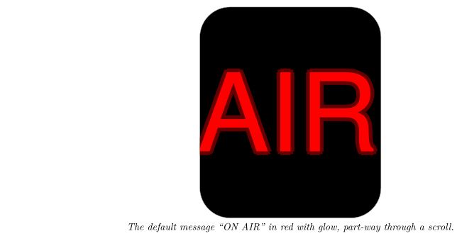

*Scroll a short message, like "ON AIR", across your Busy Tag display*

:::info[PDF version]
This guide is also available as a [PDF](pathname:///pdf/Marquee_UserGuide.pdf).
:::

## Overview

The **Marquee Text** plugin scrolls a short message across your Busy Tag screen, from right to left, like a news ticker or an “On Air” sign. You choose the text, the font, the size, the speed and the colours. You can also add a soft glow around the letters.

When you activate the plugin, the app builds the scrolling animation once and sends it to your Busy Tag. The device then plays it in a loop on its own, without stopping.

## Requirements

- The **Busy Tag app** on Windows, macOS, Android or iOS.
- A Busy Tag device added to the app.

No account and no internet connection are needed. The plugin makes the animation on your computer or phone and sends it only to your Busy Tag.

## Adding the Plugin in Busy Tag

1.  Open the Busy Tag app and select your device.
2.  Go to **Integrations** in the navigation menu.
3.  Open the **Add Integrations** tab.
4.  Find **Marquee Text**. You can type “Marquee” in the search box. Click **Add**.
5.  In the **Add Plugin** window, keep the suggested name or enter your own (for example “On air sign”). Confirm.
6.  The plugin now appears in the **My Integrations** tab, and its configuration page opens automatically.

:::tip
You can add the plugin more than once, for example one copy saying “ON AIR” and one saying “LUNCH”. Give each copy its own name so you can tell them apart.
:::

## Configuring the Plugin

The configuration page opens automatically after you add the plugin. To open it again later, click the **More Options** button (**…**) next to the plugin in **My Integrations** and choose **Configure**.

**Text**

| **Setting** | **Default** | **Description** |
|:---|:---|:---|
| Message | ON AIR | The text to scroll. Up to **20 characters**. |
| Font | Arial | Arial, Times New Roman, Verdana, Georgia, Courier New, Tahoma, Impact or Comic Sans MS. |

**Motion**

| **Setting** | **Default** | **Description** |
|:---|:---|:---|
| Font size | 144 px | From 24 to 216 pixels. Text that would be too tall for the screen is made smaller automatically (see [How the Text Is Shown](#how-the-text-is-shown)). |
| Speed | 3 | From 1 (slowest) to 5 (fastest). |
| Glow effect | On | Draws a soft halo around the letters in the glow colour. |

**Colors**

| **Setting** | **Default** | **Description** |
|:---|:---|:---|
| Background | `#000000` | The screen colour behind the text. |
| Text | `#FF0000` | The colour of the letters. |
| Glow | `#FF0000` | The colour of the halo, when glow is on. |
| LED | `#7D2BC4` | The colour of the Busy Tag LED while the plugin is shown. |

A preview next to the form shows your text, centred, with the chosen font and colours. It uses the same size as the device: if the text is too tall for the screen, the preview shows it smaller too (see [How the Text Is Shown](#how-the-text-is-shown)). The preview does not move. While you pick an LED colour, the LED preview shows it too. Click **Save** to apply your changes.

## Using the Plugin

### Show it on your Busy Tag

In **My Integrations**, click the **Activate** button (▶) next to Marquee Text. The app prepares the animation (this can take a moment) and sends it to your Busy Tag. The text starts scrolling and the LED changes to the LED colour you chose.

The animation keeps looping on the device. When you change and save the settings while the plugin is active, the new animation is sent right away.

### Interactive panel

On a computer or tablet, click **Open** to see the plugin in a panel inside the app. While the plugin is active, the panel plays the same scrolling animation as your Busy Tag, at the same speed. When the plugin is not active, the panel shows your message standing still in the middle. On phones, the **Open** button is hidden.

### Playlist

The plugin can rotate with your other integrations. Open **More Options** (**…**) and use **Include in playlist** and **Duration** to choose whether it is included and how long it stays on screen. Then click **Start Playlist**.

## Screen Examples

### One pass of the scroll

The default message, “ON AIR” in red with glow, at three moments of one pass. The text comes in from the right and leaves on the left, then the pass starts again.

### Looks you can choose

## How the Text Is Shown

- **Direction.** Each pass starts with the text just outside the right edge and ends when the last letter has left the screen on the left. Then the next pass begins.
- **Speed.** Speed 1 moves the text about 60 pixels per second; speed 5 about 300 pixels per second. The screen is 240 pixels wide.
- **Size.** The text is centred between the top status bar and the bottom edge of the screen. If the chosen font size would make the letters (and their glow) reach the status bar or the rounded corners, the plugin makes the text smaller until it fits. Letters with tails, such as “g” or “y”, make the text a bit taller and may cause this.
- **Long messages.** One pass is limited to 120 animation frames. With long messages, large fonts or low speeds, the text moves in bigger steps so that it still fits in 120 frames. The speed stays the same, but the movement looks less smooth.

## Troubleshooting

| **Problem** | **What to do** |
|:---|:---|
| I cannot type more text. | The message is limited to 20 characters. Use a shorter message. |
| The text is smaller than the font size I chose. | The text was too tall for the screen and was made smaller automatically. Choose a smaller size, turn off the glow, or avoid letters with tails. |
| The scrolling looks jerky. | The message is long for the chosen size and speed. Use a shorter message, a smaller font size or a higher speed. |
| The font looks different from the one I chose. | That font is not installed on this computer or phone, so a similar font is used instead. Fonts such as Impact or Comic Sans MS are often missing on phones. |
| Nothing changes on the Busy Tag. | Check that the device is connected in the app, then click **Activate** again. |

## Privacy

The Marquee Text plugin works offline. It does not connect to any online service and does not read any files. Your message is sent only to your Busy Tag device.
