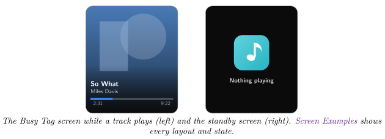
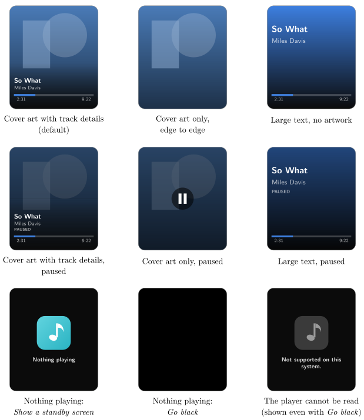

*Show the music playing on your computer, with its cover art, on your Busy Tag*

:::info[PDF version]
This guide is also available as a [PDF](pathname:///pdf/NowPlaying_UserGuide.pdf).
:::

## Overview

The **Now Playing** plugin shows the track that is playing on your computer: the cover art, the title, the artist and a progress bar. It reads the music player on your computer directly, so you do not need to sign in to any music service.

- On **Windows** it follows any app that reports what it plays to Windows, for example Spotify, Apple Music, iTunes or a web browser.
- On **macOS** it follows Apple Music, and in most cases Spotify and web browsers too (see [Setting Up on macOS](#setting-up-on-macos)).

The Busy Tag LED can take on the main colour of the cover art. When the music is paused, the screen dims. When nothing is playing, a standby screen is shown.

## Requirements

- The **Busy Tag desktop app** on **Windows** or **macOS**. The plugin is not offered in the Android or iOS apps.
- A Busy Tag device added to the app.
- A music or video player on the same computer.

No account, sign-in or API key is needed.

:::note
**Developer mode required.** Now Playing is still a preview plugin. It only appears in **Add Integrations** when developer mode is on. To turn it on, open **Settings** and tap the app version label 5 times. The app counts down the remaining taps and then confirms *Developer mode is now enabled*. Developer-only plugins show a **Dev** badge.
:::

## Adding the Plugin in Busy Tag

1.  Open the Busy Tag app and select your device.
2.  Go to **Integrations** in the navigation menu.
3.  Open the **Add Integrations** tab.
4.  Find **Now Playing**. You can type “Now Playing” in the search box. Click **Add**.
5.  In the **Add Plugin** window, keep the suggested name or enter your own. Confirm.
6.  The plugin now appears in the **My Integrations** tab, and its configuration page opens automatically.

## Setting Up on macOS

Skip this section on Windows. There is nothing to set up there.

### Allow Busy Tag to read Apple Music and Spotify

On a Mac, Busy Tag asks Apple Music (and Spotify) what is playing. The first time it does this, macOS asks whether *Busy Tag* may control *Music* (or *Spotify*). Click **Allow**. If you clicked **Don’t Allow** by mistake, turn it on again in **System Settings** → **Privacy & Security** → **Automation** → **Busy Tag**.

The plugin only reads a player while that player is open. It never starts a player by itself.

### Which player to follow

On macOS the configuration page has a **Which player to follow** setting:

- **Whatever is playing on this computer** (default): Apple Music, Spotify, web browsers and other apps, where macOS allows it.
- **Apple Music only**: ignores everything else, including Spotify.

:::tip
In the **Mac App Store** version of Busy Tag, Apple’s rules only let the app read Apple Music. Spotify and web browsers are only available in the version downloaded from the Busy Tag website.
:::

## Configuring the Plugin

The configuration page opens automatically after you add the plugin. To open it again later, click the **More Options** button (**…**) next to the plugin in **My Integrations** and choose **Configure**. If something is playing, the preview shows your real track, so you can check that the plugin can read your player. If it cannot, a *Can’t read the player* notice explains why.

| **Setting** | **Default** | **Description** |
|:---|:---|:---|
| Layout | Cover art with track details | *Cover art with track details*: art fills the screen, with title, artist and progress at the bottom. *Cover art only, edge to edge*: no text. *Large text, no artwork*: big title and artist on a coloured background. |
| Show a progress bar and track times | On | Shows a progress bar with elapsed and total time. Not shown in the *Cover art only* layout. |
| Dim the screen while playback is paused | On | Darkens the screen and shows *PAUSED* (or a pause symbol) while the music is paused. |
| When nothing is playing | Show a standby screen | *Show a standby screen* shows a music note and “Nothing playing”. *Go black* turns the screen black. |
| LED colour | Match the cover art | *Match the cover art* uses the main colour of the cover. *Always the same colour* uses *Fixed colour*. *Off* leaves the LED as it is. |
| Fixed colour | `#2DB5C4` | The LED colour for *Always the same colour*. Also used when a track has no cover art. |
| Check the player every | 5 seconds | How often the plugin asks the player what is playing: 2, 5, 10 or 30 seconds. |
| Redraw the device while a track plays | Only when the track changes | See below. |

### Redrawing while a track plays

Every redraw sends a whole new picture to your Busy Tag. By default, the screen is only updated when the track changes, when it is paused or resumed, or when the cover art changes. The progress bar then stays where it was when the track started. You can choose:

- **Only when the track changes (recommended)**.
- **Also every 30 seconds** or **Also every 10 seconds**: the progress bar moves in steps.
- **Animate the progress bar (one upload a minute)**: sends a short animation that moves the progress bar and time every second, for about a minute at a time. When paused, a still picture is sent. This needs the progress bar turned on and does not work in the *Cover art only* layout.

Click **Save** to apply your changes.

## Screen Examples

The first two rows show each **Layout** while a track plays and while it is paused (with **Dim the screen while playback is paused** on). The cover art here is a stand-in; your Busy Tag shows the real cover of the track. In the *Large text* layout the background fades from the cover’s main colour to black.

When **Which player to follow** is set to Apple Music only, the standby screen says *Apple Music isn’t playing*. The grey error screen shows the reason the player could not be read, for example *Not supported on this system.*

## Using the Plugin

### Show it on your Busy Tag

In **My Integrations**, click the **Activate** button (▶) next to Now Playing. Start some music. The track appears on your Busy Tag within a few seconds.

### Interactive panel

Click **Open** to see the plugin in a panel inside the app. It shows a live copy of the Busy Tag screen and a status line, for example *Playing · So What · Spotify* or *Nothing playing · checked 14:32:05*. If the player cannot be read, the reason is shown here.

### Playlist

The plugin can rotate with your other integrations. Open **More Options** (**…**) and use **Include in playlist** and **Duration** to choose whether it is included and how long it stays on screen. Then click **Start Playlist**.

## Troubleshooting

| **Problem or message** | **What to do** |
|:---|:---|
| Now Playing is not in **Add Integrations**. | Turn on developer mode (see [Requirements](#requirements)). |
| Busy Tag isn’t allowed to read Apple Music (or Spotify). Turn it on in System Settings … | macOS is blocking access. Turn on **Busy Tag** under **System Settings** → **Privacy & Security** → **Automation**. |
| The screen says “Nothing playing” while music plays. | Make sure the music is actually playing, not paused at the start. On macOS, check **Which player to follow** and see the tip in [Setting Up on macOS](#setting-up-on-macos). On Windows, the player must report what it plays to Windows. Most players do this. |
| Apple Music isn’t playing | You chose **Apple Music only** on macOS, and Apple Music is not playing. |
| This version of the Busy Tag app does not provide the now playing bridge. | Update the Busy Tag app to the latest version. |
| The cover art is missing. | Some players do not share cover art, or share it in a format that cannot be shown. A coloured background is used instead. |
| The progress bar does not move. | This is the default. Choose another option under **Redraw the device while a track plays**. |

## Privacy

- The plugin only reads what is playing: the title, artist, album, position and cover art. It does not need an account or a password.
- The track information stays on your computer. Only the picture and LED colour are sent to your Busy Tag device.
- On macOS, Spotify only shares a web link to its cover art, so the app downloads the cover from Spotify. No other data leaves your computer.

Apple Music and iTunes are trademarks of Apple Inc. Spotify is a trademark of Spotify AB. Busy Tag is not affiliated with or endorsed by Apple or Spotify.
