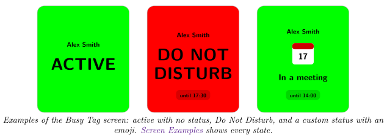
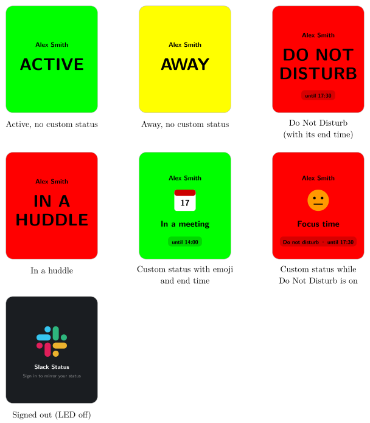

*Mirror your Slack status, presence, Do Not Disturb and huddles on your Busy Tag*

:::info[PDF version]
This guide is also available as a [PDF](pathname:///pdf/SlackStatus_UserGuide.pdf).
:::

## Overview

The **Slack Status** plugin shows your Slack state on your Busy Tag. It checks Slack every 15 seconds (you can change this) and shows:

- your Slack display name,
- your custom status, with its emoji and text (for example “In a meeting”),
- whether you are **active**, **away**, in **Do Not Disturb** or in a **huddle**,
- when your status or Do Not Disturb ends.

The whole screen is filled with the colour of your state, and the Busy Tag LED lights in the same colour.

## Requirements

- The **Busy Tag app** on Windows, macOS, Android or iOS.
- A Busy Tag device added to the app.
- A **Slack account** in the workspace you want to mirror.
- An internet connection.

:::note
**Developer mode required.** Slack Status is still a preview plugin. It only appears in **Add Integrations** when developer mode is on. To turn it on, open **Settings** and tap the app version label 5 times. The app counts down the remaining taps and then confirms *Developer mode is now enabled*. Developer-only plugins show a **Dev** badge.
:::

## Adding the Plugin in Busy Tag

1.  Open the Busy Tag app and select your device.
2.  Go to **Integrations** in the navigation menu.
3.  Open the **Add Integrations** tab.
4.  Find **Slack Status**. You can type “Slack” in the search box. Click **Add**.
5.  In the **Add Plugin** window, keep the suggested name or enter your own. Confirm.
6.  The plugin now appears in the **My Integrations** tab, and its configuration page opens automatically.

## Connecting Your Slack Workspace

Connect Slack from the configuration page. To open it later, click the **More Options** button (**…**) next to the plugin in **My Integrations** and choose **Configure**. There are two ways to connect. Most people should use the first one.

### Option 1: Sign in with Slack

1.  In the **Account** section, click **Sign in with Slack**.
2.  Slack’s sign-in page opens:

    - on **Windows and macOS**, in a panel inside the Busy Tag app,

    - on **Android**, in your web browser,

    - on **iOS**, in a sign-in window on top of the app.

3.  Sign in to Slack and choose your workspace.
4.  Slack lists what the app may see: your status, presence and Do Not Disturb settings. Click **Allow**.
5.  You return to the Busy Tag app. The page shows *Connected to Slack* and *Connected as:* your name and workspace.
6.  Click **Save**.

:::tip
Some workspaces only allow apps that an administrator has approved. If Slack asks you to request approval, ask your workspace admin, or use Option 2 if your workspace lets you create apps.
:::

### Option 2: Paste a User OAuth Token

Use this if you prefer your own Slack app. You need a Slack *User OAuth Token*, which starts with `xoxp-`.

1.  Click **Open api.slack.com/apps** and create a Slack app for your workspace.
2.  Under *User Token Scopes*, add these three scopes: `users.profile:read`, `users:read` and `dnd:read`.
3.  Install the app to your workspace and copy the *User OAuth Token*.
4.  Back in Busy Tag, paste it into **User OAuth Token** and click **Connect with token**.
5.  The page shows *Connected as* your name. Click **Save**.

### Signing out

Click **Sign out** in the **Account** section, then **Save**. The app forgets your Slack connection. While you are signed out, the Busy Tag shows the Slack logo with *Sign in to mirror your status*, and the LED is off.

## Configuring the Plugin

| **Setting** | **Default** | **Description** |
|:---|:---|:---|
| Check Slack every | 15 seconds | How often the plugin asks Slack for your state. Choices: 5, 10, 15 or 30 seconds, 1 minute or 5 minutes. |
| Active | Green | Screen and LED colour when you are active. |
| Away | Yellow | Screen and LED colour when you are away. |
| Do not disturb | Red | Screen and LED colour while Do Not Disturb is on. |
| In a huddle | Red | Screen and LED colour while you are in a huddle. |
| Text | Black | Colour of all text on the screen. |
| Turn the LED off… | Off | When ticked, the LED is off while you are active and have no custom status. The screen is still shown. |

Use **Preview shows** to see how each state looks: a custom status, Do Not Disturb, a huddle, away, or active. Click **Save** to apply your changes.

## Using the Plugin

### Show it on your Busy Tag

In **My Integrations**, click the **Activate** button (▶) next to Slack Status. The plugin reads your Slack state right away and then checks at the interval you chose. The screen is only uploaded again when something you can see changes.

### Interactive panel

On a computer or tablet, click **Open** to see the plugin in a panel inside the app. (The **Open** button is hidden on phones.) It shows who you are connected as, a live copy of the Busy Tag screen, your current state and status, and when Slack was last checked.

### Playlist

The plugin can rotate with your other integrations. Open **More Options** (**…**) and use **Include in playlist** and **Duration** to choose whether it is included and how long it stays on screen. Then click **Start Playlist**.

## Screen Examples

These are the screens the plugin shows, with the default colours. Without a custom status, your state is written in large letters. With a custom status, its emoji and text take that place and the badge at the bottom names your state. The emoji is the one you chose in Slack; the pictures below are only stand-ins.

## Reading the Display

When more than one state applies, the plugin shows the most important one, in this order: **huddle**, then **Do Not Disturb**, then **away**, then **active**.

| **Element** | **Meaning** |
|:---|:---|
| Background colour | Your state: active, away, Do Not Disturb or huddle. |
| Name at the top | Your Slack display name. |
| Large word (ACTIVE, AWAY, …) | You have no custom status, so your state is shown in large letters. |
| Emoji and status text | Your custom status. Common Slack emoji are shown as pictures. Custom workspace emoji are left out, and only the text is shown. |
| Badge at the bottom | When a custom status is set, the badge names your state (for example *Do not disturb*). It also shows when your status or Do Not Disturb ends, for example *until 17:30*. |
| Slack logo, LED off | You are signed out, or your sign-in is no longer valid. |

## Troubleshooting

| **Problem or message** | **What to do** |
|:---|:---|
| Slack Status is not in **Add Integrations**. | Turn on developer mode (see [Requirements](#requirements)). |
| Sign-in failed: … / Authentication failed: … | The sign-in did not finish. Click **Sign in with Slack** again. |
| Token exchange failed: … | Slack or the Busy Tag sign-in service did not accept the sign-in. Try again, or use a User OAuth Token (Option 2). |
| Could not connect: That does not look like a Slack user token… | The pasted text is not a user token. Copy the *User OAuth Token* (it starts with `xoxp-`), not the bot token or app secret. |
| Slack session is no longer valid. Please sign in again. | Your sign-in was revoked or expired. Connect again from the configuration page. |
| … missing_scope - the token lacks … | Your own Slack app is missing a scope. Add `users.profile:read`, `users:read` and `dnd:read` as *User Token Scopes*, reinstall the app and paste the new token. |
| Slack error: Rate limited by Slack | The plugin checked too often. Choose a longer interval. |

## Privacy and Security

- The plugin can only *read* your own profile status, presence and Do Not Disturb settings. It cannot read or send messages, and it cannot change your status.
- You enter your password on Slack’s own page. Busy Tag never sees it.
- With **Sign in with Slack**, Slack sends a one-time code back through a Busy Tag page (`ig.busytag.com`). A Busy Tag server exchanges it with Slack for your access token, because Slack requires the app’s secret for this step. The token is then returned to the app.
- With your own token (Option 2), the token is only ever sent to `slack.com`.
- Your Slack connection is stored encrypted on this device. All status checks go directly from the app to `slack.com`.
- Only the status image and LED colour are sent to your Busy Tag device.
- To remove access, click **Sign out**, or delete the plugin from **My Integrations** (**…** → **Delete**). You can also remove the app from your Slack workspace settings.

Slack is a trademark of Slack Technologies, LLC. Busy Tag is not affiliated with or endorsed by Slack.
