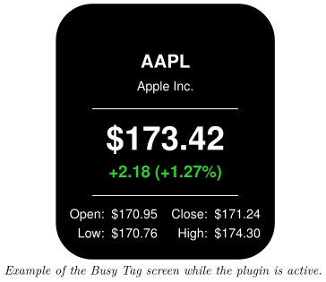
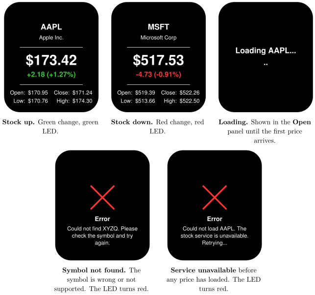

*Follow one stock's price and daily change on your Busy Tag display*

:::info[PDF version]
This guide is also available as a [PDF](pathname:///pdf/StockPrice_UserGuide.pdf).
:::

## Overview

The **Stock Price** plugin follows one stock (ticker symbol) and shows its price on your Busy Tag. Your Busy Tag shows at a glance:

- the ticker symbol and the company name,
- the current share price,
- the change since the previous close, in money and in percent,
- today’s open, low and high, and the previous close.

The price refreshes automatically, every 5 minutes by default. The Busy Tag LED turns **green** when the stock is up and **red** when it is down. No account or sign-in is needed.

## Requirements

- The Busy Tag app on **Windows**, **macOS**, **Android** or **iOS**.
- A Busy Tag device added to the app.
- An internet connection.
- The **ticker symbol** of the stock you want to follow, for example `AAPL` for Apple or `MSFT` for Microsoft.

You do not need a brokerage account or any other sign-in.

## Adding the Plugin in Busy Tag

1.  Open the Busy Tag app and select your device.
2.  Go to **Integrations** in the navigation menu.
3.  Open the **Add Integrations** tab.
4.  Find **Stock Price**. You can type “Stock” in the search box. Click **Add**.
5.  In the **Add Plugin** window, keep the suggested name or enter your own (for example “Apple shares”). Confirm.
6.  The plugin now appears in the **My Integrations** tab, and its configuration page opens automatically.

:::tip
Each copy of the plugin follows one stock. To follow several stocks, add the plugin several times, give each copy its own name and symbol, and put them in a playlist (see [Playlist](#playlist)).
:::

## Configuring the Plugin

The configuration page opens automatically after you add the plugin. To open it again later, click the **More Options** button (**…**) next to the plugin in **My Integrations** and choose **Configure**.

| **Setting** | **Default** | **Description** |
|:---|:---|:---|
| Symbol | AAPL | The ticker symbol to follow. Type it in, or click one of the quick buttons: AAPL, MSFT, GOOGL, AMZN, TSLA, META, NVDA or BRK.B. Lower-case letters are changed to capitals for you. |
| Refresh | Every 5 minutes | How often the plugin fetches a new price. Choices: every 1, 2, 5, 10, 15 or 30 minutes, or every hour. |

The colours on the screen and the LED are fixed and cannot be changed.

The preview next to the form updates as you type. If the symbol is not recognised, the preview shows a red **X** with a message such as *Could not find XYZ. Please check the symbol.* If the price service cannot be reached, it shows *Could not load XYZ. The stock service is unavailable.* instead. Click **Save** to apply your changes.

## Using the Plugin

### Show it on your Busy Tag

In **My Integrations**, click the **Activate** button (▶) next to Stock Price. The plugin fetches the price right away, sends the image to your Busy Tag and sets the LED. It then refreshes at the interval you chose.

### Interactive panel

On a computer or tablet, click **Open** to see the plugin screen in a panel inside the app. The **Open** button is hidden on phones.

### Playlist

The plugin can rotate with your other integrations. Open **More Options** (**…**) and use **Include in playlist** and **Duration** to choose whether it is included and how long it stays on screen. Then click **Start Playlist**.

## Screen Examples

The screen always has the same layout. What changes is the colour of the daily change and, when there is a problem, the error screen.

If the price service stops answering after a price has loaded, the screen keeps showing the last price. It does not switch to the error screen. The new price appears at the next successful refresh.

## Reading the Display

[TABLE]

:::note
Outside market hours the price does not move, so the display shows the last trading price and the change from that day.
:::

## Troubleshooting

| **What you see** | **What to do** |
|:---|:---|
| *Error* – Could not find XYZQ. Please check the symbol and try again. | The price service does not know this symbol. Check that it is spelled correctly in the settings, or try one of the quick buttons. |
| *Error* – Could not load AAPL. The stock service is unavailable. Retrying… | The price service could not be reached, and no price has loaded yet. Check your internet connection. The plugin tries again at the next refresh. |
| The interactive panel shows *Loading AAPL…* for a long time. | The first price has not arrived yet. Check your internet connection. |
| The price does not change. | The market may be closed. Prices only move during trading hours. If the price service is down, the plugin also keeps showing the last price it received until the service is back. |

## Privacy and Security

- The app asks the Busy Tag price service (`ig.busytag.com`) for the stock’s data. Only the ticker symbol is sent.
- No account, API key or personal data is sent with the request.
- The plugin does not read any files on your computer or phone.

Prices are for information only and may be delayed. Do not use this display to make financial decisions.
