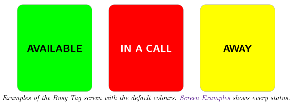
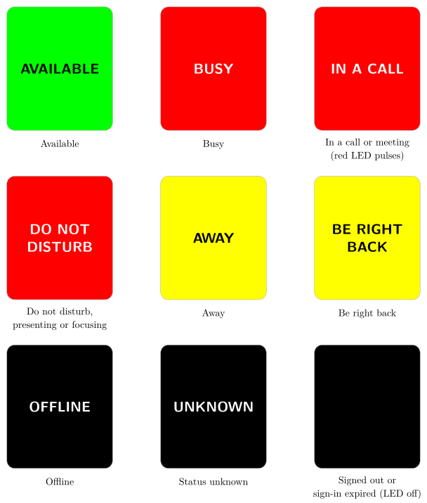

*Show your Microsoft Teams presence on your Busy Tag screen and LED*

:::info[PDF version]
This guide is also available as a [PDF](pathname:///pdf/Teams_UserGuide.pdf).
:::

## Overview

The **Microsoft Teams** plugin shows your Teams presence on your Busy Tag, so people around you can see whether you can be disturbed. After you sign in with your Microsoft work or school account, the plugin checks your presence every 30 seconds (you can change this). It then:

- fills the screen with the colour of your status and writes the status in large letters,
- lights the Busy Tag LED in the same colour,
- shows **IN A CALL** and plays a red pulsing LED pattern while you are in a call or meeting.

## Requirements

- The **Busy Tag desktop app** on **Windows** or **macOS**. The plugin is not offered in the Android or iOS apps.
- A Busy Tag device added to the app.
- A Microsoft **work or school account** that you use for Teams (Microsoft 365).
- An internet connection.

:::note
**Personal Microsoft accounts are not supported.** The sign-in only accepts work and school accounts. An account such as `someone@outlook.com` cannot be used.
:::

:::tip
Some organisations only allow apps that an administrator has approved. If Microsoft says you need admin approval when you sign in, ask your IT department to approve the *Busy Tag* app.
:::

## Adding the Plugin in Busy Tag

1.  Open the Busy Tag app and select your device.
2.  Go to **Integrations** in the navigation menu.
3.  Open the **Add Integrations** tab.
4.  Find **Microsoft Teams**. You can type “Teams” in the search box. Click **Add**.
5.  In the **Add Plugin** window, keep the suggested name or enter your own. Confirm.
6.  The plugin now appears in the **My Integrations** tab, and its configuration page opens automatically.

## Signing In to Microsoft

Sign in from the configuration page. To open it later, click the **More Options** button (**…**) next to the plugin in **My Integrations** and choose **Configure**.

1.  In the **Account** section, click **Sign in with Microsoft**.
2.  A sign-in panel opens inside the Busy Tag app. Enter your work or school e-mail address and password, and complete any extra verification your organisation uses.
3.  The first time, Microsoft asks you to allow the app to *sign you in and read your profile* and to *read your presence information*. Click **Accept**.
4.  The panel closes by itself. The page shows *Connected to Microsoft Teams* and *Connected as:* followed by your account name.
5.  Click **Save**.

The app keeps you signed in. You do not need to sign in again after restarting the app.

### Signing out

Open the configuration page and click **Sign out** in the **Account** section. The app forgets your sign-in and opens the Microsoft sign-out page in the panel. While you are signed out, the Busy Tag screen is black and the LED is off.

## Configuring the Plugin

### Update interval

**Update interval** sets how often the plugin asks Microsoft for your presence. The default is **every 30 seconds**. You can also choose every minute, 2 minutes or 5 minutes. The 5, 10 and 15 second options are marked *testing only*. Microsoft may slow you down if you check that often.

### Status colours

Each status has its own colour. The colour fills the screen and lights the LED. The text is drawn in black or white, whichever is easier to read on that colour.

| **Colour setting** | **Default** | **Used when Teams shows** |
|:---|:---|:---|
| Available | Green | Available (also while idle) |
| Busy | Red | Busy (also while idle), in a call, in a meeting |
| Do not disturb | Red | Do not disturb, presenting, focusing |
| Away | Yellow | Away |
| Be right back | Yellow | Be right back |
| Offline | Black | Offline, or the status is unknown |

### Preview

Use **Show as** to preview each status. The preview next to the form, and the LED preview, show how your Busy Tag will look with your colours. Click **Save** to apply your changes.

## Using the Plugin

### Show it on your Busy Tag

In **My Integrations**, click the **Activate** button (▶) next to Microsoft Teams. The plugin reads your presence right away, updates the screen and LED, and keeps checking at the interval you chose. The screen is only uploaded again when your status changes.

### Interactive panel

Click **Open** to see the plugin in a panel inside the app. It shows the account you are signed in with, a live copy of the Busy Tag screen, your current status and the time of the last update. You can also sign out here.

### Playlist

The plugin can rotate with your other integrations. Open **More Options** (**…**) and use **Include in playlist** and **Duration** to choose whether it is included and how long it stays on screen. Then click **Start Playlist**.

## Screen Examples

These are all the screens the plugin can show, with the default colours. Long status names are split over two lines. The text is black on light colours and white on dark ones.

## Reading the Display

| **Screen** | **Meaning** |
|:---|:---|
| **AVAILABLE** | You are available in Teams, including when Teams marks you as available but idle. |
| **BUSY** | You are busy, including busy but idle. |
| **IN A CALL** | You are in a call or a meeting. The LED also plays a red pulsing pattern. It stops when the call ends. |
| **DO NOT DISTURB** | You set Do not disturb, or you are presenting or focusing. |
| **AWAY** / **BE RIGHT BACK** | You are away from your computer. |
| **OFFLINE** / **UNKNOWN** | Teams shows you as offline, or does not know your status. |
| Black screen, LED off | You are signed out, or your sign-in has expired. |

## Troubleshooting

| **Problem or message** | **What to do** |
|:---|:---|
| The **Sign in with Microsoft** button is missing. | You are already signed in. The **Account** section shows *Connected as:* and a **Sign out** button instead. |
| Sign-in failed: … / Authentication failed: … | The sign-in did not finish. Click **Sign in with Microsoft** again. If Microsoft shows its own error, check that you are using a work or school account. |
| Microsoft asks for admin approval. | Your organisation must approve the Busy Tag app. Contact your IT department. |
| Rate limited by Microsoft. Retrying in … seconds. | The plugin checked too often. It waits and tries again by itself. Choose a longer update interval. |
| Error updating status: … | The plugin could not read your presence several times in a row. Check your internet connection. If it continues, sign out and sign in again. |
| Your Microsoft Teams session has expired. Please reconnect. | Your sign-in has expired or was revoked. The screen turns black and the LED goes off. Sign in again from the configuration page. |
| The status changes late. | The screen changes at the next check. Choose a shorter update interval. |

## Privacy and Security

- The plugin only asks Microsoft for permission to read your basic profile and your presence. It cannot read your chats, calendar, e-mail or files.
- You enter your password on Microsoft’s own sign-in page. Busy Tag never sees it.
- After sign-in, Microsoft sends a one-time code back to the app through a Busy Tag redirect page (`ig.busytag.com`). The app then exchanges the code with Microsoft directly.
- Your sign-in is stored encrypted on this computer. The plugin talks only to Microsoft (`login.microsoftonline.com` and `graph.microsoft.com`).
- Only the status image and LED colour are sent to your Busy Tag device.
- To remove access, click **Sign out**, or delete the plugin from **My Integrations** (**…** → **Delete**).

Microsoft and Microsoft Teams are trademarks of the Microsoft group of companies. Busy Tag is not affiliated with or endorsed by Microsoft.
