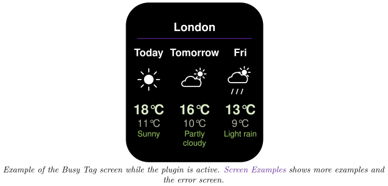
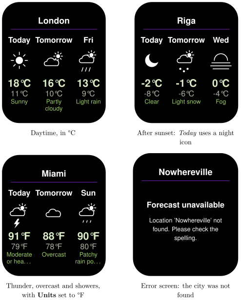

*Show a three-day weather forecast for any city on your Busy Tag display*

:::info[PDF version]
This guide is also available as a [PDF](pathname:///pdf/WeatherForecast_UserGuide.pdf).
:::

## Overview

The **Weather Forecast** plugin shows the forecast for **today**, **tomorrow** and **the day after** for a city of your choice. For each day, your Busy Tag shows:

- a weather icon,
- the highest and lowest temperature of the day,
- a short description, for example *Partly cloudy* or *Light rain*.

The plugin needs no account or sign-in. It refreshes every 15 minutes by default, and lights the Busy Tag LED in a colour you choose.

## Screen Examples

The layout is always three columns: today, tomorrow and the day after. Each column has its own icon. After sunset the *Today* column switches to a night icon (for example a moon); the other two days always use day icons. Long descriptions wrap onto a second line and are shortened with “…” when they still do not fit.

The error screen only appears when the plugin has no forecast to show for your city yet. If an update fails later, the last good forecast stays on screen and the plugin tries again in 5 minutes.

## Requirements

- The **Busy Tag app** on Windows, macOS, Android or iOS.
- A Busy Tag device added to the app.
- An internet connection.

No account, API key or sign-in is needed.

:::tip
Want the *current* conditions (temperature right now, humidity, wind) instead of a forecast? Use the **Weather Display** plugin. You can add both and rotate them in a playlist.
:::

## Adding the Plugin in Busy Tag

1.  Open the Busy Tag app and select your device.
2.  Go to **Integrations** in the navigation menu.
3.  Open the **Add Integrations** tab.
4.  Find **Weather Forecast**. You can type “Forecast” in the search box. Click **Add**.
5.  In the **Add Plugin** window, keep the suggested name or enter your own (for example “Forecast – Riga”). Confirm.
6.  The plugin now appears in the **My Integrations** tab, and its configuration page opens automatically.

## Configuring the Plugin

The configuration page opens automatically after you add the plugin. To open it again later, click the **More Options** button (**…**) next to the plugin in **My Integrations** and choose **Configure**. A preview next to the form shows how the screen will look with a sample forecast. Click **Save** to apply your changes.

### Location

| **Setting** | **Default** | **Description** |
|:---|:---|:---|
| City | London | The city to show. Type its name in English, for example *Riga* or *New York*. If there are several places with the same name, add the country, for example *Paris, France*. |
| Units | °C | °C shows temperatures in Celsius, °F in Fahrenheit. |
| Refresh | Every 15 minutes | How often the forecast is updated. Choices: every 15 or 30 minutes, every hour, every 2 hours or every 4 hours. |

### Colours

| **Setting** | **Default** | **Description** |
|:---|:---|:---|
| Background | `#000000` | Screen background colour. |
| Text | `#FFFFFF` | Colour of the city name, the day names and the icons. |
| Accent | `#7D2BC4` | Colour of the line under the city name. |
| High temp | `#DCEDC8` | Colour of each day’s highest temperature. |
| Low temp | `#B1B1A1` | Colour of each day’s lowest temperature. |
| Condition | `#9CCC65` | Colour of the weather description. |
| LED | `#7D2BC4` | The colour the Busy Tag LED shows while the plugin is active. Choose black to keep the LED dark. |

## Using the Plugin

### Show it on your Busy Tag

In **My Integrations**, click the **Activate** button (▶) next to Weather Forecast. The plugin fetches the forecast, sends the image to your Busy Tag and then refreshes at the interval you chose.

When you save new settings while the plugin is active, colours apply right away. A new city or new units fetch a fresh forecast straight away, and a new refresh interval starts a new schedule.

### Interactive panel

On a computer or tablet, click **Open** to see the forecast in a panel inside the app. (The **Open** button is hidden on phones.) The panel shows one card per day with the day’s *average* temperature. The Busy Tag screen shows the high and low instead.

### Playlist

The plugin can rotate with your other integrations. Open **More Options** (**…**) and use **Include in playlist** and **Duration** to choose whether it is included and how long it stays on screen. Then click **Start Playlist**.

## Reading the Display

| **Element** | **Meaning** |
|:---|:---|
| City name | The place the weather service matched to your entry. |
| Day names | *Today*, *Tomorrow*, and the short weekday name of the third day. The weekday is written in your computer’s or phone’s language. |
| Icon | A picture of the expected weather, for example sun, partly cloudy, overcast, fog, showers, rain, sleet, snow or thunder. After sunset the *Today* icon switches to its night version. |
| Large temperature | The highest temperature expected that day. |
| Small temperature | The lowest temperature expected that day. |
| Description | The expected weather, for example *Partly cloudy*. Long descriptions wrap onto a second line and may be shortened with “…”. |
| *Forecast unavailable* | There is no forecast to show yet. The text below says why (see [Troubleshooting](#troubleshooting)). |

## Troubleshooting

| **What you see** | **What to do** |
|:---|:---|
| *Forecast unavailable – Location ’…’ not found. Please check the spelling.* | The weather service does not know this place. Check the spelling, or add the country, for example *Paris, France*. |
| *Forecast unavailable – Could not reach the weather service.* | Check your internet connection. The plugin tries again every 5 minutes. |
| *Forecast unavailable – …sent no forecast for this location*, *Weather service error (HTTP …)* or *…unreadable response* | A temporary problem with the weather service. The plugin tries again every 5 minutes. |
| The forecast does not change for a long time. | A refresh may have failed. The plugin keeps showing the last good forecast and tries again every 5 minutes. Check your internet connection. |
| Wrong city with the same name. | Add the region or country to the city, for example *Portland, Oregon*. |
| The icons look like plain symbols. | The weather icon set is downloaded from the internet and could not be loaded, so simple symbols are shown instead. The forecast itself is still correct. It usually fixes itself the next time the plugin starts. |

## Privacy

- The plugin does not use your location. It only knows the city you type in.
- The city name is sent to the Busy Tag weather service (`ig.busytag.com`), which returns the forecast for it.
- The weather icon set is downloaded from a public font server (`cdnjs.cloudflare.com`).
- No account or personal data is involved.
- To stop the plugin, delete it from **My Integrations** (**…** → **Delete**).
