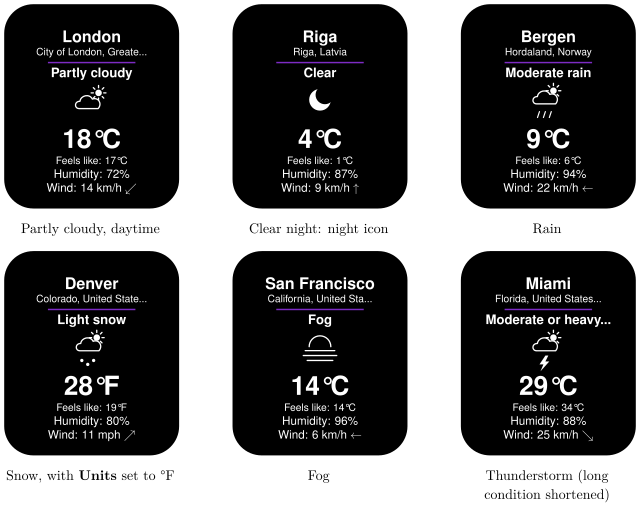
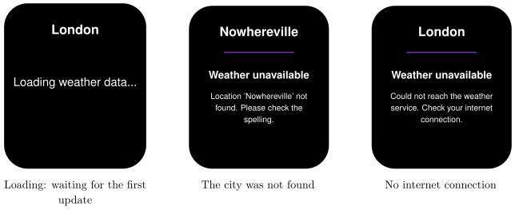

*Show the current weather for any city on your Busy Tag display*

:::info[PDF version]
This guide is also available as a [PDF](pathname:///pdf/Weather_UserGuide.pdf).
:::

## Overview

The **Weather Display** plugin shows the current weather for a city of your choice. Your Busy Tag shows:

- the city name, with its region and country,
- the current conditions as text and as an icon (with separate day and night icons),
- the temperature and the “feels like” temperature,
- the humidity,
- the wind speed, with an arrow for the wind direction.

The plugin needs no account or sign-in. It refreshes every 15 minutes by default, and lights the Busy Tag LED in a colour you choose.

## Screen Examples

### Weather conditions

The layout is always the same; the condition text, the icon and the numbers change. At night the plugin switches to night icons, for example a moon instead of a sun. Long place names and conditions are shortened with “…”.

### Status screens

The error screen only appears when the plugin has no weather to show for your city yet. If an update fails later, the last good weather stays on screen and the plugin tries again in 5 minutes.

## Requirements

- The **Busy Tag app** on Windows, macOS, Android or iOS.
- A Busy Tag device added to the app.
- An internet connection.

No account, API key or sign-in is needed.

## Adding the Plugin in Busy Tag

1.  Open the Busy Tag app and select your device.
2.  Go to **Integrations** in the navigation menu.
3.  Open the **Add Integrations** tab.
4.  Find **Weather Display**. You can type “Weather” in the search box. Click **Add**.
5.  In the **Add Plugin** window, keep the suggested name or enter your own (for example “Weather – Riga”). Confirm.
6.  The plugin now appears in the **My Integrations** tab, and its configuration page opens automatically.

:::tip
Want the weather for more than one city? Add the plugin once per city and give each copy its own name. You can then rotate them in a playlist.
:::

## Configuring the Plugin

The configuration page opens automatically after you add the plugin. To open it again later, click the **More Options** button (**…**) next to the plugin in **My Integrations** and choose **Configure**. A preview next to the form shows how the screen will look with sample weather. Click **Save** to apply your changes.

[TABLE]

## Using the Plugin

### Show it on your Busy Tag

In **My Integrations**, click the **Activate** button (▶) next to Weather Display. The plugin fetches the weather, sends the image to your Busy Tag and then refreshes at the interval you chose.

When you save new settings while the plugin is active, colours apply right away. A new city or new units fetch fresh weather straight away, and a new refresh interval starts a new schedule.

### Interactive panel

On a computer or tablet, click **Open** to see the current screen in a panel inside the app. (The **Open** button is hidden on phones.)

### Playlist

The plugin can rotate with your other integrations. Open **More Options** (**…**) and use **Include in playlist** and **Duration** to choose whether it is included and how long it stays on screen. Then click **Start Playlist**.

## Reading the Display

| **Element** | **Meaning** |
|:---|:---|
| City name | The place the weather service matched to your entry. Long names are shortened with “…”. |
| Region, country | Where that place is. Use it to check that the right city was found. Long text is cut off with “…”. |
| Condition text | The current weather, for example *Partly cloudy* or *Light rain*. |
| Icon | A picture of the current weather. At night the plugin uses night icons (for example a moon instead of a sun). |
| Large temperature | The current air temperature. |
| Feels like | How warm or cold it feels, taking wind and humidity into account. |
| Humidity | Relative humidity of the air, in percent. |
| Wind | Wind speed. The arrow shows the wind direction. |
| *Loading weather data…* | The plugin is waiting for its first weather update. |
| *Weather unavailable* | There is no weather to show yet. The text below says why (see [Troubleshooting](#troubleshooting)). |

## Troubleshooting

| **What you see** | **What to do** |
|:---|:---|
| *Weather unavailable – Location ’…’ not found. Please check the spelling.* | The weather service does not know this place. Check the spelling, or add the country, for example *Paris, France*. |
| *Weather unavailable – Could not reach the weather service.* | Check your internet connection. The plugin tries again every 5 minutes. |
| *Weather unavailable – Weather service error (HTTP …)* or *…sent incomplete data* | A temporary problem with the weather service. The plugin tries again every 5 minutes. |
| The weather does not change for a long time. | A refresh may have failed. The plugin keeps showing the last good weather and tries again every 5 minutes. Check your internet connection. |
| Wrong city with the same name. | Add the region or country to the city, for example *Portland, Oregon*. |
| *Loading weather data…* stays on screen. | The first update has not arrived yet. Check your internet connection. |
| The icon or wind arrow looks like a plain symbol, or the wind shows letters such as “SW”. | The weather icon set is downloaded from the internet and could not be loaded. The weather itself is still correct. It usually fixes itself the next time the plugin starts. |

## Privacy

- The plugin does not use your location. It only knows the city you type in.
- The city name is sent to the Busy Tag weather service (`ig.busytag.com`), which returns the current weather for it.
- The weather icon set is downloaded from a public font server (`cdnjs.cloudflare.com`).
- No account or personal data is involved.
- To stop the plugin, delete it from **My Integrations** (**…** → **Delete**).
