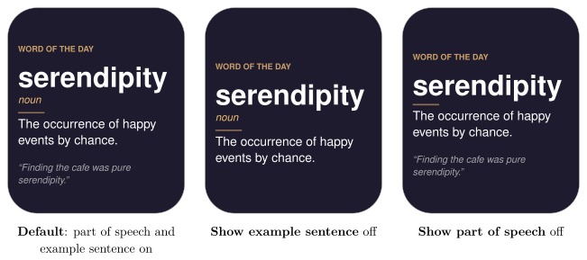

*Learn a new English word every day on your Busy Tag display*

:::info[PDF version]
This guide is also available as a [PDF](pathname:///pdf/WordOfTheDay_UserGuide.pdf).
:::

## Overview

The **Word of the Day** plugin shows an English vocabulary word on your Busy Tag. Together with the word you see its part of speech (noun, verb, adjective…), a short definition and an example sentence.

The plugin has a built-in list of 200 words, so it works offline. By default it shows a new word every day at midnight. You can also choose a new word every hour, or every few minutes.

## Requirements

- The **Busy Tag app** on Windows, macOS, Android or iOS.
- A Busy Tag device added to the app.

No account and no internet connection are needed.

:::note
**Developer mode required.** Word of the Day is a preview plugin. It appears in the list only when developer mode is on. To turn it on, open **Settings** and tap the app version label 5 times. The app counts down the remaining taps and then confirms that developer mode is enabled. Developer-only plugins show a **Dev** badge.
:::

## Adding the Plugin in Busy Tag

1.  Open the Busy Tag app and select your device.
2.  Go to **Integrations** in the navigation menu.
3.  Open the **Add Integrations** tab.
4.  Find **Word of the Day**. You can type “Word” in the search box. Click **Add**.
5.  In the **Add Plugin** window, keep the suggested name or enter your own. Confirm.
6.  The plugin now appears in the **My Integrations** tab, and its configuration page opens automatically.

## Configuring the Plugin

The configuration page opens automatically after you add the plugin. To open it again later, click the **More Options** button (**…**) next to the plugin in **My Integrations** and choose **Configure**.

| **Setting** | **Default** | **Description** |
|:---|:---|:---|
| *New word* |  |  |
| Change the word | Once a day (at midnight) | *Once a day*, *Every hour* or *Every few minutes*. |
| Interval | Every 30 minutes | Only shown for *Every few minutes*. Choices: every 5, 15 or 30 minutes, or every 2 hours. |
| *Display* |  |  |
| Show part of speech | On | Shows “noun”, “verb”, “adjective” and so on under the word. |
| Show example sentence | On | Shows an example sentence at the bottom. |
| Accent | `#F6C177` | The colour of the caption, the part of speech and the short line under it. |
| Text | `#FFFFFF` | The colour of the word, the definition and the example. |
| Background | `#1E1B2E` | The screen colour. |
| LED | Off | *Off* turns the Busy Tag LED off while the plugin is shown. *Accent color* lights the LED in the accent colour. |

Under the *New word* settings, the page shows how many words are built in and which word is today’s word. A preview next to the form shows how the screen will look. Click **Save** to apply your changes.

## Using the Plugin

### Show it on your Busy Tag

In **My Integrations**, click the **Activate** button (▶) next to Word of the Day. The current word appears on your Busy Tag right away. The plugin then changes the word on its own, at the time you chose: just after midnight, at the start of every hour, or at the end of every interval.

In daily mode the word is picked by the date. Everyone who uses the plugin sees the same word on the same day. The plugin goes through all 200 words before a word comes back.

### Interactive panel

On a computer or tablet, click **Open** to see the plugin in a panel inside the app. Below the screen preview you see the current word and its part of speech. On phones, the **Open** button is hidden.

Click **Show another word** to skip to a different word. It is sent to your Busy Tag at once. The word you picked stays until the next scheduled change (or until you save the settings). Then the plugin goes back to the scheduled word.

### Playlist

The plugin can rotate with your other integrations. Open **More Options** (**…**) and use **Include in playlist** and **Duration** to choose whether it is included and how long it stays on screen. Then click **Start Playlist**.

## Screen Examples

### Layouts

The two *Display* check boxes give four layouts. The card is always centred on the screen, so it moves down a little when there is less to show.

## Reading the Display

| **Element** | **Meaning** |
|:---|:---|
| **WORD OF THE DAY** | The caption, in the accent colour. |
| **serendipity** | The word. Long words are drawn smaller so they fit on one line. |
| *noun* | The part of speech (if turned on). |
| Definition | What the word means. A long definition is drawn in a smaller font so the whole card fits on the screen. |
| *“Example…”* | An example sentence (if turned on), dimmed. Up to three lines are shown. |

The whole card is centred on the screen and stays below the status bar at the top.

## Troubleshooting

| **Problem** | **What to do** |
|:---|:---|
| I cannot find Word of the Day in **Add Integrations**. | Turn on developer mode (see [Requirements](#requirements)). |
| The word did not change at midnight. | The app must be running for the word to change. If the computer was asleep, the word changes a short while after it wakes up. Click **Activate** again to update at once. |
| The LED went dark. | The **LED** setting is *Off*, which turns the LED off. Choose *Accent color* to keep it lit. |
| Nothing changes on the Busy Tag. | Check that the device is connected in the app, then click **Activate** again. |

## Privacy

The Word of the Day plugin works offline. All words come from a list inside the app. The plugin does not connect to any online service and does not read any files. The screen image is sent only to your Busy Tag device.
