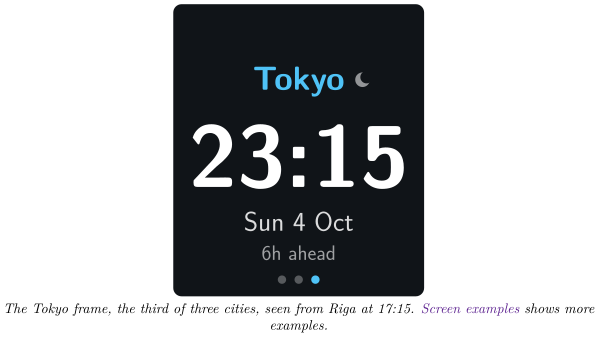
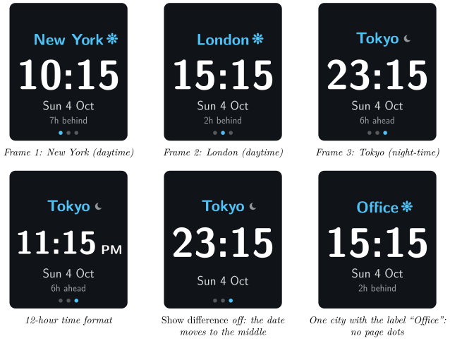

*Keep an eye on the time in up to three cities around the world*

:::info[PDF version]
This guide is also available as a [PDF](pathname:///pdf/WorldClock_UserGuide.pdf).
:::

## Overview

The **World Clock** plugin shows the time in up to three cities of your choice. The cities are shown one at a time, each for 4 seconds, in a loop. For each city your Busy Tag shows:

- the city name, with a small sun (daytime) or moon (night-time) next to it,
- the time, in large digits that are easy to read from a distance,
- the weekday and date in that city,
- how far ahead or behind your own local time the city is,
- one dot per city at the bottom, so you can see which city is on screen.

The time on the device is updated at the start of every minute. The plugin works offline: no account and no internet connection are needed. Your own local time is not shown.

## Requirements

- The **Busy Tag app** on Windows, macOS, Android or iOS.
- A Busy Tag device added to the app.

:::note
**Developer mode required.** World Clock is still in preview. It only appears in the plugin list when developer mode is on. To turn it on, open **Settings** and tap the app version label 5 times. The app counts down the remaining taps and then confirms that developer mode is enabled. Developer-only plugins show a **Dev** badge.
:::

The plugin works out the time in each city from the clock of the computer or phone that runs the Busy Tag app. Make sure its clock and time zone are correct.

## Adding the Plugin in Busy Tag

1.  Open the Busy Tag app and select your device.
2.  Go to **Integrations** in the navigation menu.
3.  Open the **Add Integrations** tab.
4.  Find **World Clock**. You can type “Clock” in the search box. Click **Add**.
5.  In the **Add Plugin** window, keep the suggested name or enter your own. Confirm.
6.  The plugin now appears in the **My Integrations** tab, and its configuration page opens automatically.

## Configuring the Plugin

The configuration page opens automatically after you add the plugin. To open it again later, click the **More Options** button (**…**) next to the plugin in **My Integrations** and choose **Configure**.

### Time zones

There are three slots: **City 1**, **City 2** and **City 3**. By default they are set to New York, London and Tokyo.

1.  In each slot, choose a city from the list. The list is grouped by region: Americas, Europe, Africa & Middle East, Asia and Oceania. *UTC* is also available.
2.  Optionally, type your own **Label**, for example “Office” or “Mum”. Labels can be up to 18 characters long. If you leave the label empty, the city name is used.
3.  To show fewer than three cities, set the unused slots to **None**.

The cities appear on the device in the same order as the slots.

### Display and colours

| **Setting** | **Default** | **Description** |
|:---|:---|:---|
| Time format | 24-hour | *24-hour* (for example 23:15) or *12-hour* (11:15 PM). |
| Show weekday and date | On | Shows the weekday and date in that city under the time. |
| Show difference | On | Shows how far the city is ahead of or behind your local time, for example “7h ahead”. |
| Accent | `#4FC3F7` | The city name, the sun marker and the current page dot. |
| Text | `#FFFFFF` | The time, the date and the difference. |
| Background | `#101418` | The screen background. |
| LED | Off | *Off* turns the Busy Tag LED off while the plugin is shown. *Accent color* lights the LED in the accent colour. |

A preview next to the form shows how the screen will look. Click **Save** to apply your changes.

:::tip
Use the *Label* field to name a city after the people you work with there, for example “Tokyo team”. Short labels are shown in a larger font.
:::

### Screen examples

All examples are seen from Riga on Sunday 4 October 2026 at 17:15, with the default colours. The top row shows the three default cities: the device shows these frames one after another, 4 seconds each.

When only *Show difference* is on, the difference line moves to the middle in the same way.

## Using the Plugin

### Show it on your Busy Tag

In **My Integrations**, click the **Activate** button (▶) next to World Clock. The cities are sent to your Busy Tag right away as a short looping animation. After that, the plugin sends an updated animation just after the start of every minute while it is active. If you chose only one city, the device shows a still image instead of an animation.

### Interactive panel

On a computer or tablet, click **Open** to see the plugin in a panel inside the app. The panel cycles through the cities at the same pace as the device. Below it, a line such as *Updated 17:15:01* shows when the device was last updated. The **Open** button is not shown on phones.

### Playlist

The plugin can rotate with your other integrations. Open **More Options** (**…**) and use **Include in playlist** and **Duration** to choose whether it is included and how long it stays on screen. Then click **Start Playlist**.

:::tip
With three cities, one full loop takes 12 seconds. In a playlist, set the duration to at least 12 seconds so every city gets shown.
:::

## Reading the Display

| **Element** | **Meaning** |
|:---|:---|
| **Tokyo** | The city name or your own label. Long names are shortened with “…”. |
| Sun marker | It is daytime in that city: between 06:00 and 19:59. |
| Moon marker | It is night-time in that city: between 20:00 and 05:59. |
| **23:15** | The current time in that city. In 12-hour mode, AM or PM is shown to the right. |
| **Sun 4 Oct** | The weekday and date in that city. This can be a different day from yours. |
| **6h ahead** | The city’s clock is 6 hours ahead of yours. Half-hour differences are shown as, for example, “3:30h behind”. “same time” means the city is in your time zone. |
| Dots | One dot per city. The highlighted dot shows which city is on screen. |

Summer time (daylight saving time) is taken into account for every city automatically, so the difference can change during the year.

## Troubleshooting

| **Problem** | **What to do** |
|:---|:---|
| I cannot find World Clock in **Add Integrations**. | Turn on developer mode (see [Requirements](#requirements)). |
| The times or the “ahead / behind” values are wrong. | Check the clock and time zone of the computer or phone that runs the Busy Tag app. |
| My city is not in the list. | Choose another city in the same time zone and type your own city name in **Label**. |
| Only New York is shown. | All three slots were set to **None**. The plugin then falls back to New York. Choose at least one city. |
| The LED goes dark when the plugin starts. | *LED* is set to *Off*. Choose *Accent color* to light it. |
| The time stopped changing. | The plugin runs inside the Busy Tag app. Keep the app running and the plugin active. Click **Activate** again to restart it. |

## Privacy

The plugin works entirely on your computer or phone. It uses the time zone data built into your system, so it does not sign in to any service, does not read any files and does not send any data over the internet. Only the finished images and the LED colour are sent to your Busy Tag device.
