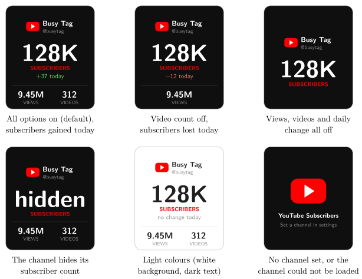

*Show the subscriber, view and video counts of any YouTube channel on your Busy Tag*

:::info[PDF version]
This guide is also available as a [PDF](pathname:///pdf/YouTubeSubscribers_UserGuide.pdf).
:::

## Overview

The **YouTube Subscribers** plugin shows live statistics for any public YouTube channel, your own or someone else’s:

- the channel name and handle,
- the number of **subscribers**, in large numbers,
- how many subscribers the channel gained or lost **today**,
- the total number of **views** and **videos**.

It works without any setup: you only enter the channel. If you want faster updates, you can use your own free YouTube API key.

## Requirements

- The **Busy Tag app** on Windows, macOS, Android or iOS.
- A Busy Tag device added to the app.
- The YouTube channel you want to follow. It must be public.
- An internet connection.
- Optional: your own YouTube Data API key, for updates more often than once a minute.

:::note
**Developer mode required.** YouTube Subscribers is still a preview plugin. It only appears in **Add Integrations** when developer mode is on. To turn it on, open **Settings** and tap the app version label 5 times. The app counts down the remaining taps and then confirms *Developer mode is now enabled*. Developer-only plugins show a **Dev** badge.
:::

## Adding the Plugin in Busy Tag

1.  Open the Busy Tag app and select your device.
2.  Go to **Integrations** in the navigation menu.
3.  Open the **Add Integrations** tab.
4.  Find **YouTube Subscribers**. You can type “YouTube” in the search box. Click **Add**.
5.  In the **Add Plugin** window, keep the suggested name or enter your own. Confirm.
6.  The plugin now appears in the **My Integrations** tab, and its configuration page opens automatically.

## Choosing the Channel

On the configuration page, enter the channel in **Handle, channel ID or URL**. To open the page later, click the **More Options** button (**…**) next to the plugin in **My Integrations** and choose **Configure**. You can enter any of these:

| **What you enter**    | **Example**                      |
|:----------------------|:---------------------------------|
| The channel handle    | `@mkbhd` (the `@` is optional)   |
| The channel ID        | `UCBJycsmduvYEL83R_U4JriQ`       |
| A link to the channel | `https://www.youtube.com/@mkbhd` |

Older channel links also work, for example links that contain `/channel/`, `/c/` or `/user/`. Click **Test connection** to check the channel. If it works, the page shows *OK:* followed by the channel name and its subscriber count.

## Shared Service or Your Own API Key

### The shared Busy Tag service (default)

By default, the plugin gets the numbers through a shared Busy Tag service. You do not need to set anything up. With the shared service:

- the plugin checks at most **once a minute**,
- YouTube numbers are refreshed about every **10 minutes**,
- all Busy Tag users share one daily YouTube allowance. On a very busy day it can run out.

### Using your own API key

With your own free API key, the plugin can check as often as every 5 seconds, and it has its own daily allowance.

1.  Tick **Use my own API key**.
2.  Click **How to get a free API key**. It opens Google’s guide for the YouTube Data API. In short: sign in to the Google Cloud Console, create a project, enable the *YouTube Data API v3*, and create an *API key* under *Credentials*.
3.  Paste the key (it starts with `AIza`) into **YouTube Data API v3 key**.
4.  Click **Test connection**, then **Save**.

:::tip
Each check uses 1 unit of your key’s free daily allowance of 10,000 units. Checking every 10 seconds or less often stays within it. Checking every 5 seconds uses about 17,000 units a day, so a free key runs out after about 13 hours and stops until midnight Pacific Time. The settings page shows how many units your chosen interval uses.
:::

## Configuring the Display

| **Setting** | **Default** | **Description** |
|:---|:---|:---|
| Show total views | On | Shows the channel’s total views at the bottom. |
| Show video count | On | Shows the number of videos at the bottom. |
| Show subscriber change since the start of today | On | Shows how many subscribers the channel gained or lost today, for example *+37 today*. |
| Refresh interval | Every 5 minutes | How often the plugin checks. With the shared service: every minute up to every hour. With your own key: every 5 seconds up to every hour. |
| Accent | `#FF0000` | Colour of the play badge and the word *SUBSCRIBERS*. |
| Text | `#FFFFFF` | Colour of the channel name and numbers. The handle, the labels and the divider line use a lighter shade of the same colour, so a dark text colour on a light background stays readable. |
| Background | `#0F0F0F` | Screen background colour. |
| LED | Off | *Off*: the LED is turned off. *Accent color*: the LED uses the accent colour. *Green when subscribers grew today*: the LED is green after the channel gained subscribers today, and off otherwise. |

The preview next to the form shows sample numbers with your settings. Click **Save** to apply your changes.

## Using the Plugin

### Show it on your Busy Tag

In **My Integrations**, click the **Activate** button (▶) next to YouTube Subscribers. The plugin checks the channel right away and then at the interval you chose. The screen is only uploaded again when a number changes.

### Interactive panel

On a computer or tablet, click **Open** to see the plugin in a panel inside the app. (The **Open** button is hidden on phones.) Below the screen preview, a status line shows *Checking YouTube…*, *Updated 14:32:05 · Channel name*, or an error message in red.

### Playlist

The plugin can rotate with your other integrations. Open **More Options** (**…**) and use **Include in playlist** and **Duration** to choose whether it is included and how long it stays on screen. Then click **Start Playlist**.

## Screen Examples

The screen rearranges itself around the parts you turn on, so it always stays centred. The examples use sample numbers.

## Reading the Display

| **Element** | **Meaning** |
|:---|:---|
| Large number | Subscribers. Large numbers are shortened: *K* = thousand, *M* = million, *B* = billion. YouTube itself rounds subscriber counts. |
| *hidden* | The channel owner has hidden the subscriber count. |
| **+37 today** | Subscribers gained since the plugin’s first check today. A loss is shown in red, and *no change today* in grey. |
| VIEWS / VIDEOS | Total views and number of public videos. |
| A dash (—) | YouTube did not report this number. |
| Play badge and “Set a channel in settings” | No channel has been entered yet, or the channel could not be loaded. |

:::note
The daily change starts counting from the **first check of the day** made by the plugin on this device. If the plugin was not running at midnight, the change only covers the time since it started. It starts again from zero every day, and when you switch to another channel.
:::

## Troubleshooting

| **Message** | **What to do** |
|:---|:---|
| YouTube Subscribers is not in **Add Integrations**. | Turn on developer mode (see [Requirements](#requirements)). |
| No channel configured. Enter a handle like @veritasium in settings. | Enter a channel on the configuration page and click **Save**. |
| Channel “…” not found. | Check the spelling of the handle, or paste the link to the channel instead. |
| The shared YouTube quota is used up for today. … | The shared allowance is used up. Try again tomorrow, or use your own API key ([Shared Service or Your Own API Key](#shared-service-or-your-own-api-key)). |
| Too many lookups, try again later. | Wait a few minutes. The plugin tries again at the next check. |
| No YouTube API key saved. … | Paste your key, or untick **Use my own API key**. |
| YouTube rejected the API key: … | The key is wrong, the YouTube Data API v3 is not enabled for it, or its daily allowance is used up. Check the key in the Google Cloud Console, or choose a longer refresh interval. |
| Busy Tag YouTube service error: … / YouTube API returned HTTP … | A temporary problem. The plugin keeps the last numbers on screen and tries again at the next check. |

## Privacy and Security

- The plugin only reads public channel statistics. It does not sign in to your Google or YouTube account.
- With the shared service, the channel you entered is sent to the Busy Tag service (`ig.busytag.com`), which asks YouTube for the numbers.
- Your own API key is stored encrypted on this device and is only sent to Google (`googleapis.com`).
- Only the picture and LED colour are sent to your Busy Tag device.

YouTube is a trademark of Google LLC. Busy Tag is not affiliated with or endorsed by Google.
