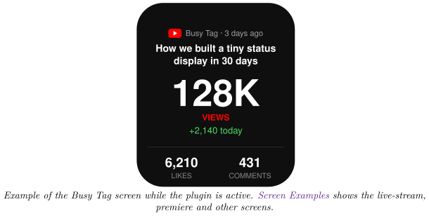
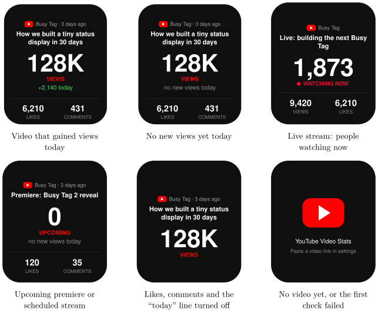

*Show the views, likes and comments of one YouTube video on your Busy Tag display*

:::info[PDF version]
This guide is also available as a [PDF](pathname:///pdf/YouTubeVideoStats_UserGuide.pdf).
:::

## Overview

The **YouTube Video Stats** plugin follows one public YouTube video and shows its numbers on your Busy Tag screen:

- the video title, the channel name and how long ago the video was published,
- the total number of **views**,
- how many views the video gained **today**,
- the number of **likes** and **comments**.

While the video is a **live stream**, the plugin shows how many people are watching right now instead. You don’t need a YouTube account. The plugin works straight away through a shared Busy Tag service. If you want faster updates, you can add your own free YouTube API key.

## Screen Examples

The screen adapts to the video: a normal video leads with its total views, a live stream with the number of people watching right now. The whole block is centred on the screen, so it moves up or down a little depending on how long the title is and which rows are switched on.

If a later check fails, the last good numbers stay on screen; the reason is shown in the status line of the interactive panel.

## Requirements

- The **Busy Tag app** on Windows, macOS, Android or iOS.
- A Busy Tag device added to the app.
- A link to a **public** (or unlisted) YouTube video. Private videos can’t be read.
- An internet connection.
- *Optional:* your own YouTube Data API v3 key, if you want updates faster than once a minute (see [Getting Your Own API Key (Optional)](#getting-your-own-api-key-optional)).

:::note
**Developer mode required.** This plugin is still in preview, so it only appears when developer mode is on. To turn it on, open **Settings** and tap the app version label 5 times. The app counts down the remaining taps and then confirms that developer mode is enabled. Developer-only plugins carry a **Dev** badge in the plugin list.
:::

## Adding the Plugin in Busy Tag

1.  Open the Busy Tag app and select your device.
2.  Go to **Integrations** in the navigation menu.
3.  Open the **Add Integrations** tab.
4.  Find **YouTube Video Stats**. You can type “YouTube” in the search box. Click **Add**.
5.  In the **Add Plugin** window, keep the suggested name or enter your own (for example “Launch video”). Confirm.
6.  The plugin now appears in the **My Integrations** tab, and its configuration page opens automatically.

:::tip
You can add the plugin more than once, for example one copy per video, and give each copy its own name.
:::

## Configuring the Plugin

The configuration page opens automatically after you add the plugin. To open it again later, click the **More Options** button (**…**) next to the plugin in **My Integrations** and choose **Configure**. A preview next to the form shows how the screen will look with sample numbers. Click **Save** to apply your changes.

### Video

Paste the video’s link into **Video link or ID**. All common link types work:

- `youtube.com/watch?v=…` and `youtu.be/…` links,
- YouTube *Shorts* and *live* links,
- the 11-character video ID on its own (for example `dQw4w9WgXcQ`).

Below the field, the plugin confirms the video ID it found. If it says *That is not a YouTube video link*, check what you pasted. Channel links are not supported.

### API key

By default the plugin uses the shared **Busy Tag YouTube service**. It needs no setup. The service checks YouTube at most once a minute, and YouTube’s numbers there refresh about every 10 minutes (every minute while the video is live).

Turn on **Use my own API key** if you want faster updates. Then paste your key into **YouTube Data API v3 key**. [Getting Your Own API Key (Optional)](#getting-your-own-api-key-optional) explains how to get one.

Click **Test connection** to check your settings. When everything works, it shows the video title and its view count.

### Display settings

[TABLE]

##### Refresh interval.

The choices depend on the API key setting:

| **API key setting** | **Refresh choices** |
|:---|:---|
| Busy Tag service (default) | Every 1, 2, 5, 15 or 30 minutes, or every hour. |
| Your own API key | Also every 5, 10, 15 or 30 seconds. |

With your own key, the page shows how many quota units a day your choice uses. Each check costs 1 unit, and a free key has 10,000 units a day. Checking every 5 seconds needs about 17,280 units, so a free key runs out after about 13 hours. It then stops working until midnight Pacific Time. Choose **10 seconds or slower** to stay within the free quota.

##### LED.

| **Option** | **What the LED does** |
|:---|:---|
| Off | The LED stays off. |
| Accent color | The LED shows your accent colour. |
| Green when views grew today | The LED turns **green** once the video has gained views today. It stays off until then. |
| Red while the video is live | The LED turns **red** while the video is streaming live. It stays off otherwise. |

## Getting Your Own API Key (Optional)

You only need this if you want updates more often than once a minute. Click **How to get a free API key** on the configuration page to open Google’s instructions. In short:

1.  Sign in to the Google Cloud Console at <https://console.cloud.google.com/> and create a project (or pick an existing one).
2.  Open **APIs & Services**, choose **Library**, search for **YouTube Data API v3** and click **Enable**.
3.  Open **APIs & Services** → **Credentials**, then choose **Create credentials** → **API key**.
4.  Copy the key. It starts with `AIza`.
5.  In Busy Tag, turn on **Use my own API key**, paste the key and click **Test connection**.

:::tip
In Google Cloud you can restrict the key so it only works with the YouTube Data API v3. This limits the damage if someone else ever gets hold of the key.
:::

## Using the Plugin

### Show it on your Busy Tag

In **My Integrations**, click the **Activate** button (▶) next to the plugin. It checks the video right away, sends the image to your Busy Tag and then checks again at the interval you chose. The screen is only re-sent when a number actually changes.

### Interactive panel

On a computer or tablet, click **Open** to see the plugin in a panel inside the app. (The **Open** button is hidden on phones.) Below the screen preview, a status line shows what the plugin is doing:

- *Checking YouTube…* while a check is running.
- *Updated 14:32:05 · \<video title\>* after a successful check.
- An error message in red if something went wrong (see [Troubleshooting](#troubleshooting)).

### Playlist

The plugin can rotate with your other integrations. Open **More Options** (**…**) and use **Include in playlist** and **Duration** to choose whether it is included and how long it stays on screen. Then click **Start Playlist**.

## Reading the Display

| **Element** | **Meaning** |
|:---|:---|
| Play badge, channel name and age | The channel that published the video and how long ago, for example “3 days ago”. The age is hidden while the video is live. |
| Title | The video title, on up to two lines. Longer titles end with “…”. |
| Large number + **VIEWS** | Total views. Numbers under 10,000 are shown in full. Larger numbers are shortened: 184K = 184 thousand, 1.2M = 1.2 million, 2.1B = 2.1 billion. |
| **UPCOMING** | The video is a scheduled premiere or stream that has not started yet. |
| **• WATCHING NOW** | The video is streaming live. The large number is the number of people watching right now. |
| **+1,204 today** | Views gained today. It reads “no new views today” until the count goes up. It is hidden while the video is live. |
| LIKES / COMMENTS | Like and comment counts, if turned on in the settings. While the video is live, the bottom row shows total VIEWS first. There is room for two numbers, so it is followed by likes (or by comments if likes are turned off). |
| Red play badge with *Paste a video link in settings* | No video is configured yet, or the first check has not succeeded. |

:::note
**How “today” is counted.** The plugin remembers the view count from its first check of the day, on this device, and counts up from there. The count restarts at midnight (your local time) and when you switch to a different video. If the plugin was not running in the morning, “today” starts from when it was first activated that day.
:::

## Troubleshooting

Error messages appear in the status line of the interactive panel and under **Test connection**. When a check fails, the last good numbers stay on your Busy Tag screen.

| **Message** | **What to do** |
|:---|:---|
| No video configured. Paste a YouTube video link in settings. | Open **Configure** and paste a video link. |
| “…” is not a YouTube video link or ID. | The link is not a video link. Copy the link again from the video page or the **Share** button. Channel links are not supported. |
| Video not found, or it is private. | Check that the video still exists and is public or unlisted. |
| The shared YouTube quota is used up for today. | All Busy Tag users share one daily quota, and it has run out. Try again tomorrow, or use your own API key ([Getting Your Own API Key (Optional)](#getting-your-own-api-key-optional)). |
| Too many lookups, try again later. | The Busy Tag service is busy. The plugin tries again at the next refresh. |
| Busy Tag YouTube service error: … | A temporary problem with the shared service. Wait for the next refresh. |
| No YouTube API key saved. | You turned on **Use my own API key** but didn’t enter a key. Paste your key, or turn the option off. |
| YouTube rejected the API key: … | The key is wrong, the YouTube Data API v3 is not enabled for it, or its daily quota is used up. Check the key in Google Cloud, or choose a slower refresh interval. |
| YouTube API returned HTTP … | A temporary problem at YouTube. The plugin tries again at the next refresh. |

## Privacy and Security

- The plugin only reads **public** information about the video. It never signs in to your YouTube or Google account.
- With the default setting, only the video ID is sent to the Busy Tag YouTube service (`ig.busytag.com`), which looks the video up on YouTube for you.
- If you use your own API key, the plugin talks to YouTube (`googleapis.com`) directly. Your key is stored encrypted on this device and is only ever sent to `googleapis.com`.
- The “views today” starting count is stored only on this device.
- To stop the plugin, delete it from **My Integrations** (**…** → **Delete**).

YouTube is a trademark of Google LLC. Busy Tag is not affiliated with or endorsed by Google.
